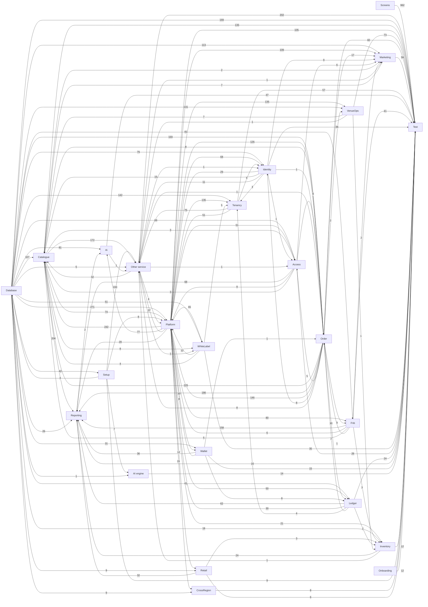

# How the Block A tickets are linked

> **Generated by** `tools/build-ticket-links.py` from `handoff/service-docs/tasks.csv` (the task sheet that becomes the OpenProject tickets). A ticket *waits on* another when it cannot be finished before the other is: that is the "follows" link in OpenProject and the order of each person's board.

**2315 tasks, 13042 links.**

## 1. The build layers, in order

| Layer | Tasks | Build order | Waits on |
|---|---:|---|---|
| Setup | 9 | #3 to #409 | Database (42) |
| Onboarding | 12 | #5 to #16 | nothing |
| Database | 169 | #23 to #2499 | Setup (3) |
| Platform | 20 | #31 to #84 | Setup (8), Database (2) |
| AI engine | 13 | #87 to #2491 | Setup (7), Database (1) |
| Services | 259 | #79 to #1458 | Platform (524), Database (486), Setup (1) |
| Screens | 331 | #125 to #1489 | Services (983), Setup (194), Services (Venue Management) (98), AI engine (3) |
| Services (Venue Management) | 675 | #123 to #2503 | Database (1182), Services (1089), Platform (851), Setup (192) |
| Screens (Venue Management) | 631 | #128 to #2507 | Services (Venue Management) (1038), Services (639), Setup (631), AI engine (1) |
| Test | 196 | #63 to #2508 | Services (Venue Management) (675), Screens (Venue Management) (631), Screens (331), Services (261), Database (169), Platform (20), AI engine (14), Onboarding (12), Setup (9) |

## 2. Service map

An arrow means the service on the right waits on the one on the left; the number is how many task links carry it. Screens are left out here (section 4).

## 3. Services: what each waits on and what waits on it

| Service | Owner | Tasks | Points | Build order | Waits on | Needed by |
|---|---|---:|---:|---|---|---|
| **Other service** | Sanket Keluskar, Chinmay Patkar | 202 | 526 | #79 to #2496 | Setup 193, Catalogue 172, Tenancy 75, Platform 37, Identity 11, Order 8, Database 5, VenueOps 1, Inventory 1, Ai 1 | Test 202, Catalogue 32, Platform 6, Identity 1, Access 1, WhiteLabel 1 ... |
| **Ai** | Sanket Keluskar, Narayan Gaonkar | 45 | 167 | #90 to #1601 | Database 81, Platform 77, Reporting 2 | screens: Other 58, Test 47, screens: Platform 32, screens: Analytics 19, screens: Engagement & Support 14, screens: White Label 10 ... |
| **Identity** | Deep Khanvilkar, Sanket Keluskar | 36 | 150 | #104 to #1780 | Database 79, Platform 68, Order 8, Tenancy 5, Other service 1 | screens: Platform 55, screens: Other 39, Test 36, Platform 29, screens: Analytics 27, screens: Tenants & Licensing 21 ... |
| **Order** | Pranay Shinde, Chinmay Patkar | 60 | 313 | #108 to #2375 | Database 169, Platform 126, Catalogue 8, Access 5, Ledger 2, Other service 1, Fnb 1, Identity 1, Wallet 1 | Catalogue 225, Reporting 186, Platform 146, screens: Sell 63, Test 60, Ledger 30 ... |
| **Marketing** | Pranay Shinde, Deep Khanvilkar | 58 | 269 | #112 to #2355 | Database 113, Platform 109, Order 17, Identity 9, Access 6, Catalogue 2, Fnb 2, Other service 1 | Test 58, screens: Other 44, screens: Engagement & Support 33, screens: Account & Self-Service 25, screens: Membership, Loyalty & Value 16, screens: Sell 8 ... |
| **WhiteLabel** | Hrushikant Patkar, Deep Khanvilkar | 35 | 175 | #153 to #2503 | Platform 65, Database 51, Catalogue 8, Other service 1 | screens: White Label 71, Test 35, screens: Engagement & Support 17, Platform 12, screens: Branding & Localisation 9, screens: Discovery & Browse 9 ... |
| **Platform** | Sanket Keluskar, Narayan Gaonkar | 85 | 358 | #161 to #2365 | Database 269, Platform 149, Order 146, Catalogue 74, Tenancy 51, Ledger 30, Identity 29, WhiteLabel 12, Access 9, Wallet 8, Other service 6, Fnb 6 | screens: Tenants & Licensing 155, Test 85, screens: Other 65, screens: Platform 31, screens: Partners 26, screens: Setup & Go-Live 23 ... |
| **Tenancy** | Deep Khanvilkar, Pranay Shinde | 57 | 209 | #166 to #2383 | Database 142, Platform 135, WhiteLabel 5, Identity 4, Ledger 4 | Other service 75, screens: Venue Operations 66, Test 57, Platform 51, screens: Other 51, screens: Sell 34 ... |
| **CrossRegion** | Deep Khanvilkar, Chinmay Patkar | 8 | 29 | #190 to #1726 | Platform 15, Database 9 | Test 8, screens: Access 3 |
| **Wallet** | Pranay Shinde, Sanket Keluskar | 15 | 66 | #205 to #2098 | Database 31, Platform 30 | Reporting 36, screens: Other 17, Test 15, Ledger 8, Platform 8, screens: Membership, Loyalty & Value 5 ... |
| **Retail** | Pranay Shinde, Deep Khanvilkar | 6 | 30 | #210 to #861 | Platform 12, Database 9 | Reporting 32, screens: Sell 11, screens: Retail 7, Test 6, Inventory 3, screens: Other 3 ... |
| **VenueOps** | Narayan Gaonkar, Chinmay Patkar | 73 | 332 | #231 to #2137 | Platform 135, Database 131, Order 2 | Test 73, screens: Other 71, screens: Media Library 50, screens: Access & Venue 20, screens: Operations 17, screens: Transport 16 ... |
| **Catalogue** | Narayan Gaonkar, Chinmay Patkar | 135 | 589 | #246 to #2470 | Database 327, Platform 242, Order 225, Other service 32, Identity 15, VenueOps 7, Marketing 7, Fnb 5, WhiteLabel 4, Access 3 | Reporting 206, Other service 172, Test 135, screens: Other 134, screens: Sell 129, Platform 74 ... |
| **Access** | Narayan Gaonkar, Hrushikant Patkar | 26 | 135 | #250 to #1655 | Database 66, Platform 51, Order 5, Catalogue 3, Other service 1, Identity 1 | Reporting 68, screens: Other 44, Test 26, screens: Access & Venue 24, screens: Account & Self-Service 14, Platform 9 ... |
| **Fnb** | Narayan Gaonkar, Deep Khanvilkar | 41 | 227 | #339 to #1250 | Database 81, Platform 80, Order 9 | Reporting 158, screens: Other 50, Test 41, screens: Sell 28, screens: Kitchen 26, screens: In-venue Services 19 ... |
| **Ledger** | Narayan Gaonkar, Sanket Keluskar | 24 | 114 | #715 to #1773 | Database 61, Platform 50, Order 30, Wallet 8 | Reporting 62, Platform 30, Test 24, screens: Other 20, screens: Orders & Money 12, screens: Sell 5 ... |
| **Inventory** | Pranay Shinde, Deep Khanvilkar | 12 | 55 | #723 to #1259 | Platform 21, Database 18, Fnb 3, Retail 3, Ledger 2, VenueOps 1 | Reporting 24, screens: Other 12, Test 12, screens: Stock & Supply 2, screens: Operations 1, screens: Sell 1 ... |
| **Reporting** | Chinmay Patkar, Narayan Gaonkar | 16 | 54 | #957 to #1552 | Catalogue 206, Order 186, Fnb 158, Access 68, Ledger 62, Wallet 36, Retail 32, Platform 28, Database 26, Inventory 24 | screens: Other 17, Test 16, screens: Analytics 10, screens: Venue Operations 4, screens: Reports 3, screens: Orders & Money 3 ... |

## 4. Module builds: the services each module's screens need

| App | Module | Screen tasks | Build order | Waits on services | Other |
|---|---|---:|---|---|---|
| Guest Web — Storefront | Cart & Checkout | 5 | #125 to #1296 | Order 11, Catalogue 4, Marketing 4, WhiteLabel 4, Identity 3, VenueOps 1 | Setup 5 |
| Guest App — Mobile | Cart & Checkout | 3 | #126 to #695 | Order 10, WhiteLabel 3, Identity 3, Catalogue 2, VenueOps 1 | Setup 3 |
| Venue Staff App — Operations | Operations | 12 | #128 to #2194 | VenueOps 17, Identity 13, Catalogue 3, Order 2, Tenancy 2, Marketing 1, Inventory 1 | Setup 12 |
| Guest App — Mobile | Account & Self-Service | 14 | #132 to #1309 | Order 20, Marketing 15, Identity 13, Access 11, Wallet 3, Ledger 2, WhiteLabel 1 | Setup 14 |
| Venue Scanner — Access Control | Access | 4 | #137 to #1724 | Identity 5, Access 3, CrossRegion 3, Order 1, Tenancy 1 | Setup 4 |
| Venue POS — Terminal and Tablet | Shift | 4 | #143 to #1115 | Order 12, Identity 7, Tenancy 3 | Setup 4 |
| Venue CMS — White Label | White Label | 23 | #145 to #1330 | WhiteLabel 71, Ai 10, Marketing 8, VenueOps 8, Catalogue 6, Identity 2, Order 1, Tenancy 1 | Setup 23 |
| Venue Support — Agent Console | Access & Availability | 1 | #148 to #148 | Identity 6 | Setup 1 |
| TICVAI Web — Platform Console | Access & Identity | 4 | #160 to #1560 | Identity 17 | Setup 4, Platform 2 |
| Partner Web — Reseller Portal | Access & Account | 4 | #163 to #2109 | Identity 10 | Setup 4, Platform 6 |
| TICVAI Web — Platform Console | Tenants & Licensing | 87 | #198 to #2106 | Identity 21, Tenancy 6, WhiteLabel 2, Order 1 | Setup 84, Platform 155 |
| Venue Management — Back Office | People & Access Rights | 9 | #220 to #1962 | Tenancy 13, Identity 12, Order 1, Reporting 1, Catalogue 1, Ai 1 | Setup 6 |
| Guest App — Mobile | Discovery & Browse | 7 | #264 to #1313 | Catalogue 15, WhiteLabel 4, VenueOps 3, Marketing 2, Access 1 | Setup 7 |
| TICVAI Web — Platform Console | Branding & Localisation | 4 | #281 to #1713 | Identity 10, WhiteLabel 9, Tenancy 2, VenueOps 2 | Setup 4, Platform 4 |
| Guest Web — Storefront | Engagement & Support | 5 | #283 to #1349 | Marketing 8, WhiteLabel 3, Ai 3, Order 1, Fnb 1 | Setup 5, AI engine 1 |
| Guest Web — Storefront | System States | 1 | #284 to #284 | WhiteLabel 1 | Setup 1 |
| Guest Web — Storefront | Support | 2 | #285 to #1273 | WhiteLabel 3, Marketing 2 | Setup 2 |
| Guest App — Mobile | Engagement & Support | 12 | #286 to #1354 | VenueOps 14, Marketing 13, Ai 9, WhiteLabel 4, Fnb 3, Order 3, Catalogue 1 | Setup 12, AI engine 2 |
| Guest App — Mobile | System States | 2 | #287 to #288 | WhiteLabel 2 | Setup 2 |
| Venue Management — Back Office | Platform | 3 | #331 to #333 | Identity 3, Tenancy 1 | - |
| Venue Management — Back Office | Sell | 81 | #337 to #2456 | Catalogue 108, Tenancy 23, Order 5, Identity 5, Fnb 4, Retail 2, Ai 2, VenueOps 1, Wallet 1, WhiteLabel 1 | Setup 65, Platform 22 |
| Venue Management | Other | 156 | #338 to #2507 | Catalogue 134, VenueOps 71, Tenancy 49, Access 44, Fnb 44, Marketing 34, Ai 29, Order 21, Ledger 20, Wallet 17, Identity 16, Reporting 9, Inventory 7, WhiteLabel 5, Retail 3 | Setup 139, Platform 21 |
| Venue Management — Back Office | Food & Beverage | 5 | #340 to #1498 | Fnb 12, Tenancy 3, Reporting 2, Retail 1 | Setup 3 |
| TICVAI Web — Platform Console | Overview & Health | 5 | #370 to #1811 | Identity 2, Ai 1, Tenancy 1 | Setup 5, Platform 15 |
| TICVAI Web | Other | 12 | #376 to #1483 | Ai 29, Identity 23, Tenancy 2, Order 2 | Setup 12, Platform 29, AI engine 1 |
| Developer Portal | Developer & API | 8 | #387 to #2117 | - | Setup 5, Platform 15 |
| Developer | Other | 3 | #401 to #404 | - | Setup 3, Platform 15 |
| Venue Management — Back Office | Commercial | 21 | #430 to #955 | Catalogue 18, Order 2, Ledger 2 | - |
| Venue Management — Back Office | Access & Venue | 44 | #441 to #2207 | Access 24, VenueOps 20, Tenancy 8, Order 5, Catalogue 4, Reporting 2, Ai 1, Marketing 1 | Setup 21, Platform 4 |
| Guest Web — Storefront | High-Demand Access | 1 | #574 to #574 | Catalogue 2 | Setup 1 |
| Venue Management — Back Office | Venue Operations | 38 | #576 to #2080 | Tenancy 66, Reporting 4, Order 3, Ai 3, Fnb 3, VenueOps 3, Access 2, Retail 1 | Setup 35, Platform 1 |
| Guest Web — Storefront | Discovery & Browse | 5 | #582 to #1311 | Catalogue 11, VenueOps 5, WhiteLabel 5, Access 1, Marketing 1 | Setup 5 |
| Guest Web — Storefront | Booking & Selection | 7 | #583 to #1348 | Catalogue 15, Order 7, VenueOps 6, WhiteLabel 5, Marketing 3, Ai 1 | Setup 7 |
| Guest Web — Storefront | Membership, Loyalty & Value | 5 | #584 to #1298 | Marketing 11, Order 5, Catalogue 5, Identity 4, Wallet 3, Access 2, VenueOps 1, WhiteLabel 1 | Setup 5 |
| Guest App — Mobile | High-Demand Access | 1 | #595 to #595 | Catalogue 2 | Setup 1 |
| Guest App — Mobile | Discovery | 1 | #596 to #596 | Catalogue 1 | Setup 1 |
| Guest App — Mobile | Booking & Selection | 10 | #601 to #1294 | Catalogue 20, Order 15, VenueOps 8, WhiteLabel 3, Marketing 2, Ai 1 | Setup 10 |
| Venue POS — Terminal and Tablet | Sell | 26 | #604 to #1304 | Order 58, Fnb 24, Catalogue 17, Tenancy 11, Retail 9, Marketing 8, Ledger 5, Reporting 3, Wallet 2, Access 1, VenueOps 1, Inventory 1 | Setup 26 |
| Guest Kiosk — Self-Service | Sell | 5 | #607 to #2189 | Catalogue 4, WhiteLabel 2 | Setup 5 |
| Guest Web — Storefront | Promotions | 1 | #634 to #634 | Catalogue 2 | Setup 1 |
| Guest App — Mobile | Promotions | 1 | #638 to #638 | Catalogue 3 | Setup 1 |
| Guest Web — Storefront | Ticketing | 3 | #680 to #865 | Order 9, Catalogue 3, Fnb 2, VenueOps 1, Ledger 1 | Setup 3 |
| Guest Web — Storefront | Retail | 2 | #681 to #1081 | Retail 4, Order 3 | Setup 2 |
| Guest App — Mobile | Ticketing | 4 | #693 to #869 | Order 7, Catalogue 1, Ledger 1 | Setup 4 |
| Guest App — Mobile | Membership, Loyalty & Value | 3 | #694 to #1278 | Marketing 5, Order 4, Catalogue 3, Wallet 2, VenueOps 1, Identity 1 | Setup 3 |
| Venue Management — Back Office | Orders & Money | 10 | #747 to #1324 | Order 18, Ledger 12, Tenancy 3, Reporting 3, Fnb 2, Retail 1, Marketing 1 | Setup 4 |
| Guest Web — Storefront | Account & Self-Service | 5 | #826 to #1307 | Marketing 10, Order 10, Identity 7, Access 3, Ledger 2, Wallet 1 | Setup 5 |
| Guest Web — Storefront | In-venue Services | 6 | #827 to #1162 | Fnb 9, VenueOps 7, Access 3, Order 2 | Setup 6 |
| Guest App — Mobile | In-venue Services | 10 | #831 to #1166 | Fnb 10, VenueOps 8, Access 5, Order 3, Catalogue 2, WhiteLabel 2 | Setup 10 |
| Venue Management — Back Office | Rentals | 19 | #907 to #2397 | VenueOps 12, Catalogue 8, Tenancy 2, Ai 2 | Setup 11, Platform 1 |
| Venue Analytics — Cross-Domain Reporting | Analytics | 6 | #981 to #1709 | Reporting 10, Identity 3, Ai 2, Tenancy 1 | Setup 3 |
| Guest Web — Storefront | Transport | 1 | #984 to #984 | VenueOps 6, Order 1 | Setup 1 |
| Guest App — Mobile | Transport | 4 | #987 to #991 | VenueOps 10, Order 2 | Setup 4 |
| Guest App — Mobile | In-Venue Experience | 2 | #1033 to #1084 | Access 1, Retail 1, Fnb 1 | Setup 2 |
| Kitchen Display — Pass and Stations | Kitchen | 10 | #1038 to #1489 | Fnb 26, Reporting 2 | Setup 10 |
| Venue Staff App | Other | 2 | #1055 to #1240 | Fnb 6, Inventory 5 | Setup 2 |
| Venue Staff App — Operations | Floor Service | 2 | #1057 to #1059 | Fnb 15, Order 1 | Setup 2 |
| Guest App — Mobile | Retail | 1 | #1085 to #1085 | Retail 3, Order 1 | Setup 1 |
| Venue POS — Terminal and Tablet | Payment | 1 | #1090 to #1090 | Retail 3, Order 2, Access 1, Marketing 1 | Setup 1 |
| Venue Management — Back Office | Games & Rides | 10 | #1143 to #2506 | WhiteLabel 4, Catalogue 3, VenueOps 1 | Setup 10 |
| Venue Staff App — Operations | Stock on the Floor | 2 | #1184 to #1185 | Fnb 2, Inventory 1 | - |
| Venue Management — Back Office | Stock & Supply | 2 | #1195 to #1494 | Inventory 2, Reporting 1 | Setup 1 |
| Venue Analytics | Other | 3 | #1213 to #1216 | Reporting 8 | Setup 3 |
| Guest App — Mobile | Support | 1 | #1280 to #1280 | Marketing 2 | Setup 1 |
| Venue Support — Agent Console | Conversations | 2 | #1337 to #1339 | Marketing 7 | Setup 2 |
| Guest Kiosk — Self-Service | AI | 1 | #1357 to #1357 | Catalogue 2, Ai 1, Marketing 1, Order 1 | Setup 1 |
| Venue Management — Back Office | Engagement & Support | 26 | #1366 to #2356 | Marketing 12, WhiteLabel 10, Ai 2, Tenancy 2, Identity 1 | Setup 16 |
| Venue Management — Back Office | Guests & Marketing | 3 | #1387 to #1640 | Tenancy 4, Marketing 2, Ai 2, Reporting 1, Identity 1 | Setup 2 |
| Venue CMS — White Label | Policy | 2 | #1408 to #1409 | Marketing 2 | - |
| Venue CMS | Other | 2 | #1415 to #1416 | Marketing 5 | Setup 2 |
| Venue Support — Agent Console | Overview | 1 | #1419 to #1419 | Marketing 1 | - |
| Venue Support | Other | 1 | #1423 to #1423 | Marketing 5 | Setup 1 |
| TICVAI Web — Platform Console | AI | 2 | #1459 to #1462 | Ai 4 | Platform 2 |
| TICVAI Web — Platform Console | Analytics | 14 | #1460 to #1587 | Identity 24, Ai 17, Tenancy 1 | Setup 12, Platform 14 |
| TICVAI Web — Platform Console | Platform | 31 | #1463 to #2077 | Identity 52, Ai 32, Tenancy 7 | Setup 26, Platform 31 |
| Venue POS — Terminal and Tablet | Reports | 1 | #1486 to #1486 | Reporting 3 | Setup 1 |
| Venue CMS — White Label | Media Library | 40 | #1548 to #2170 | VenueOps 50, Identity 3, Ai 1 | Setup 40 |
| TICVAI Web — Platform Console | Commercial | 2 | #1580 to #2270 | Identity 4, Order 1, Ledger 1, Catalogue 1 | Setup 2, Platform 2 |
| TICVAI Sign-up — Onboarding & Purchase | Onboarding & Assessment | 10 | #1623 to #1915 | Identity 1 | Setup 10, Platform 10 |
| Partner Web — Reseller Portal | Partners | 22 | #1630 to #2231 | Identity 4 | Setup 22, Platform 26 |
| Venue Management — Back Office | Setup & Go-Live | 19 | #1695 to #2419 | Catalogue 3, Tenancy 2 | Setup 19, Platform 23 |
| Venue Management — Back Office | Operations | 3 | #1699 to #1701 | Tenancy 6 | Setup 3 |
| TICVAI Web — Platform Console | Releases & Environments | 8 | #1732 to #1753 | Identity 4 | Setup 8, Platform 16 |
| TICVAI Web — Platform Console | Platform Ops | 1 | #1742 to #1742 | - | Setup 1, Platform 2 |
| TICVAI Web — Platform Console | Support & Communications | 2 | #1751 to #1752 | - | Setup 2, Platform 2 |
| TICVAI Sign-up — Onboarding & Purchase | Purchase & Activation | 6 | #1906 to #1928 | - | Setup 6, Platform 3 |
| TICVAI Sign-up — Onboarding & Purchase | Package Builder | 7 | #1916 to #1924 | - | Setup 7, Platform 8 |
| Partner Web — Reseller Portal | Reports & Settlement | 1 | #1944 to #1944 | - | Setup 1, Platform 2 |
| Partner Web — Reseller Portal | Inventory & Pricing | 2 | #2422 to #2423 | Catalogue 6 | Setup 2 |
| Venue CMS — White Label | Kiosk | 1 | #2504 to #2504 | WhiteLabel 4 | Setup 1 |
| Kiosk | Other | 1 | #2505 to #2505 | WhiteLabel 1 | Setup 1 |

## 5. Reports and other read-only work that waits for its data

A backend task that only reads waits for the tasks that write what it reads (decided 30 September).

| Task | Service | Waits on the data of |
|---|---|---|
| SVC-IDENTITY-SESSION-1 | Identity | Other service |
| SVC-CATALOGUE-PRODUCT-2 | Catalogue | Other service, WhiteLabel |
| VM-TENANCY-MATRIX-1 | Tenancy | WhiteLabel |
| SVC-CATALOGUE-PRODUCT-1 | Catalogue | Other service |
| SVC-CATALOGUE-CAPACITY-1 | Catalogue | Order, VenueOps |
| SVC-CATALOGUE-DRAFTED-21 | Catalogue | Other service |
| SVC-ORDER-ORDERS-8 | Order | Catalogue, Other service |
| VM-IDENTITY-ADMINISTRATION-2 | Identity | Order, Tenancy |
| SVC-IDENTITY-ADMINISTRATION-9 | Identity | Order, Tenancy |
| SVC-IDENTITY-ADMINISTRATION-10 | Identity | Order, Tenancy |
| SVC-IDENTITY-IDENTITY-7 | Identity | Order, Tenancy |
| SVC-CATALOGUE-DRAFTED-27 | Catalogue | Identity, Order, Other service |
| SVC-CATALOGUE-DRAFTED-22 | Catalogue | Identity, Order, Other service, VenueOps |
| SVC-CATALOGUE-DRAFTED-26 | Catalogue | Identity, Order, Other service, VenueOps |
| SVC-CATALOGUE-DRAFTED-30 | Catalogue | Identity, Order, Other service, VenueOps |
| VM-ADM-268 | Other service | Catalogue |
| APP-SETUP-ADM-603 | Other service | Order |
| SVC-ACCESS-ACCESS-3 | Access | Catalogue, Identity, Order, Other service |
| SVC-MARKETING-CONSENT-2 | Marketing | Access, Identity, Order |
| SVC-ORDER-DRAFTED-1 | Order | Access |
| SVC-CATALOGUE-DRAFTED-18 | Catalogue | Access, Identity, Order, Other service |
| SVC-LEDGER-FINANCE-5 | Ledger | Order, Wallet |
| SVC-CATALOGUE-DRAFTED-6 | Catalogue | Identity, Order, Other service |
| VM-ADM-088 | Other service | Catalogue |
| VM-ADM-108 | Other service | Catalogue |
| SVC-VENUEOPS-GENERAL-1 | VenueOps | Order |
| SVC-FNB-GUESTORDERING-2 | Fnb | Order |
| SVC-CATALOGUE-DRAFTED-48 | Catalogue | Fnb, Identity, Order, Other service |
| VM-ORDER-DRAFTED-1 | Order | Access, Fnb, Identity, Ledger, Wallet |
| SVC-LEDGER-REPORTING-2 | Ledger | Order, Wallet |
| VM-INVENTORY-STOCK-1 | Inventory | Fnb, Ledger, Retail, VenueOps |
| SVC-MARKETING-GUEST-4 | Marketing | Access, Identity, Order |
| SVC-MARKETING-SEGMENT-4 | Marketing | Access, Order |
| VM-ADM-247 | Other service | Identity, Tenancy |
| SVC-AI-GOVERNANCE-5 | Ai | Reporting |
| SVC-AI-AUDIT-1 | Ai | Reporting |
| VM-ADM-582 | Other service | Tenancy |
| VM-ADM-584 | Other service | Tenancy |
| VM-ADM-587 | Other service | Tenancy, VenueOps |
| VM-ADM-581 | Other service | Order, Tenancy |
| VM-ADM-346 | Other service | Tenancy |
| VM-PTR-035 | Other service | Identity, Platform |
| VM-PTR-039 | Other service | Platform |
| VM-PTR-048 | Other service | Identity, Platform |
| SVC-PLATFORM-SUBSCRIPTION-18 | Platform | Tenancy |
| SVC-TENANCY-ANALYTICS-1 | Tenancy | Identity, Ledger, Platform, WhiteLabel |
| VM-ADM-238 | Other service | Tenancy |
| VM-ADM-239 | Other service | Tenancy |
| VM-ADM-240 | Other service | Tenancy |
| VM-ADM-241 | Other service | Tenancy |
| VM-ADM-245 | Other service | Tenancy |
| VM-ADM-246 | Other service | Tenancy |
| VM-ADM-248 | Other service | Tenancy |
| VM-ADM-250 | Other service | Tenancy |
| VM-ADM-253 | Other service | Tenancy |
| VM-ADM-254 | Other service | Tenancy |
| VM-ADM-256 | Other service | Tenancy |
| VM-ADM-257 | Other service | Tenancy |
| VM-ADM-320 | Other service | Tenancy |
| VM-ADM-322 | Other service | Tenancy |
| VM-ADM-323 | Other service | Tenancy |
| VM-ADM-324 | Other service | Tenancy |
| VM-ADM-325 | Other service | Tenancy |
| VM-ADM-326 | Other service | Tenancy |
| VM-ADM-327 | Other service | Tenancy |
| VM-ADM-328 | Other service | Tenancy |
| VM-ADM-330 | Other service | Tenancy |
| VM-ADM-331 | Other service | Tenancy |
| VM-ADM-332 | Other service | Tenancy |
| VM-ADM-319 | Other service | Catalogue, Tenancy |
| VM-ADM-329 | Other service | Tenancy |
| VM-ADM-333 | Other service | Tenancy |
| VM-ADM-334 | Other service | Tenancy |
| VM-ADM-335 | Other service | Tenancy |
| VM-ADM-336 | Other service | Tenancy |
| VM-ADM-341 | Other service | Tenancy |
| VM-ADM-343 | Other service | Tenancy |
| VM-ADM-345 | Other service | Tenancy |
| VM-ADM-347 | Other service | Tenancy |
| VM-ADM-350 | Other service | Tenancy |
| VM-ADM-352 | Other service | Platform, Tenancy |
| VM-ADM-355 | Other service | Tenancy |
| VM-ADM-338 | Other service | Tenancy |
| VM-ADM-349 | Other service | Tenancy |
| VM-ADM-337 | Other service | Tenancy |
| VM-ADM-339 | Other service | Tenancy |
| VM-ADM-348 | Other service | Tenancy |
| VM-ADM-359 | Other service | Tenancy |
| VM-ADM-360 | Other service | Tenancy |
| VM-ADM-361 | Other service | Tenancy |
| VM-ADM-362 | Other service | Tenancy |
| VM-ADM-367 | Other service | Tenancy |
| VM-ADM-363 | Other service | Tenancy |
| VM-ADM-364 | Other service | Tenancy |
| VM-ADM-366 | Other service | Ai, Tenancy |
| VM-ADM-368 | Other service | Tenancy |
| SVC-PLATFORM-DRAFTED-14 | Platform | Fnb, Identity, Ledger, Order, Tenancy, Wallet, WhiteLabel |
| SVC-TENANCY-APPROVALS-9 | Tenancy | Identity, Ledger, Platform, WhiteLabel |
| VM-ADM-251 | Other service | Tenancy |
| VM-ADM-255 | Other service | Tenancy |
| VM-ADM-357 | Other service | Tenancy |
| VM-ADM-358 | Other service | Tenancy |
| SVC-PLATFORM-DRAFTED-10 | Platform | Fnb, Identity, Ledger, Order, Tenancy, Wallet, WhiteLabel |
| VM-ADM-356 | Other service | Identity, Platform |
| VM-ADM-351 | Other service | Platform |
| SVC-PLATFORM-DRAFTED-4 | Platform | Catalogue, Fnb, Identity, Ledger, Order, Other service, Tenancy, Wallet, WhiteLabel |
| VM-PTR-026 | Other service | Platform |
| VM-PTR-029 | Other service | Identity, Platform |
| VM-PTR-047 | Other service | Platform |
| SVC-PLATFORM-DRAFTED-11 | Platform | Catalogue, Fnb, Identity, Ledger, Order, Other service, Tenancy, Wallet, WhiteLabel |
| SVC-PLATFORM-DRAFTED-15 | Platform | Catalogue, Identity, Ledger, Order, Other service, Tenancy, Wallet |
| VM-ADM-123 | Other service | Catalogue |
| VM-ADM-129 | Other service | Catalogue, Tenancy |
| VM-ADM-120 | Other service | Catalogue |
| VM-ADM-124 | Other service | Catalogue |
| VM-ADM-127 | Other service | Catalogue |
| VM-ADM-130 | Other service | Catalogue, Tenancy |
| VM-ADM-133 | Other service | Catalogue |
| VM-ADM-134 | Other service | Catalogue |
| VM-ADM-137 | Other service | Catalogue |
| SVC-CATALOGUE-DRAFTED-13 | Catalogue | Other service |
| SVC-CATALOGUE-DRAFTED-15 | Catalogue | Other service |
| VM-ADM-055 | Other service | Catalogue |
| VM-ADM-070 | Other service | Catalogue |
| VM-ADM-050 | Other service | Catalogue |
| VM-ADM-054 | Other service | Catalogue |
| VM-ADM-056 | Other service | Catalogue |
| VM-ADM-058 | Other service | Catalogue |
| VM-ADM-059 | Other service | Catalogue |
| VM-ADM-060 | Other service | Catalogue |
| VM-ADM-061 | Other service | Catalogue |
| VM-ADM-063 | Other service | Catalogue |
| VM-ADM-064 | Other service | Catalogue |
| VM-ADM-065 | Other service | Catalogue |
| VM-ADM-066 | Other service | Catalogue |
| VM-ADM-067 | Other service | Catalogue |
| SVC-CATALOGUE-DRAFTED-46 | Catalogue | Other service |
| SVC-CATALOGUE-DRAFTED-8 | Catalogue | Other service |
| VM-ADM-118 | Other service | Catalogue |
| VM-ADM-122 | Other service | Catalogue |
| VM-ADM-126 | Other service | Catalogue |
| VM-ADM-128 | Other service | Catalogue |
| SVC-CATALOGUE-DRAFTED-19 | Catalogue | Identity, Order, Platform |
| VM-ADM-072 | Other service | Catalogue |
| VM-ADM-075 | Other service | Catalogue |
| VM-ADM-079 | Other service | Catalogue |
| VM-ADM-080 | Other service | Catalogue |
| VM-ADM-083 | Other service | Catalogue, Tenancy |
| VM-ADM-084 | Other service | Catalogue |
| VM-ADM-078 | Other service | Catalogue |
| VM-ADM-081 | Other service | Catalogue |
| VM-ADM-085 | Other service | Catalogue |
| VM-ADM-086 | Other service | Catalogue |
| VM-ADM-073 | Other service | Catalogue |
| VM-ADM-074 | Other service | Catalogue |
| VM-ADM-082 | Other service | Catalogue |
| VM-ADM-076 | Other service | Catalogue |
| SVC-CATALOGUE-DRAFTED-23 | Catalogue | Identity, Order, Other service, Platform |
| VM-ADM-087 | Other service | Catalogue |
| VM-ADM-092 | Other service | Catalogue |
| VM-ADM-114 | Other service | Catalogue |
| VM-ADM-111 | Other service | Catalogue |
| VM-ADM-093 | Other service | Catalogue |
| VM-ADM-096 | Other service | Catalogue |
| VM-ADM-102 | Other service | Catalogue |
| VM-ADM-098 | Other service | Catalogue |
| VM-ADM-100 | Other service | Catalogue |
| VM-ADM-105 | Other service | Catalogue |
| VM-ADM-113 | Other service | Catalogue |
| VM-ADM-117 | Other service | Catalogue |
| VM-ADM-099 | Other service | Catalogue |
| VM-ADM-101 | Other service | Catalogue |
| VM-ADM-103 | Other service | Catalogue |
| VM-ADM-104 | Other service | Catalogue |
| VM-ADM-116 | Other service | Catalogue |
| SVC-CATALOGUE-DRAFTED-31 | Catalogue | Identity, Order, Other service, Platform |
| SVC-CATALOGUE-DRAFTED-32 | Catalogue | Order, Other service, VenueOps |
| SVC-CATALOGUE-DRAFTED-28 | Catalogue | Identity, Order, Other service, Platform |
| VM-ADM-107 | Other service | Catalogue |
| VM-ADM-110 | Other service | Catalogue |
| VM-ADM-112 | Other service | Catalogue |
| VM-ADM-365 | Other service | Catalogue |
| VM-ADM-258 | Other service | Catalogue |
| VM-ADM-262 | Other service | Catalogue |
| VM-ADM-264 | Other service | Catalogue |
| VM-ADM-265 | Other service | Catalogue |
| VM-ADM-270 | Other service | Catalogue |
| VM-ADM-271 | Other service | Catalogue |
| VM-ADM-272 | Other service | Catalogue |
| VM-ADM-273 | Other service | Catalogue |
| VM-ADM-274 | Other service | Catalogue |
| VM-ADM-275 | Other service | Catalogue |
| VM-ADM-276 | Other service | Catalogue |
| VM-ADM-277 | Other service | Catalogue |
| SVC-CATALOGUE-DRAFTED-9 | Catalogue | Identity, Order, Other service, Platform |
| VM-ADM-125 | Other service | Catalogue |
| VM-ADM-132 | Other service | Catalogue |
| VM-ADM-135 | Other service | Catalogue |
| VM-ADM-136 | Other service | Catalogue |
| SVC-MARKETING-GUESTS-1 | Marketing | Access, Catalogue, Fnb, Identity, Order, Other service, Platform |
| SVC-PLATFORM-DRAFTED-3 | Platform | Access, Catalogue, Identity, Ledger, Order, Other service, Tenancy, Wallet, WhiteLabel |
| VM-PTR-036 | Other service | Identity, Platform |
| VM-PTR-037 | Other service | Platform |
| SVC-PLATFORM-DRAFTED-6 | Platform | Access, Catalogue, Fnb, Identity, Ledger, Order, Other service, Tenancy, Wallet, WhiteLabel |
| SVC-PLATFORM-DRAFTED-7 | Platform | Access, Catalogue, Fnb, Identity, Order, Other service, Wallet |
| SVC-CATALOGUE-DRAFTED-12 | Catalogue | Other service |
| VM-ADM-048 | Other service | Catalogue |
| VM-ADM-057 | Other service | Catalogue |
| VM-ADM-062 | Other service | Catalogue |
| SVC-CATALOGUE-DRAFTED-36 | Catalogue | Marketing |
| SVC-CATALOGUE-DRAFTED-39 | Catalogue | Other service |
| SVC-CATALOGUE-UPSELL-2 | Catalogue | Other service |
| SVC-CATALOGUE-DRAFTED-35 | Catalogue | Fnb, Identity, Order, Platform |
| SVC-CATALOGUE-DRAFTED-38 | Catalogue | Fnb, Identity, Order, Platform |
| SVC-CATALOGUE-PROMOTIONS-3 | Catalogue | Marketing, Order, Other service, VenueOps |
| VM-ADM-149 | Other service | Catalogue |
| VM-ADM-151 | Other service | Catalogue |
| VM-ADM-153 | Other service | Catalogue |
| VM-ADM-154 | Other service | Catalogue |
| VM-ADM-156 | Other service | Catalogue |
| VM-ADM-160 | Other service | Catalogue |
| VM-ADM-162 | Other service | Catalogue |
| VM-ADM-142 | Other service | Catalogue |
| VM-ADM-146 | Other service | Catalogue |
| VM-ADM-150 | Other service | Catalogue |
| VM-ADM-152 | Other service | Catalogue |
| VM-ADM-155 | Other service | Catalogue |
| VM-ADM-161 | Other service | Catalogue |
| VM-ADM-139 | Other service | Catalogue |
| VM-ADM-143 | Other service | Catalogue |
| VM-ADM-144 | Other service | Catalogue |
| VM-ADM-147 | Other service | Catalogue |
| SVC-CATALOGUE-DRAFTED-43 | Catalogue | Fnb, Identity, Order, Platform |
| SVC-CATALOGUE-DRAFTED-40 | Catalogue | Order |
| SVC-CATALOGUE-DRAFTED-41 | Catalogue | Fnb, Order, Platform, VenueOps |
| SVC-CATALOGUE-DRAFTED-42 | Catalogue | Order |
| SVC-CATALOGUE-DRAFTED-44 | Catalogue | Order |
| VM-ADM-165 | Other service | Catalogue |
| VM-ADM-167 | Other service | Catalogue |
| VM-ADM-182 | Other service | Catalogue |
| VM-ADM-185 | Other service | Catalogue |
| VM-ADM-186 | Other service | Catalogue |
| VM-ADM-163 | Other service | Catalogue |
| VM-ADM-166 | Other service | Catalogue |
| VM-ADM-168 | Other service | Catalogue |
| VM-ADM-170 | Other service | Catalogue |
| VM-ADM-171 | Other service | Catalogue |
| VM-ADM-175 | Other service | Catalogue |
| VM-ADM-176 | Other service | Catalogue |
| VM-ADM-177 | Other service | Catalogue |
| VM-ADM-183 | Other service | Catalogue |
| VM-ADM-184 | Other service | Catalogue |
| VM-ADM-187 | Other service | Catalogue |
| VM-ADM-188 | Other service | Catalogue |
| VM-ADM-189 | Other service | Catalogue, Inventory |
| DEVICE-BOCA-FGL | Other service | Order |
| SVC-WHITELABEL-KIOSK-2 | WhiteLabel | Catalogue, Other service |

## 6. Tasks that wait on nothing

Only setup and onboarding should be here.

| Task | Layer | Build order |
|---|---|---|
| SETUP-CI | Setup | #3 |
| SETUP-ENV | Setup | #4 |
| SETUP-ONBOARD-CHINMAY-PATKAR | Onboarding | #5 |
| SETUP-ONBOARD-CHITRANGI-MESTRY | Onboarding | #6 |
| SETUP-ONBOARD-DEEP-KHANVILKAR | Onboarding | #7 |
| SETUP-ONBOARD-HRUSHIKANT-PATKAR | Onboarding | #8 |
| SETUP-ONBOARD-KALPITA-MEJARI | Onboarding | #9 |
| SETUP-ONBOARD-PALLAVI-SAWANT | Onboarding | #10 |
| SETUP-ONBOARD-PRADNYA-YERAM | Onboarding | #11 |
| SETUP-ONBOARD-PRANAY-SHINDE | Onboarding | #12 |
| SETUP-ONBOARD-SANKET-KELUSKAR | Onboarding | #13 |
| SETUP-ONBOARD-SECOND-AI-ENGINEER | Onboarding | #14 |
| SETUP-ONBOARD-SURENDRA | Onboarding | #15 |
| SETUP-ONBOARD-TANMAY-DUKHANDE | Onboarding | #16 |
| TEST-BLOCK-A2-BE | Test | #1518 |
| TEST-BLOCK-A2-FE | Test | #1519 |

