# How the Block A tickets are linked

> **Generated by** `tools/build-ticket-links.py` from `handoff/service-docs/tasks.csv` (the task sheet that becomes the OpenProject tickets). A ticket *waits on* another when it cannot be finished before the other is: that is the "follows" link in OpenProject and the order of each person's board.

**2653 tasks, 17146 links.**

## 1. The build layers, in order

| Layer | Tasks | Build order | Waits on |
|---|---:|---|---|
| Setup | 23 | #3 to #585 | Database (42), Platform (1) |
| Onboarding | 12 | #5 to #16 | nothing |
| Database | 242 | #36 to #4095 | Setup (3) |
| Platform | 28 | #46 to #198 | Setup (10), Database (2), Services (2) |
| AI engine | 14 | #201 to #2493 | Setup (7), Services (1), Database (1) |
| Services | 403 | #162 to #3488 | Platform (679), Database (620), Setup (83), Services (Venue Management) (8), AI engine (3), DevOps (2) |
| Screens | 329 | #254 to #3324 | Services (987), Setup (781), Services (Venue Management) (122), AI engine (3) |
| Services (Venue Management) | 545 | #245 to #3487 | Database (1330), Services (1317), Platform (914), Setup (34), AI engine (3) |
| Screens (Venue Management) | 857 | #516 to #3493 | Setup (2498), Services (Venue Management) (1360), Services (661), AI engine (1) |
| DevOps | 1 | #138 to #138 | Setup (1) |
| Test | 199 | #199 to #3494 | Screens (Venue Management) (856), Services (Venue Management) (545), Services (394), Screens (329), Database (241), Platform (28), Setup (23), AI engine (15), Onboarding (12), DevOps (1) |

## 2. Service map

An arrow means the service on the right waits on the one on the left; the number is how many task links carry it. Screens are left out here (section 4).

```mermaid
flowchart LR
  Screens["Screens"] -->|1185| Test["Test"]
  Database["Database"] -->|388| Catalogue["Catalogue"]
  Database["Database"] -->|304| Platform["Platform"]
  Platform["Platform"] -->|274| Catalogue["Catalogue"]
  Database["Database"] -->|241| Test["Test"]
  Order["Order"] -->|238| Catalogue["Catalogue"]
  Catalogue["Catalogue"] -->|202| Reporting["Reporting"]
  Order["Order"] -->|188| Reporting["Reporting"]
  Database["Database"] -->|186| Order["Order"]
  Fnb["Fnb"] -->|168| Reporting["Reporting"]
  Platform["Platform"] -->|164| Tenancy["Tenancy"]
  Database["Database"] -->|163| Tenancy["Tenancy"]
  Catalogue["Catalogue"] -->|156| Test["Test"]
  Order["Order"] -->|154| Platform["Platform"]
  Platform["Platform"] -->|154| VenueOps["VenueOps"]
  Platform["Platform"] -->|148| Order["Order"]
  Database["Database"] -->|147| VenueOps["VenueOps"]
  Platform["Platform"] -->|142| Marketing["Marketing"]
  Database["Database"] -->|138| Marketing["Marketing"]
  Platform["Platform"] -->|133| Test["Test"]
  Database["Database"] -->|102| Identity["Identity"]
  Platform["Platform"] -->|98| Identity["Identity"]
  Database["Database"] -->|93| Ai["Ai"]
  Platform["Platform"] -->|91| Fnb["Fnb"]
  Database["Database"] -->|85| Fnb["Fnb"]
  Platform["Platform"] -->|85| WhiteLabel["WhiteLabel"]
  VenueOps["VenueOps"] -->|85| Test["Test"]
  Catalogue["Catalogue"] -->|84| Platform["Platform"]
  Database["Database"] -->|79| Access["Access"]
  Marketing["Marketing"] -->|76| Test["Test"]
  Order["Order"] -->|70| Test["Test"]
  Platform["Platform"] -->|68| Other_service["Other service"]
  Access["Access"] -->|66| Reporting["Reporting"]
  Ledger["Ledger"] -->|66| Reporting["Reporting"]
  Tenancy["Tenancy"] -->|66| Test["Test"]
  Database["Database"] -->|64| Ledger["Ledger"]
  Database["Database"] -->|64| WhiteLabel["WhiteLabel"]
  Platform["Platform"] -->|64| Access["Access"]
  Ai["Ai"] -->|62| Test["Test"]
  Other_service["Other service"] -->|60| Ai["Ai"]
  Platform["Platform"] -->|55| Ledger["Ledger"]
  Other_service["Other service"] -->|52| Test["Test"]
  Identity["Identity"] -->|49| Test["Test"]
  Tenancy["Tenancy"] -->|49| Platform["Platform"]
  Fnb["Fnb"] -->|47| Test["Test"]
  WhiteLabel["WhiteLabel"] -->|44| Test["Test"]
  Database["Database"] -->|42| Setup["Setup"]
  Other_service["Other service"] -->|37| Catalogue["Catalogue"]
  Wallet["Wallet"] -->|36| Reporting["Reporting"]
  Access["Access"] -->|34| Test["Test"]
  Database["Database"] -->|33| Other_service["Other service"]
  Database["Database"] -->|33| Wallet["Wallet"]
  Platform["Platform"] -->|33| Reporting["Reporting"]
  Database["Database"] -->|32| Reporting["Reporting"]
  Platform["Platform"] -->|32| Wallet["Wallet"]
  Retail["Retail"] -->|32| Reporting["Reporting"]
  Ledger["Ledger"] -->|30| Platform["Platform"]
  Order["Order"] -->|30| Ledger["Ledger"]
  Ledger["Ledger"] -->|26| Test["Test"]
  Platform["Platform"] -->|26| Inventory["Inventory"]
  Setup["Setup"] -->|25| Platform["Platform"]
  Inventory["Inventory"] -->|24| Reporting["Reporting"]
  Marketing["Marketing"] -->|24| Catalogue["Catalogue"]
  Setup["Setup"] -->|23| Test["Test"]
  Identity["Identity"] -->|21| Platform["Platform"]
  Database["Database"] -->|20| Inventory["Inventory"]
  Order["Order"] -->|19| Marketing["Marketing"]
  Reporting["Reporting"] -->|19| Test["Test"]
  Access["Access"] -->|18| Platform["Platform"]
  Platform["Platform"] -->|18| CrossRegion["CrossRegion"]
  Setup["Setup"] -->|16| Catalogue["Catalogue"]
  Wallet["Wallet"] -->|16| Test["Test"]
  AI_engine["AI engine"] -->|15| Test["Test"]
  Catalogue["Catalogue"] -->|15| Order["Order"]
  Inventory["Inventory"] -->|15| Test["Test"]
  Access["Access"] -->|14| Order["Order"]
  Identity["Identity"] -->|13| Order["Order"]
  Platform["Platform"] -->|13| Retail["Retail"]
  Onboarding["Onboarding"] -->|12| Test["Test"]
  WhiteLabel["WhiteLabel"] -->|12| Platform["Platform"]
  Database["Database"] -->|11| CrossRegion["CrossRegion"]
  Ai["Ai"] -->|10| Order["Order"]
  CrossRegion["CrossRegion"] -->|10| Test["Test"]
  Database["Database"] -->|10| Retail["Retail"]
  Setup["Setup"] -->|10| Identity["Identity"]
  Setup["Setup"] -->|10| Marketing["Marketing"]
  Setup["Setup"] -->|10| VenueOps["VenueOps"]
  Setup["Setup"] -->|10| WhiteLabel["WhiteLabel"]
  Catalogue["Catalogue"] -->|9| WhiteLabel["WhiteLabel"]
  Marketing["Marketing"] -->|9| Order["Order"]
  Order["Order"] -->|9| Fnb["Fnb"]
  Other_service["Other service"] -->|9| Platform["Platform"]
  Platform["Platform"] -->|9| Ai["Ai"]
  Setup["Setup"] -->|9| Order["Order"]
  VenueOps["VenueOps"] -->|9| Catalogue["Catalogue"]
  Access["Access"] -->|8| Marketing["Marketing"]
  Identity["Identity"] -->|8| Marketing["Marketing"]
  Order["Order"] -->|8| Identity["Identity"]
  Wallet["Wallet"] -->|8| Ledger["Ledger"]
  Wallet["Wallet"] -->|8| Platform["Platform"]
  Access["Access"] -->|7| Catalogue["Catalogue"]
  Ai["Ai"] -->|7| Catalogue["Catalogue"]
  Fnb["Fnb"] -->|7| Catalogue["Catalogue"]
  Identity["Identity"] -->|7| Tenancy["Tenancy"]
  Order["Order"] -->|7| Access["Access"]
  Other_service["Other service"] -->|7| Marketing["Marketing"]
  Retail["Retail"] -->|7| Test["Test"]
  Setup["Setup"] -->|7| AI_engine["AI engine"]
  Setup["Setup"] -->|7| Access["Access"]
  Setup["Setup"] -->|7| Tenancy["Tenancy"]
  WhiteLabel["WhiteLabel"] -->|7| Tenancy["Tenancy"]
  Fnb["Fnb"] -->|6| Platform["Platform"]
  Other_service["Other service"] -->|6| VenueOps["VenueOps"]
  AI_engine["AI engine"] -->|5| Ai["Ai"]
  Ai["Ai"] -->|5| Tenancy["Tenancy"]
  Catalogue["Catalogue"] -->|5| Other_service["Other service"]
  Identity["Identity"] -->|5| Access["Access"]
  Inventory["Inventory"] -->|5| Order["Order"]
  Ledger["Ledger"] -->|5| Order["Order"]
  Marketing["Marketing"] -->|5| Access["Access"]
  Order["Order"] -->|5| Tenancy["Tenancy"]
  Other_service["Other service"] -->|5| Order["Order"]
  Setup["Setup"] -->|5| Ai["Ai"]
  WhiteLabel["WhiteLabel"] -->|5| Catalogue["Catalogue"]
  Access["Access"] -->|4| Tenancy["Tenancy"]
  Catalogue["Catalogue"] -->|4| Access["Access"]
  Catalogue["Catalogue"] -->|4| Tenancy["Tenancy"]
  Fnb["Fnb"] -->|4| Order["Order"]
  Ledger["Ledger"] -->|4| Tenancy["Tenancy"]
  Marketing["Marketing"] -->|4| Identity["Identity"]
  Marketing["Marketing"] -->|4| Tenancy["Tenancy"]
  Order["Order"] -->|4| Other_service["Other service"]
  Setup["Setup"] -->|4| Other_service["Other service"]
  Access["Access"] -->|3| Identity["Identity"]
  Fnb["Fnb"] -->|3| Inventory["Inventory"]
  Ledger["Ledger"] -->|3| Inventory["Inventory"]
  Ledger["Ledger"] -->|3| Wallet["Wallet"]
  Marketing["Marketing"] -->|3| Ai["Ai"]
  Other_service["Other service"] -->|3| Ledger["Ledger"]
  Other_service["Other service"] -->|3| Reporting["Reporting"]
  Other_service["Other service"] -->|3| Tenancy["Tenancy"]
  Retail["Retail"] -->|3| Inventory["Inventory"]
  Setup["Setup"] -->|3| Database["Database"]
  Setup["Setup"] -->|3| Fnb["Fnb"]
  Setup["Setup"] -->|3| Inventory["Inventory"]
  Setup["Setup"] -->|3| Reporting["Reporting"]
  Ai["Ai"] -->|2| Access["Access"]
  Ai["Ai"] -->|2| Reporting["Reporting"]
  Catalogue["Catalogue"] -->|2| Marketing["Marketing"]
  DevOps["DevOps"] -->|2| Other_service["Other service"]
  Fnb["Fnb"] -->|2| Ai["Ai"]
  Fnb["Fnb"] -->|2| Marketing["Marketing"]
  Identity["Identity"] -->|2| Catalogue["Catalogue"]
  Identity["Identity"] -->|2| Other_service["Other service"]
  Identity["Identity"] -->|2| WhiteLabel["WhiteLabel"]
  Inventory["Inventory"] -->|2| Ai["Ai"]
  Inventory["Inventory"] -->|2| Retail["Retail"]
  Marketing["Marketing"] -->|2| Other_service["Other service"]
  Order["Order"] -->|2| VenueOps["VenueOps"]
  Other_service["Other service"] -->|2| Access["Access"]
  Other_service["Other service"] -->|2| WhiteLabel["WhiteLabel"]
  Reporting["Reporting"] -->|2| Ai["Ai"]
  Setup["Setup"] -->|2| CrossRegion["CrossRegion"]
  Setup["Setup"] -->|2| Ledger["Ledger"]
  Tenancy["Tenancy"] -->|2| Ai["Ai"]
  Tenancy["Tenancy"] -->|2| Identity["Identity"]
  Tenancy["Tenancy"] -->|2| Marketing["Marketing"]
  VenueOps["VenueOps"] -->|2| Ai["Ai"]
  VenueOps["VenueOps"] -->|2| Wallet["Wallet"]
  Wallet["Wallet"] -->|2| Order["Order"]
  AI_engine["AI engine"] -->|1| Catalogue["Catalogue"]
  Ai["Ai"] -->|1| Identity["Identity"]
  Ai["Ai"] -->|1| Marketing["Marketing"]
  Catalogue["Catalogue"] -->|1| VenueOps["VenueOps"]
  CrossRegion["CrossRegion"] -->|1| Access["Access"]
  CrossRegion["CrossRegion"] -->|1| Other_service["Other service"]
  Database["Database"] -->|1| AI_engine["AI engine"]
  DevOps["DevOps"] -->|1| Test["Test"]
  Fnb["Fnb"] -->|1| Other_service["Other service"]
  Identity["Identity"] -->|1| AI_engine["AI engine"]
  Identity["Identity"] -->|1| VenueOps["VenueOps"]
  Inventory["Inventory"] -->|1| VenueOps["VenueOps"]
  Marketing["Marketing"] -->|1| Fnb["Fnb"]
  Marketing["Marketing"] -->|1| Wallet["Wallet"]
  Other_service["Other service"] -->|1| Identity["Identity"]
  Platform["Platform"] -->|1| Setup["Setup"]
  Reporting["Reporting"] -->|1| Order["Order"]
  Reporting["Reporting"] -->|1| Tenancy["Tenancy"]
  Setup["Setup"] -->|1| DevOps["DevOps"]
  Setup["Setup"] -->|1| Retail["Retail"]
  VenueOps["VenueOps"] -->|1| Inventory["Inventory"]
  VenueOps["VenueOps"] -->|1| Order["Order"]
  WhiteLabel["WhiteLabel"] -->|1| Other_service["Other service"]
```

## 3. Services: what each waits on and what waits on it

| Service | Owner | Tasks | Points | Build order | Waits on | Needed by |
|---|---|---:|---:|---|---|---|
| **Other service** | Pranay Shinde, Hrushikant Patkar | 63 | 183 | #162 to #3488 | Platform 68, Database 33, Catalogue 5, Setup 4, Order 4, DevOps 2, Identity 2, Marketing 2, Fnb 1, WhiteLabel 1, CrossRegion 1 | Ai 60, Test 52, Catalogue 37, Platform 9, Marketing 7, VenueOps 6 ... |
| **Identity** | Hrushikant Patkar, Chinmay Patkar | 49 | 175 | #212 to #1871 | Database 102, Platform 98, Setup 10, Order 8, Marketing 4, Access 3, Tenancy 2, Ai 1, Other service 1 | screens: Platform 58, Test 49, screens: Other 40, screens: Analytics 27, screens: Account & Self-Service 23, screens: Tenants & Licensing 22 ... |
| **Order** | Pranay Shinde, Chinmay Patkar | 70 | 335 | #220 to #3330 | Database 186, Platform 148, Catalogue 15, Access 14, Identity 13, Ai 10, Marketing 9, Setup 9, Ledger 5, Inventory 5, Other service 5, Fnb 4, Wallet 2, VenueOps 1, Reporting 1 | Catalogue 238, Reporting 188, Platform 154, Test 70, screens: Sell 64, Ledger 30 ... |
| **Marketing** | Pranay Shinde, Deep Khanvilkar | 76 | 311 | #228 to #3353 | Platform 142, Database 138, Order 19, Setup 10, Access 8, Identity 8, Other service 7, Tenancy 2, Catalogue 2, Fnb 2, Ai 1 | Test 76, screens: Other 49, screens: Engagement & Support 33, screens: Account & Self-Service 25, Catalogue 24, screens: Membership, Loyalty & Value 16 ... |
| **WhiteLabel** | Hrushikant Patkar, Deep Khanvilkar | 44 | 187 | #259 to #2500 | Platform 85, Database 64, Setup 10, Catalogue 9, Other service 2, Identity 2 | screens: White Label 71, Test 44, screens: Engagement & Support 16, Platform 12, screens: Branding & Localisation 9, screens: Discovery & Browse 9 ... |
| **Platform** | Narayan Gaonkar, Sanket Keluskar | 105 | 405 | #269 to #3401 | Database 302, Platform 178, Order 154, Catalogue 84, Tenancy 49, Ledger 30, Identity 21, Access 18, Setup 15, WhiteLabel 12, Wallet 8, Other service 7, Fnb 6 | screens: Tenants & Licensing 154, Test 105, screens: Other 67, screens: Partners 42, screens: Platform 37, Tenancy 33 ... |
| **Tenancy** | Deep Khanvilkar, Pranay Shinde | 66 | 232 | #272 to #3151 | Platform 164, Database 163, Identity 7, WhiteLabel 7, Setup 7, Ai 5, Order 5, Access 4, Catalogue 4, Ledger 4, Marketing 4, Other service 3, Reporting 1 | screens: Platform 75, Test 66, screens: Venue Operations 65, screens: Other 61, Platform 49, screens: Sell 34 ... |
| **Reporting** | Chinmay Patkar, Narayan Gaonkar | 19 | 58 | #295 to #3351 | Catalogue 202, Order 188, Fnb 168, Access 66, Ledger 66, Wallet 36, Platform 33, Database 32, Retail 32, Inventory 24, Other service 3, Setup 3, Ai 2 | Test 19, screens: Other 17, screens: Analytics 10, screens: Venue Operations 4, screens: Sell 3, screens: Orders & Money 3 ... |
| **CrossRegion** | Deep Khanvilkar, Chinmay Patkar | 10 | 32 | #297 to #1829 | Platform 18, Database 11, Setup 2 | Test 10, screens: Access 3, Access 1, Other service 1 |
| **Ledger** | Narayan Gaonkar, Sanket Keluskar | 26 | 117 | #316 to #3270 | Database 64, Platform 55, Order 30, Wallet 8, Other service 3, Setup 2 | Reporting 66, Platform 30, Test 26, screens: Other 20, screens: Orders & Money 12, Order 5 ... |
| **Wallet** | Pranay Shinde, Sanket Keluskar | 16 | 67 | #349 to #2150 | Database 33, Platform 32, Ledger 3, VenueOps 2, Marketing 1 | Reporting 36, screens: Other 20, Test 16, Ledger 8, Platform 8, screens: Membership, Loyalty & Value 5 ... |
| **Access** | Narayan Gaonkar, Pranay Shinde | 34 | 155 | #357 to #3334 | Database 79, Platform 64, Order 7, Setup 7, Identity 5, Marketing 5, Catalogue 4, Other service 2, Ai 2, CrossRegion 1 | Reporting 66, screens: Other 42, Test 34, screens: Access & Venue 25, Platform 18, Order 14 ... |
| **Retail** | Pranay Shinde, Chinmay Patkar | 7 | 32 | #358 to #933 | Platform 13, Database 10, Inventory 2, Setup 1 | Reporting 32, screens: Sell 11, screens: Retail 7, Test 7, screens: Payment 3, Inventory 3 ... |
| **VenueOps** | Narayan Gaonkar, Chinmay Patkar | 85 | 355 | #360 to #2590 | Platform 154, Database 147, Setup 10, Other service 6, Order 2, Identity 1, Inventory 1, Catalogue 1 | Test 85, screens: Other 73, screens: Media Library 50, screens: Access & Venue 22, screens: Operations 17, screens: Transport 16 ... |
| **Inventory** | Pranay Shinde, Narayan Gaonkar | 15 | 59 | #362 to #1535 | Platform 26, Database 20, Setup 3, Fnb 3, Ledger 3, Retail 3, VenueOps 1 | Reporting 24, Test 15, screens: Other 12, Order 5, Ai 2, Retail 2 ... |
| **Ai** | Kalpita Mejari, Second AI engineer | 60 | 194 | #387 to #3359 | Database 93, Other service 60, Platform 9, AI engine 5, Setup 5, Marketing 3, Fnb 2, Inventory 2, VenueOps 2, Tenancy 2, Reporting 2 | Test 62, screens: Other 58, screens: Platform 33, screens: Analytics 19, screens: Engagement & Support 14, screens: White Label 10 ... |
| **Catalogue** | Narayan Gaonkar, Deep Khanvilkar | 156 | 645 | #416 to #3473 | Database 388, Platform 274, Order 238, Other service 37, Marketing 24, Setup 16, VenueOps 9, Fnb 7, Ai 7, Access 7, WhiteLabel 5, Identity 2, AI engine 1 | Reporting 202, screens: Commercial 192, Test 156, screens: Sell 127, screens: Other 126, Platform 84 ... |
| **Fnb** | Narayan Gaonkar, Deep Khanvilkar | 47 | 238 | #503 to #3253 | Platform 91, Database 85, Order 9, Setup 3, Marketing 1 | Reporting 168, screens: Other 62, Test 47, screens: Sell 30, screens: Kitchen 26, screens: In-venue Services 19 ... |

## 4. Module builds: the services each module's screens need

| App | Module | Screen tasks | Build order | Waits on services | Other |
|---|---|---:|---|---|---|
| Venue CMS — White Label | White Label | 23 | #254 to #1439 | WhiteLabel 71, Ai 10, VenueOps 9, Marketing 8, Catalogue 7, Identity 3, Order 1, Tenancy 1 | Setup 69 |
| TICVAI Web — Platform Console | Tenants & Licensing | 87 | #331 to #2154 | Identity 22, Tenancy 6, WhiteLabel 2, Order 1 | Setup 258, Platform 154 |
| Guest App — Mobile | Discovery & Browse | 7 | #437 to #1400 | Catalogue 15, WhiteLabel 4, VenueOps 3, Marketing 2, Access 1 | Setup 19 |
| TICVAI Web — Platform Console | Branding & Localisation | 4 | #451 to #1815 | Identity 10, WhiteLabel 9, Tenancy 2, VenueOps 2 | Setup 12, Platform 4 |
| Guest Web — Storefront | Engagement & Support | 5 | #452 to #3302 | Marketing 8, WhiteLabel 3, Ai 3, Fnb 1, Order 1 | Setup 13, AI engine 1 |
| Guest Web — Storefront | System States | 1 | #453 to #453 | WhiteLabel 1 | Setup 1 |
| Guest Web — Storefront | Support | 2 | #454 to #1325 | WhiteLabel 3, Marketing 2 | Setup 4 |
| Guest App — Mobile | System States | 2 | #455 to #1328 | WhiteLabel 2, Marketing 2 | Setup 2 |
| Venue Management — Back Office | Platform | 63 | #497 to #3176 | Tenancy 68, Identity 6, Catalogue 3, Ai 1 | Setup 186, Platform 6 |
| Venue Management — Back Office | People & Access Rights | 9 | #498 to #3346 | Identity 13, Tenancy 12, Catalogue 1, Ai 1, Reporting 1, Order 1 | Setup 24 |
| Venue Management — Back Office | Sell | 81 | #501 to #3449 | Catalogue 107, Tenancy 23, Order 5, Identity 5, Fnb 5, Ai 2, Retail 2, WhiteLabel 1, Wallet 1, VenueOps 1 | Setup 227, Platform 22 |
| Venue Management — Back Office | Food & Beverage | 6 | #504 to #3349 | Fnb 13, Tenancy 4, Reporting 2, Retail 1 | Setup 15 |
| Venue Management | Other | 154 | #516 to #3328 | Catalogue 126, VenueOps 71, Tenancy 59, Fnb 56, Access 42, Marketing 34, Ai 29, Order 21, Wallet 20, Ledger 20, Identity 17, Reporting 9, Inventory 7, WhiteLabel 5, Retail 3 | Setup 445, Platform 23 |
| Venue CMS — White Label | Media Library | 40 | #528 to #2214 | VenueOps 50, Identity 3, Ai 1, Tenancy 1 | Setup 119 |
| Venue CMS | Other | 5 | #534 to #3140 | Marketing 10, VenueOps 2 | Setup 15 |
| TICVAI Web — Platform Console | Overview & Health | 5 | #548 to #3357 | Identity 2, Ai 1, Tenancy 1 | Setup 15, Platform 15 |
| TICVAI Web | Other | 12 | #554 to #1597 | Ai 29, Identity 23, Tenancy 2, Order 2 | Setup 36, Platform 29, AI engine 1 |
| Developer Portal | Developer & API | 8 | #562 to #2168 | - | Setup 13, Platform 15 |
| Developer | Other | 3 | #578 to #581 | - | Setup 6, Platform 15 |
| Venue Management — Back Office | Access & Venue | 44 | #604 to #3342 | Access 25, VenueOps 22, Tenancy 8, Order 5, Catalogue 4, Reporting 2, Ai 1, Marketing 1 | Setup 110, Platform 4 |
| Venue Management — Back Office | Commercial | 148 | #605 to #3482 | Catalogue 191, Order 7, Tenancy 5, Ledger 2, VenueOps 1, Inventory 1 | Setup 431 |
| Guest Web — Storefront | Discovery & Browse | 5 | #736 to #1398 | Catalogue 11, VenueOps 5, WhiteLabel 5, Access 1, Marketing 1 | Setup 11 |
| Guest Web — Storefront | Booking & Selection | 7 | #742 to #2431 | Catalogue 16, Order 7, VenueOps 6, WhiteLabel 5, Marketing 3, Ai 1 | Setup 17 |
| Guest Web — Storefront | High-Demand Access | 1 | #744 to #744 | Other service 1, Catalogue 1 | Setup 1 |
| Guest App — Mobile | High-Demand Access | 1 | #748 to #748 | Other service 1, Catalogue 1 | Setup 3 |
| Guest App — Mobile | Discovery | 1 | #749 to #749 | Catalogue 1 | Setup 1 |
| Guest App — Mobile | Booking & Selection | 10 | #754 to #1685 | Catalogue 20, Order 15, VenueOps 8, WhiteLabel 3, Marketing 2, Ai 1 | Setup 28 |
| Guest Kiosk — Self-Service | Sell | 5 | #757 to #2232 | Catalogue 4, WhiteLabel 2 | Setup 15 |
| Guest App — Mobile | Cart & Checkout | 3 | #798 to #3240 | Order 10, WhiteLabel 3, Identity 3, Catalogue 2, VenueOps 1 | Setup 7 |
| Guest App — Mobile | Account & Self-Service | 14 | #799 to #3265 | Order 20, Identity 15, Marketing 15, Access 11, Wallet 3, Ledger 2, WhiteLabel 1 | Setup 38 |
| Venue Management — Back Office | Orders & Money | 10 | #841 to #3331 | Order 18, Ledger 12, Tenancy 3, Reporting 3, Fnb 2, Retail 1, Marketing 1 | Setup 24 |
| Guest App — Mobile | Engagement & Support | 12 | #916 to #3304 | Marketing 13, VenueOps 13, Ai 9, WhiteLabel 4, Order 3, Fnb 3, Catalogue 1 | Setup 32, AI engine 2 |
| Guest Web — Storefront | Ticketing | 3 | #938 to #1295 | Order 9, Catalogue 3, Fnb 2, VenueOps 1, Ledger 1 | Setup 9 |
| Guest App — Mobile | Ticketing | 4 | #940 to #1300 | Order 7, Catalogue 1, Ledger 1 | Setup 12 |
| Venue POS — Terminal and Tablet | Sell | 26 | #942 to #3300 | Order 59, Fnb 25, Catalogue 16, Tenancy 11, Retail 9, Marketing 8, Ledger 5, VenueOps 3, Reporting 3, Access 1, Wallet 1, Inventory 1 | Setup 78 |
| Venue Management — Back Office | Rentals | 22 | #953 to #3371 | VenueOps 13, Catalogue 8, Tenancy 4, Ai 2, Identity 1 | Setup 57, Platform 1 |
| Venue Management — Back Office | Venue Operations | 38 | #959 to #3368 | Tenancy 65, Reporting 4, VenueOps 3, Ai 3, Fnb 3, Order 3, Access 2, Retail 1 | Setup 110, Platform 1 |
| Venue Analytics — Cross-Domain Reporting | Analytics | 6 | #1030 to #3317 | Reporting 10, Identity 3, Ai 2, Tenancy 1 | Setup 9 |
| Guest Web — Storefront | Transport | 1 | #1033 to #1033 | VenueOps 6, Order 1 | Setup 3 |
| Guest App — Mobile | Transport | 4 | #1036 to #1311 | VenueOps 10, Order 2 | Setup 12 |
| Guest App — Mobile | In-venue Services | 10 | #1043 to #3296 | Fnb 10, VenueOps 8, Access 5, Order 3, Catalogue 2, WhiteLabel 2 | Setup 30 |
| Venue POS — Terminal and Tablet | Shift | 4 | #1052 to #1359 | Order 12, Identity 7, Tenancy 3 | Setup 12 |
| Kitchen Display — Pass and Stations | Kitchen | 10 | #1069 to #3310 | Fnb 26, Reporting 2 | Setup 20 |
| Venue Staff App | Other | 2 | #1083 to #1210 | Fnb 6, Inventory 5 | Setup 6 |
| Venue Staff App — Operations | Floor Service | 2 | #1086 to #1313 | Fnb 15, Order 1 | Setup 6 |
| Guest Web — Storefront | Retail | 2 | #1107 to #1294 | Retail 4, Order 3 | Setup 6 |
| Guest App — Mobile | Retail | 1 | #1110 to #1110 | Retail 3, Order 1 | Setup 3 |
| Venue Staff App — Operations | Operations | 12 | #1146 to #2237 | VenueOps 17, Identity 13, Catalogue 3, Tenancy 2, Order 2, Marketing 1, Inventory 1 | Setup 36 |
| Venue Management — Back Office | Games & Rides | 10 | #1159 to #2503 | WhiteLabel 4, Catalogue 3, VenueOps 1 | Setup 30 |
| Guest Web — Storefront | In-venue Services | 6 | #1176 to #3291 | Fnb 9, VenueOps 7, Access 3, Order 2 | Setup 18 |
| Venue Staff App — Operations | Stock on the Floor | 2 | #1202 to #1203 | Fnb 2, Inventory 1 | Setup 4 |
| Venue Management — Back Office | Stock & Supply | 3 | #1222 to #3348 | Inventory 2, Reporting 1, Fnb 1 | Setup 7 |
| Guest Web — Storefront | Cart & Checkout | 5 | #1290 to #3238 | Order 11, WhiteLabel 4, Catalogue 4, Marketing 4, Identity 3, VenueOps 1 | Setup 11 |
| Guest Web — Storefront | Membership, Loyalty & Value | 5 | #1292 to #2448 | Marketing 11, Order 8, Catalogue 7, Identity 5, Wallet 3, WhiteLabel 2, Access 2, VenueOps 1 | Setup 11 |
| Guest App — Mobile | Membership, Loyalty & Value | 3 | #1298 to #2450 | Marketing 5, Order 4, Catalogue 3, Wallet 2, Identity 1, VenueOps 1 | Setup 9 |
| Guest Kiosk — Self-Service | AI | 1 | #1323 to #1323 | Catalogue 2, Ai 1, Marketing 1, Order 1 | Setup 3 |
| Guest App — Mobile | Support | 1 | #1327 to #1327 | Marketing 2 | Setup 3 |
| Guest Web — Storefront | Account & Self-Service | 5 | #1367 to #3262 | Order 10, Marketing 10, Identity 8, Access 3, Ledger 2, Wallet 1 | Setup 9 |
| Venue Scanner — Access Control | Access | 4 | #1371 to #2587 | Identity 5, Access 3, CrossRegion 3, Order 1, Tenancy 1 | Setup 12 |
| Venue Support — Agent Console | Access & Availability | 1 | #1374 to #1374 | Identity 6 | Setup 2 |
| TICVAI Web — Platform Console | Access & Identity | 4 | #1376 to #1653 | Identity 17 | Setup 12, Platform 2 |
| Guest App — Mobile | In-Venue Experience | 2 | #1427 to #3295 | Fnb 1, Access 1, Retail 1 | Setup 6 |
| Venue POS — Terminal and Tablet | Payment | 1 | #1430 to #1430 | Retail 3, Order 2, Access 1, Marketing 1, Wallet 1 | Setup 3 |
| Venue Support — Agent Console | Conversations | 2 | #1446 to #1447 | Marketing 7 | Setup 4 |
| Venue Management — Back Office | Engagement & Support | 26 | #1463 to #3354 | Marketing 12, WhiteLabel 9, Tenancy 2, Ai 2, Identity 1 | Setup 68 |
| Venue CMS — White Label | Policy | 6 | #1510 to #3137 | Marketing 6 | Setup 14 |
| Venue Support — Agent Console | Overview | 1 | #1526 to #1526 | Marketing 1 | Setup 1 |
| Venue Support | Other | 1 | #1530 to #1530 | Marketing 5 | Setup 2 |
| Venue Management — Back Office | Guests & Marketing | 3 | #1538 to #3344 | Tenancy 4, Ai 2, Marketing 2, Identity 1, Reporting 1 | Setup 8 |
| TICVAI Web — Platform Console | AI | 2 | #1567 to #1581 | Ai 4 | Setup 4, Platform 2 |
| TICVAI Web — Platform Console | Analytics | 14 | #1568 to #1700 | Identity 24, Ai 17, Tenancy 1 | Setup 40, Platform 14 |
| TICVAI Web — Platform Console | Platform | 31 | #1569 to #3366 | Identity 52, Ai 32, Tenancy 7 | Setup 88, Platform 31 |
| TICVAI Web — Platform Console | Commercial | 2 | #1690 to #2283 | Identity 4, Catalogue 1, Order 1, Ledger 1 | Setup 6, Platform 2 |
| TICVAI Sign-up — Onboarding & Purchase | Onboarding & Assessment | 10 | #1724 to #2006 | Identity 1 | Setup 20, Platform 10 |
| Partner Web — Reseller Portal | Access & Account | 4 | #1727 to #2157 | Identity 10 | Setup 7, Platform 6 |
| Partner Web — Reseller Portal | Partners | 22 | #1731 to #3408 | Identity 4 | Setup 44, Platform 26 |
| Venue Management — Back Office | Setup & Go-Live | 19 | #1797 to #2398 | Catalogue 3, Tenancy 1 | Setup 57, Platform 23 |
| Venue Management — Back Office | Operations | 3 | #1803 to #1805 | Tenancy 6 | Setup 9 |
| TICVAI Web — Platform Console | Releases & Environments | 8 | #1835 to #1856 | Identity 4 | Setup 24, Platform 16 |
| TICVAI Web — Platform Console | Platform Ops | 1 | #1845 to #1845 | - | Setup 3, Platform 2 |
| TICVAI Web — Platform Console | Support & Communications | 2 | #1854 to #1855 | - | Setup 6, Platform 2 |
| Venue Management — Back Office | Partners | 8 | #1865 to #3376 | Identity 8 | Setup 24, Platform 16 |
| TICVAI Sign-up — Onboarding & Purchase | Purchase & Activation | 6 | #1997 to #2019 | - | Setup 12, Platform 3 |
| TICVAI Sign-up — Onboarding & Purchase | Package Builder | 7 | #2007 to #2015 | - | Setup 14, Platform 8 |
| Venue Management — Back Office | Catalogue | 17 | #2262 to #3414 | Catalogue 24, Tenancy 2 | Setup 51 |
| Partner Web — Reseller Portal | Inventory & Pricing | 2 | #2401 to #2402 | Catalogue 6 | Setup 4 |
| Guest Web — Storefront | Promotions | 1 | #2434 to #2434 | Catalogue 2 | Setup 1 |
| Guest App — Mobile | Promotions | 1 | #2436 to #2436 | Catalogue 3 | Setup 1 |
| Venue CMS — White Label | Kiosk | 1 | #2501 to #2501 | WhiteLabel 4 | Setup 3 |
| Kiosk | Other | 1 | #2502 to #2502 | WhiteLabel 1 | Setup 3 |
| Partner Web — Reseller Portal | Reports & Settlement | 1 | #3143 to #3143 | - | Setup 2, Platform 2 |
| Venue Analytics | Other | 3 | #3284 to #3287 | Reporting 8 | Setup 6 |
| Venue POS — Terminal and Tablet | Reports | 1 | #3307 to #3307 | Reporting 3 | Setup 3 |
| P05 | Other | 1 | #3492 to #3492 | Other service 1 | Setup 2 |
| POS | Other | 1 | #3493 to #3493 | Other service 1 | Setup 2 |

## 5. Reports and other read-only work that waits for its data

A backend task that only reads waits for the tasks that write what it reads (decided 30 September).

| Task | Service | Waits on the data of |
|---|---|---|
| CR241-SYNC-REJECTION-ROUTES | Other service | CrossRegion |
| CR480-ORDER-EXCHANGED-CONSUMERS | Other service | Order |
| CR174-GUEST-DEVICE-SIGN-OUT-CALL | Other service | Identity, Marketing |
| CR275-PROFILE-NAME-AND-LANGUAGE-TO-IDENTITY | Other service | Identity, Marketing |
| CR476-PREVIEW-RENDERER | Other service | WhiteLabel |
| JOB-AI-HISTORY-IMPORT | Ai | Other service |
| JOB-AI-PROVIDER-HEALTH | Ai | Other service |
| SVC-AI-ACTIONS-1 | Ai | Other service |
| SVC-AI-RETRIEVAL-2 | Ai | Other service |
| SVC-AI-AI-2 | Ai | Other service |
| SVC-AI-FORECAST-2 | Ai | Other service |
| CONS-AI-ORDER-EXCHANGED | Ai | Other service |
| CONS-AI-KNOWLEDGE-INDEX | Ai | Other service |
| CONS-AI-ANSWER-CACHE | Ai | Other service |
| SVC-AI-GOVERNANCE-2 | Ai | Marketing, Other service |
| CONS-AI-GOVERNANCE-AND-PLANS | Ai | Other service |
| VM-AI-RISK-1 | Ai | Other service |
| SVC-AI-RETRIEVAL-1 | Ai | Other service |
| SVC-CATALOGUE-PRODUCT-2 | Catalogue | Other service, WhiteLabel |
| CONS-AI-FORECAST-ACTUALS | Ai | Other service |
| SVC-AI-ASSIST-1 | Ai | Other service |
| SVC-AI-CONFIGURE-1 | Ai | Other service |
| SVC-AI-GENERATE-1 | Ai | Other service |
| SVC-AI-AI-1 | Ai | Other service |
| JOB-AI-EXPIRY-TIMERS | Ai | Other service |
| JOB-AI-ACTION-PLAN-EXECUTOR | Ai | Other service |
| SVC-AI-GOVERNANCE-1 | Ai | Other service |
| SVC-AI-GOVERNANCE-4 | Ai | Other service |
| VM-TENANCY-MATRIX-1 | Tenancy | WhiteLabel |
| CONS-AI-RECOMMENDATION-AND-RISK-SIGNALS | Ai | Other service |
| CR422-PRICE-EXECUTION-DEPLOYMENT-JOB | Other service | Catalogue |
| CR457-CHANNEL-RETRY-JOB | Other service | Catalogue |
| JOB-CATALOGUE-PRICING-ENGINE | Ai | Other service |
| SVC-AI-GENERATE-2 | Ai | Other service |
| SVC-CATALOGUE-PRODUCT-1 | Catalogue | Other service |
| SVC-AI-AI-3 | Ai | Other service |
| CR277-FNB-ORDER-ENTITLEMENT-LINES | Other service | Fnb |
| SVC-AI-RECOMMEND-1 | Ai | Other service |
| SVC-WHITELABEL-CONTENT-8 | WhiteLabel | Other service |
| VM-INVENTORY-STOCK-1 | Inventory | Fnb, Ledger, Retail, VenueOps |
| SVC-CATALOGUE-CAPACITY-1 | Catalogue | Order, VenueOps |
| CAT-AVAIL-CACHE | Other service | Catalogue |
| SVC-VENUEOPS-GENERAL-1 | VenueOps | Catalogue, Order |
| SVC-IDENTITY-SESSION-1 | Identity | Other service |
| VM-IDENTITY-ADMINISTRATION-2 | Identity | Order, Tenancy |
| SVC-IDENTITY-ADMINISTRATION-9 | Identity | Order |
| SVC-IDENTITY-ADMINISTRATION-10 | Identity | Order, Tenancy |
| SVC-IDENTITY-IDENTITY-7 | Identity | Order |
| SVC-MARKETING-CONSENT-2 | Marketing | Access, Identity, Order |
| SVC-ACCESS-ACCESS-3 | Access | Catalogue, Identity, Order, Other service |
| SVC-ORDER-DRAFTED-1 | Order | Access |
| SVC-AI-KNOWLEDGE-1 | Ai | Other service |
| JOB-AI-NIGHTLY-INSIGHTS | Ai | Other service |
| SVC-AI-INSIGHTS-1 | Ai | Other service |
| SVC-AI-INSIGHTS-3 | Ai | Other service |
| SVC-MARKETING-GUEST-4 | Marketing | Access, Identity, Order |
| SVC-MARKETING-SEGMENT-4 | Marketing | Access, Order |
| SVC-MARKETING-CASE-12 | Marketing | Other service |
| SVC-AI-CONFIG-2 | Ai | Other service |
| SVC-AI-FORECAST-1 | Ai | Fnb, Inventory, Marketing, Other service, Tenancy, VenueOps |
| SVC-AI-CONFIG-3 | Ai | Other service |
| SVC-AI-KNOWLEDGE-2 | Ai | Other service |
| SVC-AI-RETRIEVAL-4 | Ai | Other service |
| SVC-AI-CONFIG-1 | Ai | Other service |
| SVC-AI-FORECAST-4 | Ai | Other service |
| SVC-AI-MODELS-1 | Ai | Other service |
| SVC-AI-MODELS-2 | Ai | Other service |
| SVC-AI-FORECAST-7 | Ai | Other service |
| SVC-AI-GOVERNANCE-3 | Ai | Other service |
| SVC-AI-MONITORING-1 | Ai | Marketing, Other service, Platform |
| JOB-AI-FORECAST-RUN | Ai | Other service |
| SVC-AI-FORECAST-3 | Ai | Fnb, Inventory, Other service, Tenancy, VenueOps |
| SVC-AI-FORECAST-8 | Ai | Other service |
| SVC-AI-MONITORING-5 | Ai | Other service |
| SVC-AI-ACTIONS-7 | Ai | Other service |
| SVC-AI-MODELS-3 | Ai | Other service |
| SVC-AI-INSIGHTS-4 | Ai | Other service |
| SVC-IDENTITY-IDENTITY-19 | Identity | Access |
| SVC-ORDER-ORDERS-8 | Order | Catalogue, Other service |
| SVC-CATALOGUE-GENERAL-2 | Catalogue | Other service |
| SVC-AI-CONFIGURE-2 | Ai | Other service |
| SVC-AI-ACTIONS-3 | Ai | Other service |
| SVC-AI-ACTIONS-2 | Ai | Other service |
| SVC-AI-FORECAST-5 | Ai | Other service |
| JOB-AI-EVIDENCE-PACKAGE | Ai | Other service |
| SVC-AI-MONITORING-2 | Ai | Other service |
| SVC-AI-AUDIT-2 | Ai | Other service |
| JOB-AI-PERSONAL-DATA-RETENTION | Ai | Other service |
| SVC-CATALOGUE-DRAFTED-26 | Catalogue | Order, Other service, VenueOps |
| SVC-CATALOGUE-DRAFTED-6 | Catalogue | Order, Other service |
| SEAT-PRICING-STEP | Other service | Catalogue |
| SVC-CATALOGUE-DRAFTED-46 | Catalogue | Other service |
| SVC-CATALOGUE-DRAFTED-8 | Catalogue | Other service |
| SVC-CATALOGUE-DRAFTED-27 | Catalogue | Other service |
| SVC-CATALOGUE-DRAFTED-32 | Catalogue | Order, Other service, VenueOps |
| SVC-CATALOGUE-DRAFTED-13 | Catalogue | Other service |
| SVC-CATALOGUE-DRAFTED-15 | Catalogue | Other service |
| SVC-CATALOGUE-DRAFTED-21 | Catalogue | Other service |
| SVC-CATALOGUE-DRAFTED-12 | Catalogue | Other service |
| SVC-CATALOGUE-UPSELL-2 | Catalogue | Other service |
| SVC-CATALOGUE-DRAFTED-36 | Catalogue | Marketing |
| SVC-CATALOGUE-DRAFTED-39 | Catalogue | Other service |
| SVC-CATALOGUE-PROMOTIONS-3 | Catalogue | Marketing, Order, Other service, VenueOps |
| SVC-CATALOGUE-DRAFTED-40 | Catalogue | Order |
| SVC-CATALOGUE-DRAFTED-42 | Catalogue | Order |
| SVC-CATALOGUE-DRAFTED-44 | Catalogue | Order |
| SVC-CATALOGUE-DRAFTED-83 | Catalogue | Marketing |
| SVC-CATALOGUE-DRAFTED-82 | Catalogue | Marketing |
| SVC-WHITELABEL-KIOSK-2 | WhiteLabel | Catalogue, Other service |
| SVC-MARKETING-CONSENT-18 | Marketing | Tenancy |
| SVC-MARKETING-CONSENT-29 | Marketing | Access, Order, Tenancy |
| SVC-PLATFORM-SUBSCRIPTION-18 | Platform | Tenancy |
| SVC-TENANCY-ANALYTICS-1 | Tenancy | Access, Catalogue, Identity, Ledger, Platform, WhiteLabel |
| SVC-TENANCY-APPROVALS-9 | Tenancy | Access, Catalogue, Identity, Ledger, Platform, WhiteLabel |
| SVC-CATALOGUE-DRAFTED-30 | Catalogue | Order, Other service, Platform, VenueOps |
| SVC-CATALOGUE-DRAFTED-48 | Catalogue | Fnb, Order, Other service, Platform |
| SVC-FNB-GUESTORDERING-2 | Fnb | Order |
| SVC-ORDER-REFUND-2 | Order | Fnb, Platform, Wallet |
| SVC-LEDGER-REPORTING-2 | Ledger | Order, Platform, Wallet |
| SVC-LEDGER-FINANCE-5 | Ledger | Order, Platform, Wallet |
| SVC-REPORTING-NATURALLANGUAGE-2 | Reporting | Other service |
| SVC-PLATFORM-DRAFTED-3 | Platform | Access, Catalogue, Identity, Ledger, Order, Other service, Tenancy, Wallet, WhiteLabel |
| SVC-CATALOGUE-DRAFTED-18 | Catalogue | Access, Order, Other service, Platform |
| VM-ORDER-DRAFTED-1 | Order | Access, Catalogue, Fnb, Ledger, Platform, Wallet |
| SVC-MARKETING-GUESTS-1 | Marketing | Access, Catalogue, Fnb, Order, Other service, Platform |
| SVC-AI-GOVERNANCE-5 | Ai | Other service, Reporting |
| SVC-AI-AUDIT-1 | Ai | Other service, Reporting |
| SVC-PLATFORM-DRAFTED-4 | Platform | Access, Catalogue, Fnb, Identity, Ledger, Order, Other service, Tenancy, Wallet, WhiteLabel |
| SVC-PLATFORM-DRAFTED-6 | Platform | Access, Catalogue, Fnb, Identity, Ledger, Order, Other service, Tenancy, Wallet, WhiteLabel |
| SVC-PLATFORM-DRAFTED-7 | Platform | Access, Catalogue, Fnb, Order, Other service, Wallet |
| SVC-PLATFORM-DRAFTED-10 | Platform | Access, Catalogue, Fnb, Identity, Ledger, Order, Tenancy, Wallet, WhiteLabel |
| SVC-PLATFORM-DRAFTED-11 | Platform | Access, Catalogue, Fnb, Identity, Ledger, Order, Other service, Tenancy, Wallet, WhiteLabel |
| SVC-PLATFORM-DRAFTED-14 | Platform | Access, Catalogue, Fnb, Identity, Ledger, Order, Tenancy, Wallet, WhiteLabel |
| SVC-PLATFORM-DRAFTED-15 | Platform | Catalogue, Ledger, Order, Other service, Tenancy, Wallet |
| SVC-CATALOGUE-DRAFTED-9 | Catalogue | Order, Other service, Platform |
| SVC-CATALOGUE-DRAFTED-19 | Catalogue | Order, Platform |
| SVC-CATALOGUE-DRAFTED-22 | Catalogue | Order, Other service, Platform, VenueOps |
| SVC-CATALOGUE-DRAFTED-23 | Catalogue | Order, Other service, Platform |
| SVC-CATALOGUE-DRAFTED-31 | Catalogue | Order, Other service, Platform |
| SVC-CATALOGUE-DRAFTED-28 | Catalogue | Order, Other service, Platform |
| SVC-CATALOGUE-DRAFTED-35 | Catalogue | Fnb, Order, Platform |
| SVC-CATALOGUE-DRAFTED-38 | Catalogue | Fnb, Order, Platform |
| SVC-CATALOGUE-DRAFTED-41 | Catalogue | Fnb, Order, Platform, VenueOps |
| SVC-CATALOGUE-DRAFTED-43 | Catalogue | Fnb, Order, Platform |
| SVC-CATALOGUE-DRAFTED-80 | Catalogue | Fnb, Marketing, Order, Platform, VenueOps |
| SVC-CATALOGUE-DRAFTED-81 | Catalogue | Fnb, Order, Platform, VenueOps |
| DEVICE-BOCA-FGL | Other service | Order |

## 6. Tasks that wait on nothing

Only setup and onboarding should be here.

| Task | Layer | Build order |
|---|---|---|
| SETUP-CI | Setup | #3 |
| SETUP-ENV | Setup | #4 |
| SETUP-ONBOARD-CHINMAY-PATKAR | Onboarding | #5 |
| SETUP-ONBOARD-CHITRANGI-MESTRY | Onboarding | #6 |
| SETUP-ONBOARD-DEEP-KHANVILKAR | Onboarding | #7 |
| SETUP-ONBOARD-HRUSHIKANT-PATKAR | Onboarding | #8 |
| SETUP-ONBOARD-KALPITA-MEJARI | Onboarding | #9 |
| SETUP-ONBOARD-PALLAVI-SAWANT | Onboarding | #10 |
| SETUP-ONBOARD-PRADNYA-YERAM | Onboarding | #11 |
| SETUP-ONBOARD-PRANAY-SHINDE | Onboarding | #12 |
| SETUP-ONBOARD-SANKET-KELUSKAR | Onboarding | #13 |
| SETUP-ONBOARD-SECOND-AI-ENGINEER | Onboarding | #14 |
| SETUP-ONBOARD-SURENDRA | Onboarding | #15 |
| SETUP-ONBOARD-TANMAY-DUKHANDE | Onboarding | #16 |
| SETUP-SHELL-EMPLOYEE-APP | Setup | #17 |
| SETUP-SHELL-GUEST-APP | Setup | #18 |
| SETUP-SHELL-GUEST-WEB | Setup | #19 |
| SETUP-SHELL-KIOSK | Setup | #20 |
| SETUP-SHELL-POS | Setup | #21 |
| SETUP-SHELL-VENUE-MANAGEMENT | Setup | #22 |
| SETUP-SHELL-WEB | Setup | #23 |
| R13-DB-SHARED | Services | #162 |
| R8-DB-LOCAL-CHINMAY-PATKAR | Services | #163 |
| R8-DB-LOCAL-CHITRANGI-MESTRY | Services | #164 |
| R8-DB-LOCAL-DEEP-KHANVILKAR | Services | #165 |
| R8-DB-LOCAL-KALPITA-MEJARI | Services | #166 |
| R8-DB-LOCAL-NARAYAN-GAONKAR | Services | #167 |
| R8-DB-LOCAL-PALLAVI-SAWANT | Services | #168 |
| R8-DB-LOCAL-PRADNYA-YERAM | Services | #169 |
| R8-DB-LOCAL-PRANAY-SHINDE | Services | #170 |
| R8-DB-LOCAL-SANKET-KELUSKAR | Services | #171 |
| R8-DB-LOCAL-SURENDRA | Services | #172 |
| R8-DB-SHARED | Services | #173 |
| TEST-BLOCK-A2-BE | Test | #1610 |
| TEST-BLOCK-A2-FE | Test | #1611 |
| CR403-DB-SEAT-MAP-TEMPLATE-STRUCTURE | Database | #2648 |

