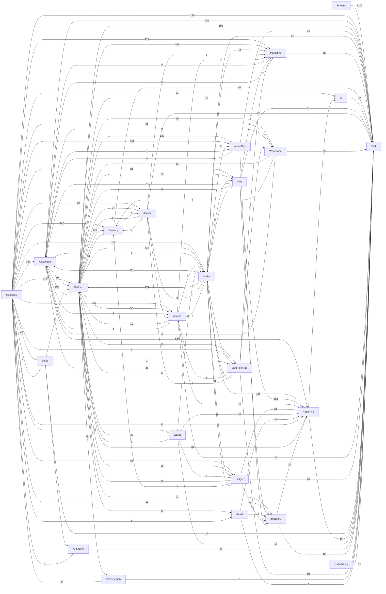

# How the Block A tickets are linked

> **Generated by** `tools/build-ticket-links.py` from `handoff/service-docs/tasks.csv` (the task sheet that becomes the OpenProject tickets). A ticket *waits on* another when it cannot be finished before the other is: that is the "follows" link in OpenProject and the order of each person's board.

**2369 tasks, 15647 links.**

## 1. The build layers, in order

| Layer | Tasks | Build order | Waits on |
|---|---:|---|---|
| Setup | 17 | #3 to #430 | Database (43) |
| Onboarding | 12 | #5 to #16 | nothing |
| Database | 170 | #31 to #2553 | Setup (3) |
| Platform | 20 | #38 to #104 | Setup (8), Database (2) |
| AI engine | 13 | #107 to #2545 | Setup (7), Database (1) |
| Services | 271 | #88 to #1487 | Platform (530), Database (491), Setup (1) |
| Screens | 332 | #151 to #1518 | Services (988), Setup (803), Services (Venue Management) (109), AI engine (3) |
| Services (Venue Management) | 495 | #149 to #2557 | Database (1229), Services (1158), Platform (873) |
| Screens (Venue Management) | 843 | #154 to #2561 | Setup (2458), Services (Venue Management) (1335), Services (657), AI engine (1) |
| Test | 196 | #72 to #2562 | Screens (Venue Management) (843), Services (Venue Management) (495), Screens (332), Services (262), Database (170), Platform (20), Setup (17), AI engine (14), Onboarding (12) |

## 2. Service map

An arrow means the service on the right waits on the one on the left; the number is how many task links carry it. Screens are left out here (section 4).

## 3. Services: what each waits on and what waits on it

| Service | Owner | Tasks | Points | Build order | Waits on | Needed by |
|---|---|---:|---:|---|---|---|
| **Other service** | Sanket Keluskar, Surendra | 21 | 59 | #88 to #2550 | Platform 15, Database 5, Order 3, Setup 1 | Catalogue 35, Test 10, Platform 6, Order 1, WhiteLabel 1, Access 1 ... |
| **Ai** | Sanket Keluskar, Narayan Gaonkar | 45 | 167 | #110 to #1630 | Database 81, Platform 77, Reporting 2 | screens: Other 58, Test 47, screens: Platform 33, screens: Analytics 19, screens: Engagement & Support 14, screens: White Label 10 ... |
| **Identity** | Deep Khanvilkar, Sanket Keluskar | 37 | 151 | #124 to #1806 | Database 80, Platform 71, Order 8, Tenancy 5, Other service 1 | screens: Platform 58, screens: Other 39, Test 37, screens: Analytics 27, screens: Account & Self-Service 23, screens: Tenants & Licensing 21 ... |
| **Order** | Pranay Shinde, Chinmay Patkar | 61 | 315 | #128 to #2402 | Database 173, Platform 129, Catalogue 9, Access 6, Fnb 2, Wallet 2, Ledger 2, Other service 1 | Catalogue 271, Reporting 188, Platform 154, screens: Sell 64, Test 61, screens: Account & Self-Service 30 ... |
| **Marketing** | Pranay Shinde, Deep Khanvilkar | 58 | 269 | #135 to #2382 | Database 113, Platform 109, Order 18, Identity 8, Access 7, Catalogue 2, Fnb 2, Other service 1 | Test 58, screens: Other 44, screens: Engagement & Support 33, screens: Account & Self-Service 25, Catalogue 23, screens: Membership, Loyalty & Value 16 ... |
| **WhiteLabel** | Hrushikant Patkar, Deep Khanvilkar | 35 | 175 | #179 to #2557 | Platform 69, Database 55, Catalogue 9, Other service 1 | screens: White Label 71, Test 35, screens: Engagement & Support 17, Platform 12, screens: Branding & Localisation 9, screens: Discovery & Browse 9 ... |
| **Platform** | Sanket Keluskar, Narayan Gaonkar | 88 | 370 | #187 to #2392 | Database 276, Platform 154, Order 154, Catalogue 80, Tenancy 51, Ledger 30, Identity 21, WhiteLabel 12, Access 12, Wallet 8, Fnb 6, Other service 6 | screens: Tenants & Licensing 155, Test 88, screens: Other 65, screens: Partners 42, screens: Platform 37, screens: Setup & Go-Live 23 ... |
| **Tenancy** | Deep Khanvilkar, Pranay Shinde | 57 | 209 | #189 to #2410 | Database 148, Platform 135, WhiteLabel 5, Identity 4, Ledger 4 | screens: Platform 75, screens: Venue Operations 65, screens: Other 58, Test 57, Platform 51, screens: Sell 34 ... |
| **CrossRegion** | Deep Khanvilkar, Chinmay Patkar | 8 | 29 | #213 to #1752 | Platform 15, Database 9 | Test 8, screens: Access 3 |
| **Wallet** | Pranay Shinde, Sanket Keluskar | 16 | 67 | #228 to #2126 | Database 33, Platform 32 | Reporting 36, screens: Other 20, Test 16, Ledger 8, Platform 8, screens: Membership, Loyalty & Value 5 ... |
| **Retail** | Pranay Shinde, Deep Khanvilkar | 6 | 30 | #233 to #882 | Platform 12, Database 9 | Reporting 32, screens: Sell 11, screens: Retail 7, Test 6, screens: Payment 3, Inventory 3 ... |
| **VenueOps** | Narayan Gaonkar, Chinmay Patkar | 74 | 337 | #256 to #2164 | Platform 138, Database 133, Order 2, Catalogue 1 | Test 74, screens: Other 71, screens: Media Library 50, screens: Access & Venue 22, screens: Operations 17, screens: Transport 16 ... |
| **Catalogue** | Narayan Gaonkar, Hrushikant Patkar | 140 | 606 | #271 to #2523 | Database 347, Order 271, Platform 250, Other service 35, Marketing 23, VenueOps 9, Fnb 7, Access 4, WhiteLabel 4 | Reporting 206, screens: Commercial 186, Test 140, screens: Other 133, screens: Sell 128, Platform 80 ... |
| **Access** | Narayan Gaonkar, Hrushikant Patkar | 27 | 136 | #276 to #1684 | Database 67, Platform 53, Order 5, Catalogue 4, Other service 1, Identity 1 | Reporting 70, screens: Other 44, Test 27, screens: Access & Venue 24, screens: Account & Self-Service 14, Platform 12 ... |
| **Fnb** | Narayan Gaonkar, Deep Khanvilkar | 41 | 227 | #359 to #1278 | Database 81, Platform 80, Order 9 | Reporting 158, screens: Other 50, Test 41, screens: Sell 29, screens: Kitchen 26, screens: In-venue Services 19 ... |
| **Ledger** | Narayan Gaonkar, Sanket Keluskar | 24 | 114 | #735 to #1802 | Database 61, Platform 50, Order 30, Wallet 8 | Reporting 64, Platform 30, Test 24, screens: Other 20, screens: Orders & Money 12, screens: Sell 5 ... |
| **Inventory** | Pranay Shinde, Deep Khanvilkar | 12 | 55 | #743 to #1287 | Platform 21, Database 18, Fnb 3, Retail 3, Ledger 2, VenueOps 1 | Reporting 24, Test 12, screens: Other 12, screens: Stock & Supply 2, screens: Stock on the Floor 1, screens: Operations 1 ... |
| **Reporting** | Chinmay Patkar, Narayan Gaonkar | 16 | 54 | #980 to #1581 | Catalogue 206, Order 188, Fnb 158, Access 70, Ledger 64, Wallet 36, Retail 32, Database 31, Platform 28, Inventory 24 | screens: Other 17, Test 16, screens: Analytics 10, screens: Venue Operations 4, screens: Orders & Money 3, screens: Reports 3 ... |

## 4. Module builds: the services each module's screens need

| App | Module | Screen tasks | Build order | Waits on services | Other |
|---|---|---:|---|---|---|
| Guest Web — Storefront | Cart & Checkout | 5 | #151 to #1327 | Order 11, Catalogue 4, WhiteLabel 4, Marketing 4, Identity 3, VenueOps 1 | Setup 13 |
| Guest App — Mobile | Cart & Checkout | 3 | #152 to #716 | Order 10, WhiteLabel 3, Identity 3, Catalogue 2, VenueOps 1 | Setup 7 |
| Venue Staff App — Operations | Operations | 12 | #154 to #2221 | VenueOps 17, Identity 13, Catalogue 3, Tenancy 2, Order 2, Marketing 1, Inventory 1 | Setup 36 |
| Guest App — Mobile | Account & Self-Service | 14 | #158 to #1338 | Order 20, Identity 15, Marketing 15, Access 11, Wallet 3, Ledger 2, WhiteLabel 1 | Setup 38 |
| Venue Scanner — Access Control | Access | 4 | #163 to #1750 | Identity 5, Access 3, CrossRegion 3, Order 1, Tenancy 1 | Setup 12 |
| Venue POS — Terminal and Tablet | Shift | 4 | #169 to #1139 | Order 12, Identity 7, Tenancy 3 | Setup 12 |
| Venue CMS — White Label | White Label | 23 | #171 to #1359 | WhiteLabel 71, Ai 10, VenueOps 8, Marketing 8, Catalogue 7, Identity 2, Order 1, Tenancy 1 | Setup 69 |
| Venue Support — Agent Console | Access & Availability | 1 | #174 to #174 | Identity 6 | Setup 2 |
| TICVAI Web — Platform Console | Access & Identity | 4 | #186 to #1589 | Identity 17 | Setup 12, Platform 2 |
| TICVAI Web — Platform Console | Tenants & Licensing | 87 | #221 to #2131 | Identity 21, Tenancy 6, WhiteLabel 2, Order 1 | Setup 258, Platform 155 |
| Venue Management — Back Office | People & Access Rights | 9 | #243 to #1995 | Tenancy 13, Identity 12, Reporting 1, Catalogue 1, Ai 1, Order 1 | Setup 24 |
| Guest App — Mobile | Discovery & Browse | 7 | #290 to #1342 | Catalogue 15, WhiteLabel 4, VenueOps 3, Marketing 2, Access 1 | Setup 19 |
| TICVAI Web — Platform Console | Branding & Localisation | 4 | #307 to #1739 | Identity 10, WhiteLabel 9, Tenancy 2, VenueOps 2 | Setup 12, Platform 4 |
| Guest Web — Storefront | Engagement & Support | 5 | #309 to #1378 | Marketing 8, Ai 3, WhiteLabel 3, Fnb 1, Order 1 | AI engine 1, Setup 13 |
| Guest Web — Storefront | System States | 1 | #310 to #310 | WhiteLabel 1 | Setup 1 |
| Guest Web — Storefront | Support | 2 | #311 to #1301 | WhiteLabel 3, Marketing 2 | Setup 6 |
| Guest App — Mobile | Engagement & Support | 12 | #312 to #1383 | Marketing 13, VenueOps 13, Ai 9, WhiteLabel 4, Fnb 3, Order 3, Catalogue 1 | Setup 34, AI engine 2 |
| Guest App — Mobile | System States | 2 | #313 to #1310 | WhiteLabel 2, Marketing 2 | Setup 2 |
| Venue Management — Back Office | Platform | 63 | #351 to #2342 | Tenancy 68, Identity 6, Catalogue 3, Ai 1 | Setup 186, Platform 6 |
| Venue Management — Back Office | Sell | 81 | #357 to #2483 | Catalogue 108, Tenancy 23, Order 5, Identity 5, Fnb 4, Ai 2, Retail 2, VenueOps 1, WhiteLabel 1, Wallet 1 | Setup 227, Platform 22 |
| Venue Management | Other | 158 | #358 to #2561 | Catalogue 133, VenueOps 71, Tenancy 56, Access 44, Fnb 44, Marketing 34, Ai 29, Order 21, Wallet 20, Ledger 20, Identity 16, Reporting 9, Inventory 7, WhiteLabel 5, Retail 3 | Setup 457, Platform 21 |
| Venue Management — Back Office | Food & Beverage | 5 | #360 to #1527 | Fnb 12, Tenancy 3, Reporting 2, Retail 1 | Setup 13 |
| TICVAI Web — Platform Console | Overview & Health | 5 | #392 to #1837 | Identity 2, Ai 1, Tenancy 1 | Setup 15, Platform 15 |
| TICVAI Web | Other | 12 | #398 to #1512 | Ai 29, Identity 23, Order 2, Tenancy 2 | Setup 36, Platform 29, AI engine 1 |
| Developer Portal | Developer & API | 8 | #409 to #2144 | - | Setup 13, Platform 15 |
| Developer | Other | 3 | #422 to #425 | - | Setup 6, Platform 15 |
| Venue Management — Back Office | Commercial | 147 | #450 to #2542 | Catalogue 185, Order 7, Tenancy 6, Ledger 2, Inventory 1, VenueOps 1 | Setup 420 |
| Venue Management — Back Office | Access & Venue | 44 | #461 to #2234 | Access 24, VenueOps 22, Tenancy 8, Order 5, Catalogue 4, Reporting 2, Marketing 1, Ai 1 | Setup 109, Platform 4 |
| Guest Web — Storefront | High-Demand Access | 1 | #596 to #596 | Catalogue 2 | Setup 1 |
| Venue Management — Back Office | Venue Operations | 38 | #598 to #2106 | Tenancy 65, Reporting 4, Order 3, Ai 3, Fnb 3, VenueOps 3, Access 2, Retail 1 | Setup 110, Platform 1 |
| Guest Web — Storefront | Discovery & Browse | 5 | #604 to #1340 | Catalogue 11, WhiteLabel 5, VenueOps 5, Access 1, Marketing 1 | Setup 13 |
| Guest Web — Storefront | Booking & Selection | 7 | #605 to #1377 | Catalogue 15, Order 7, VenueOps 6, WhiteLabel 5, Marketing 3, Ai 1 | Setup 17 |
| Guest Web — Storefront | Membership, Loyalty & Value | 5 | #606 to #1326 | Marketing 11, Order 5, Catalogue 5, Identity 5, Wallet 3, Access 2, VenueOps 1, WhiteLabel 1 | Setup 11 |
| Guest App — Mobile | High-Demand Access | 1 | #617 to #617 | Catalogue 2 | Setup 3 |
| Guest App — Mobile | Discovery | 1 | #618 to #618 | Catalogue 1 | Setup 3 |
| Guest App — Mobile | Booking & Selection | 10 | #623 to #1324 | Catalogue 20, Order 15, VenueOps 8, WhiteLabel 3, Marketing 2, Ai 1 | Setup 30 |
| Venue POS — Terminal and Tablet | Sell | 26 | #626 to #1333 | Order 59, Fnb 25, Catalogue 16, Tenancy 11, Retail 9, Marketing 8, Ledger 5, Reporting 3, VenueOps 3, Inventory 1, Access 1, Wallet 1 | Setup 78 |
| Guest Kiosk — Self-Service | Sell | 5 | #629 to #2216 | Catalogue 4, WhiteLabel 2 | Setup 15 |
| Guest Web — Storefront | Promotions | 1 | #656 to #656 | Catalogue 2 | Setup 1 |
| Guest App — Mobile | Promotions | 1 | #660 to #660 | Catalogue 3 | Setup 1 |
| Guest Web — Storefront | Ticketing | 3 | #702 to #886 | Order 9, Catalogue 3, Fnb 2, Ledger 1, VenueOps 1 | Setup 9 |
| Guest Web — Storefront | Retail | 2 | #703 to #1106 | Retail 4, Order 3 | Setup 6 |
| Guest App — Mobile | Ticketing | 4 | #714 to #890 | Order 7, Catalogue 1, Ledger 1 | Setup 12 |
| Guest App — Mobile | Membership, Loyalty & Value | 3 | #715 to #1306 | Marketing 5, Order 4, Catalogue 3, Wallet 2, Identity 1, VenueOps 1 | Setup 9 |
| Venue Management — Back Office | Orders & Money | 10 | #767 to #1353 | Order 18, Ledger 12, Tenancy 3, Reporting 3, Fnb 2, Marketing 1, Retail 1 | Setup 24 |
| Guest Web — Storefront | Account & Self-Service | 5 | #846 to #1336 | Marketing 10, Order 10, Identity 8, Access 3, Ledger 2, Wallet 1 | Setup 13 |
| Guest Web — Storefront | In-venue Services | 6 | #847 to #1186 | Fnb 9, VenueOps 7, Access 3, Order 2 | Setup 18 |
| Guest App — Mobile | In-venue Services | 10 | #851 to #1190 | Fnb 10, VenueOps 8, Access 5, Order 3, WhiteLabel 2, Catalogue 2 | Setup 30 |
| Venue Management — Back Office | Rentals | 19 | #929 to #2424 | VenueOps 13, Catalogue 8, Ai 2, Tenancy 2 | Setup 49, Platform 1 |
| Venue Analytics — Cross-Domain Reporting | Analytics | 6 | #1004 to #1735 | Reporting 10, Identity 3, Ai 2, Tenancy 1 | Setup 9 |
| Guest Web — Storefront | Transport | 1 | #1007 to #1007 | VenueOps 6, Order 1 | Setup 3 |
| Guest App — Mobile | Transport | 4 | #1010 to #1014 | VenueOps 10, Order 2 | Setup 12 |
| Guest App — Mobile | In-Venue Experience | 2 | #1055 to #1109 | Fnb 1, Access 1, Retail 1 | Setup 6 |
| Kitchen Display — Pass and Stations | Kitchen | 10 | #1060 to #1518 | Fnb 26, Reporting 2 | Setup 20 |
| Venue Staff App | Other | 2 | #1077 to #1268 | Fnb 6, Inventory 5 | Setup 6 |
| Venue Staff App — Operations | Floor Service | 2 | #1079 to #1081 | Fnb 15, Order 1 | Setup 6 |
| Guest App — Mobile | Retail | 1 | #1110 to #1110 | Retail 3, Order 1 | Setup 3 |
| Venue POS — Terminal and Tablet | Payment | 1 | #1114 to #1114 | Retail 3, Order 2, Access 1, Marketing 1, Wallet 1 | Setup 3 |
| Venue Management — Back Office | Games & Rides | 10 | #1167 to #2560 | WhiteLabel 4, Catalogue 3, VenueOps 1 | Setup 30 |
| Venue Staff App — Operations | Stock on the Floor | 2 | #1207 to #1208 | Fnb 2, Inventory 1 | Setup 4 |
| Venue Management — Back Office | Stock & Supply | 2 | #1223 to #1523 | Inventory 2, Reporting 1 | Setup 5 |
| Venue Analytics | Other | 3 | #1241 to #1244 | Reporting 8 | Setup 6 |
| Guest App — Mobile | Support | 1 | #1308 to #1308 | Marketing 2 | Setup 3 |
| Venue Support — Agent Console | Conversations | 2 | #1366 to #1368 | Marketing 7 | Setup 4 |
| Guest Kiosk — Self-Service | AI | 1 | #1386 to #1386 | Catalogue 2, Ai 1, Marketing 1, Order 1 | Setup 3 |
| Venue Management — Back Office | Engagement & Support | 26 | #1395 to #2383 | Marketing 12, WhiteLabel 10, Ai 2, Tenancy 2, Identity 1 | Setup 68 |
| Venue Management — Back Office | Guests & Marketing | 3 | #1416 to #1670 | Tenancy 4, Ai 2, Marketing 2, Identity 1, Reporting 1 | Setup 8 |
| Venue CMS — White Label | Policy | 2 | #1437 to #1438 | Marketing 2 | Setup 4 |
| Venue CMS | Other | 2 | #1444 to #1445 | Marketing 5 | Setup 6 |
| Venue Support — Agent Console | Overview | 1 | #1448 to #1448 | Marketing 1 | Setup 1 |
| Venue Support | Other | 1 | #1452 to #1452 | Marketing 5 | Setup 2 |
| TICVAI Web — Platform Console | AI | 2 | #1488 to #1491 | Ai 4 | Setup 4, Platform 2 |
| TICVAI Web — Platform Console | Analytics | 14 | #1489 to #1616 | Identity 24, Ai 17, Tenancy 1 | Setup 40, Platform 14 |
| TICVAI Web — Platform Console | Platform | 31 | #1492 to #2103 | Identity 52, Ai 32, Tenancy 7 | Setup 88, Platform 31 |
| Venue POS — Terminal and Tablet | Reports | 1 | #1515 to #1515 | Reporting 3 | Setup 3 |
| Venue CMS — White Label | Media Library | 40 | #1577 to #2197 | VenueOps 50, Identity 3, Ai 1, Tenancy 1 | Setup 120 |
| TICVAI Web — Platform Console | Commercial | 2 | #1609 to #2297 | Identity 4, Catalogue 1, Order 1, Ledger 1 | Setup 6, Platform 2 |
| TICVAI Sign-up — Onboarding & Purchase | Onboarding & Assessment | 10 | #1651 to #1941 | Identity 1 | Setup 20, Platform 10 |
| Partner Web — Reseller Portal | Access & Account | 4 | #1654 to #2134 | Identity 10 | Setup 7, Platform 6 |
| Partner Web — Reseller Portal | Partners | 22 | #1659 to #2258 | Identity 4 | Setup 44, Platform 26 |
| Venue Management — Back Office | Operations | 3 | #1710 to #1729 | Tenancy 6 | Setup 9 |
| Venue Management — Back Office | Setup & Go-Live | 19 | #1723 to #2446 | Catalogue 3, Tenancy 2 | Setup 57, Platform 23 |
| TICVAI Web — Platform Console | Releases & Environments | 8 | #1758 to #1779 | Identity 4 | Setup 24, Platform 16 |
| TICVAI Web — Platform Console | Platform Ops | 1 | #1768 to #1768 | - | Setup 3, Platform 2 |
| TICVAI Web — Platform Console | Support & Communications | 2 | #1777 to #1778 | - | Setup 6, Platform 2 |
| Venue Management — Back Office | Partners | 8 | #1799 to #2389 | Identity 8 | Setup 24, Platform 16 |
| TICVAI Sign-up — Onboarding & Purchase | Purchase & Activation | 6 | #1932 to #1954 | - | Setup 12, Platform 3 |
| TICVAI Sign-up — Onboarding & Purchase | Package Builder | 7 | #1942 to #1950 | - | Setup 14, Platform 8 |
| Partner Web — Reseller Portal | Reports & Settlement | 1 | #1970 to #1970 | - | Setup 2, Platform 2 |
| Venue Management — Back Office | Catalogue | 17 | #2261 to #2379 | Catalogue 24, Tenancy 2 | Setup 51 |
| Partner Web — Reseller Portal | Inventory & Pricing | 2 | #2449 to #2450 | Catalogue 6 | Setup 4 |
| Venue CMS — White Label | Kiosk | 1 | #2558 to #2558 | WhiteLabel 4 | Setup 3 |
| Kiosk | Other | 1 | #2559 to #2559 | WhiteLabel 1 | Setup 3 |

## 5. Reports and other read-only work that waits for its data

A backend task that only reads waits for the tasks that write what it reads (decided 30 September).

| Task | Service | Waits on the data of |
|---|---|---|
| SVC-IDENTITY-SESSION-1 | Identity | Other service |
| SVC-CATALOGUE-PRODUCT-2 | Catalogue | Other service, WhiteLabel |
| VM-TENANCY-MATRIX-1 | Tenancy | WhiteLabel |
| SVC-CATALOGUE-PRODUCT-1 | Catalogue | Other service |
| SVC-CATALOGUE-CAPACITY-1 | Catalogue | Order, VenueOps |
| SVC-CATALOGUE-DRAFTED-21 | Catalogue | Other service |
| SVC-ORDER-ORDERS-8 | Order | Catalogue, Other service |
| VM-IDENTITY-ADMINISTRATION-2 | Identity | Order, Tenancy |
| SVC-IDENTITY-ADMINISTRATION-9 | Identity | Order, Tenancy |
| SVC-IDENTITY-ADMINISTRATION-10 | Identity | Order, Tenancy |
| SVC-IDENTITY-IDENTITY-7 | Identity | Order, Tenancy |
| SVC-CATALOGUE-DRAFTED-27 | Catalogue | Order, Other service |
| SVC-CATALOGUE-DRAFTED-22 | Catalogue | Order, Other service, VenueOps |
| SVC-CATALOGUE-DRAFTED-26 | Catalogue | Order, Other service, VenueOps |
| SVC-CATALOGUE-DRAFTED-30 | Catalogue | Order, Other service, VenueOps |
| SVC-MARKETING-CONSENT-2 | Marketing | Access, Identity, Order |
| SVC-ACCESS-ACCESS-3 | Access | Catalogue, Identity, Order, Other service |
| SVC-ORDER-DRAFTED-1 | Order | Access |
| SVC-CATALOGUE-DRAFTED-18 | Catalogue | Access, Order, Other service |
| SVC-LEDGER-FINANCE-5 | Ledger | Order, Wallet |
| SVC-CATALOGUE-DRAFTED-6 | Catalogue | Order, Other service |
| SVC-VENUEOPS-GENERAL-1 | VenueOps | Catalogue, Order |
| SVC-FNB-GUESTORDERING-2 | Fnb | Order |
| SVC-CATALOGUE-DRAFTED-48 | Catalogue | Fnb, Order, Other service |
| VM-ORDER-DRAFTED-1 | Order | Access, Fnb, Ledger, Wallet |
| SVC-LEDGER-REPORTING-2 | Ledger | Order, Wallet |
| SVC-ORDER-REFUND-2 | Order | Fnb, Wallet |
| VM-INVENTORY-STOCK-1 | Inventory | Fnb, Ledger, Retail, VenueOps |
| SVC-MARKETING-GUEST-4 | Marketing | Access, Identity, Order |
| SVC-MARKETING-SEGMENT-4 | Marketing | Access, Order |
| SVC-AI-GOVERNANCE-5 | Ai | Reporting |
| SVC-AI-AUDIT-1 | Ai | Reporting |
| SVC-PLATFORM-SUBSCRIPTION-18 | Platform | Tenancy |
| SVC-TENANCY-ANALYTICS-1 | Tenancy | Identity, Ledger, Platform, WhiteLabel |
| SVC-PLATFORM-DRAFTED-14 | Platform | Fnb, Identity, Ledger, Order, Tenancy, Wallet, WhiteLabel |
| SVC-TENANCY-APPROVALS-9 | Tenancy | Identity, Ledger, Platform, WhiteLabel |
| SVC-PLATFORM-DRAFTED-10 | Platform | Fnb, Identity, Ledger, Order, Tenancy, Wallet, WhiteLabel |
| SVC-PLATFORM-DRAFTED-4 | Platform | Catalogue, Fnb, Identity, Ledger, Order, Other service, Tenancy, Wallet, WhiteLabel |
| SVC-PLATFORM-DRAFTED-11 | Platform | Catalogue, Fnb, Identity, Ledger, Order, Other service, Tenancy, Wallet, WhiteLabel |
| SVC-PLATFORM-DRAFTED-15 | Platform | Catalogue, Ledger, Order, Other service, Tenancy, Wallet |
| SVC-CATALOGUE-DRAFTED-13 | Catalogue | Other service |
| SVC-CATALOGUE-DRAFTED-15 | Catalogue | Other service |
| SVC-CATALOGUE-DRAFTED-46 | Catalogue | Other service |
| SVC-CATALOGUE-DRAFTED-8 | Catalogue | Other service |
| SVC-CATALOGUE-DRAFTED-19 | Catalogue | Order, Platform |
| SVC-CATALOGUE-DRAFTED-23 | Catalogue | Order, Other service, Platform |
| SVC-CATALOGUE-DRAFTED-31 | Catalogue | Order, Other service, Platform |
| SVC-CATALOGUE-DRAFTED-32 | Catalogue | Order, Other service, VenueOps |
| SVC-CATALOGUE-DRAFTED-28 | Catalogue | Order, Other service, Platform |
| SVC-CATALOGUE-DRAFTED-9 | Catalogue | Order, Other service, Platform |
| SVC-MARKETING-GUESTS-1 | Marketing | Access, Catalogue, Fnb, Identity, Order, Other service, Platform |
| SVC-PLATFORM-DRAFTED-3 | Platform | Access, Catalogue, Identity, Ledger, Order, Other service, Tenancy, Wallet, WhiteLabel |
| SVC-PLATFORM-DRAFTED-6 | Platform | Access, Catalogue, Fnb, Identity, Ledger, Order, Other service, Tenancy, Wallet, WhiteLabel |
| SVC-PLATFORM-DRAFTED-7 | Platform | Access, Catalogue, Fnb, Order, Other service, Wallet |
| SVC-CATALOGUE-DRAFTED-12 | Catalogue | Other service |
| SVC-CATALOGUE-DRAFTED-36 | Catalogue | Marketing |
| SVC-CATALOGUE-DRAFTED-39 | Catalogue | Other service |
| SVC-CATALOGUE-UPSELL-2 | Catalogue | Other service |
| SVC-CATALOGUE-DRAFTED-35 | Catalogue | Fnb, Order, Platform |
| SVC-CATALOGUE-DRAFTED-38 | Catalogue | Fnb, Order, Platform |
| SVC-CATALOGUE-PROMOTIONS-3 | Catalogue | Marketing, Order, Other service, VenueOps |
| SVC-CATALOGUE-DRAFTED-40 | Catalogue | Order |
| SVC-CATALOGUE-DRAFTED-41 | Catalogue | Fnb, Order, Platform, VenueOps |
| SVC-CATALOGUE-DRAFTED-42 | Catalogue | Order |
| SVC-CATALOGUE-DRAFTED-44 | Catalogue | Order |
| SVC-CATALOGUE-DRAFTED-43 | Catalogue | Fnb, Order, Platform |
| SVC-CATALOGUE-DRAFTED-82 | Catalogue | Marketing |
| SVC-CATALOGUE-DRAFTED-83 | Catalogue | Marketing |
| SVC-CATALOGUE-DRAFTED-80 | Catalogue | Fnb, Marketing, Order, Platform, VenueOps |
| SVC-CATALOGUE-DRAFTED-81 | Catalogue | Fnb, Order, Platform, VenueOps |
| DEVICE-BOCA-FGL | Other service | Order |
| SVC-WHITELABEL-KIOSK-2 | WhiteLabel | Catalogue, Other service |

## 6. Tasks that wait on nothing

Only setup and onboarding should be here.

| Task | Layer | Build order |
|---|---|---|
| SETUP-CI | Setup | #3 |
| SETUP-ENV | Setup | #4 |
| SETUP-ONBOARD-CHINMAY-PATKAR | Onboarding | #5 |
| SETUP-ONBOARD-CHITRANGI-MESTRY | Onboarding | #6 |
| SETUP-ONBOARD-DEEP-KHANVILKAR | Onboarding | #7 |
| SETUP-ONBOARD-HRUSHIKANT-PATKAR | Onboarding | #8 |
| SETUP-ONBOARD-KALPITA-MEJARI | Onboarding | #9 |
| SETUP-ONBOARD-PALLAVI-SAWANT | Onboarding | #10 |
| SETUP-ONBOARD-PRADNYA-YERAM | Onboarding | #11 |
| SETUP-ONBOARD-PRANAY-SHINDE | Onboarding | #12 |
| SETUP-ONBOARD-SANKET-KELUSKAR | Onboarding | #13 |
| SETUP-ONBOARD-SECOND-AI-ENGINEER | Onboarding | #14 |
| SETUP-ONBOARD-SURENDRA | Onboarding | #15 |
| SETUP-ONBOARD-TANMAY-DUKHANDE | Onboarding | #16 |
| SETUP-SHELL-EMPLOYEE-APP | Setup | #17 |
| SETUP-SHELL-GUEST-APP | Setup | #18 |
| SETUP-SHELL-GUEST-WEB | Setup | #19 |
| SETUP-SHELL-KIOSK | Setup | #20 |
| SETUP-SHELL-POS | Setup | #21 |
| SETUP-SHELL-VENUE-MANAGEMENT | Setup | #22 |
| SETUP-SHELL-WEB | Setup | #23 |
| R8-DB-LOCAL-CHINMAY-PATKAR | Services | #88 |
| R8-DB-LOCAL-CHITRANGI-MESTRY | Services | #89 |
| R8-DB-LOCAL-DEEP-KHANVILKAR | Services | #90 |
| R8-DB-LOCAL-KALPITA-MEJARI | Services | #91 |
| R8-DB-LOCAL-NARAYAN-GAONKAR | Services | #92 |
| R8-DB-LOCAL-PALLAVI-SAWANT | Services | #93 |
| R8-DB-LOCAL-PRADNYA-YERAM | Services | #94 |
| R8-DB-LOCAL-PRANAY-SHINDE | Services | #95 |
| R8-DB-LOCAL-SANKET-KELUSKAR | Services | #96 |
| R8-DB-LOCAL-SURENDRA | Services | #97 |
| R8-DB-SHARED | Services | #98 |
| TEST-BLOCK-A2-BE | Test | #1547 |
| TEST-BLOCK-A2-FE | Test | #1548 |

