# How the Block A tickets are linked

> **Generated by** `tools/build-ticket-links.py` from `handoff/service-docs/tasks.csv` (the task sheet that becomes the OpenProject tickets). A ticket *waits on* another when it cannot be finished before the other is: that is the "follows" link in OpenProject and the order of each person's board.

**2734 tasks, 17546 links.**

## 1. The build layers, in order

| Layer | Tasks | Build order | Waits on |
|---|---:|---|---|
| Setup | 23 | #3 to #634 | Database (43), Platform (1) |
| Onboarding | 12 | #5 to #16 | nothing |
| Database | 261 | #36 to #4066 | Setup (3) |
| Platform | 30 | #46 to #227 | Setup (11), Database (2), Services (2) |
| AI engine | 14 | #230 to #4630 | Setup (7), Services (1), Database (1) |
| Services | 444 | #182 to #4750 | Platform (751), Database (673), Setup (111), Services (Venue Management) (9), AI engine (3), DevOps (2) |
| Screens | 334 | #306 to #4766 | Services (1011), Setup (785), Services (Venue Management) (134), AI engine (3), Screens (Venue Management) (2) |
| Services (Venue Management) | 552 | #291 to #4808 | Services (1363), Database (1343), Platform (923), Setup (36), AI engine (3) |
| Screens (Venue Management) | 862 | #293 to #4830 | Setup (2513), Services (Venue Management) (1371), Services (667), AI engine (1) |
| DevOps | 3 | #155 to #157 | Setup (3) |
| Test | 199 | #228 to #4944 | Screens (Venue Management) (861), Services (Venue Management) (552), Services (435), Screens (334), Database (260), Platform (30), Setup (23), AI engine (15), Onboarding (12), DevOps (3) |

## 2. Service map

An arrow means the service on the right waits on the one on the left; the number is how many task links carry it. Screens are left out here (section 4).

```mermaid
flowchart LR
  Screens["Screens"] -->|1195| Test["Test"]
  Database["Database"] -->|395| Catalogue["Catalogue"]
  Database["Database"] -->|305| Platform["Platform"]
  Platform["Platform"] -->|282| Catalogue["Catalogue"]
  Database["Database"] -->|260| Test["Test"]
  Order["Order"] -->|246| Catalogue["Catalogue"]
  Catalogue["Catalogue"] -->|202| Reporting["Reporting"]
  Database["Database"] -->|193| Order["Order"]
  Order["Order"] -->|188| Reporting["Reporting"]
  Platform["Platform"] -->|171| VenueOps["VenueOps"]
  Platform["Platform"] -->|170| Tenancy["Tenancy"]
  Database["Database"] -->|169| Tenancy["Tenancy"]
  Fnb["Fnb"] -->|168| Reporting["Reporting"]
  Catalogue["Catalogue"] -->|161| Test["Test"]
  Database["Database"] -->|157| VenueOps["VenueOps"]
  Order["Order"] -->|154| Platform["Platform"]
  Platform["Platform"] -->|153| Order["Order"]
  Platform["Platform"] -->|141| Marketing["Marketing"]
  Database["Database"] -->|137| Marketing["Marketing"]
  Platform["Platform"] -->|137| Test["Test"]
  Database["Database"] -->|114| Identity["Identity"]
  Platform["Platform"] -->|101| Identity["Identity"]
  Platform["Platform"] -->|97| Fnb["Fnb"]
  Database["Database"] -->|96| Ai["Ai"]
  VenueOps["VenueOps"] -->|93| Test["Test"]
  Database["Database"] -->|90| Fnb["Fnb"]
  Platform["Platform"] -->|86| WhiteLabel["WhiteLabel"]
  Catalogue["Catalogue"] -->|84| Platform["Platform"]
  Database["Database"] -->|81| Access["Access"]
  Platform["Platform"] -->|79| Other_service["Other service"]
  Marketing["Marketing"] -->|76| Test["Test"]
  Order["Order"] -->|73| Test["Test"]
  Tenancy["Tenancy"] -->|71| Test["Test"]
  Access["Access"] -->|66| Reporting["Reporting"]
  Database["Database"] -->|66| Ledger["Ledger"]
  Database["Database"] -->|66| WhiteLabel["WhiteLabel"]
  Ledger["Ledger"] -->|66| Reporting["Reporting"]
  Platform["Platform"] -->|66| Access["Access"]
  Ai["Ai"] -->|64| Test["Test"]
  Other_service["Other service"] -->|63| Test["Test"]
  Other_service["Other service"] -->|62| Ai["Ai"]
  Platform["Platform"] -->|57| Ledger["Ledger"]
  Identity["Identity"] -->|50| Test["Test"]
  Fnb["Fnb"] -->|49| Test["Test"]
  Tenancy["Tenancy"] -->|49| Platform["Platform"]
  WhiteLabel["WhiteLabel"] -->|45| Test["Test"]
  Database["Database"] -->|43| Setup["Setup"]
  Other_service["Other service"] -->|38| Catalogue["Catalogue"]
  Database["Database"] -->|36| Other_service["Other service"]
  Wallet["Wallet"] -->|36| Reporting["Reporting"]
  Access["Access"] -->|35| Test["Test"]
  Database["Database"] -->|35| Wallet["Wallet"]
  Platform["Platform"] -->|35| Reporting["Reporting"]
  Platform["Platform"] -->|35| Wallet["Wallet"]
  Database["Database"] -->|33| Reporting["Reporting"]
  Retail["Retail"] -->|32| Reporting["Reporting"]
  Ledger["Ledger"] -->|30| Platform["Platform"]
  Order["Order"] -->|30| Ledger["Ledger"]
  Platform["Platform"] -->|28| Inventory["Inventory"]
  Setup["Setup"] -->|28| Platform["Platform"]
  Ledger["Ledger"] -->|27| Test["Test"]
  Marketing["Marketing"] -->|27| Catalogue["Catalogue"]
  Inventory["Inventory"] -->|24| Reporting["Reporting"]
  Setup["Setup"] -->|23| Test["Test"]
  Database["Database"] -->|21| Inventory["Inventory"]
  Identity["Identity"] -->|21| Platform["Platform"]
  Order["Order"] -->|20| Marketing["Marketing"]
  Platform["Platform"] -->|20| CrossRegion["CrossRegion"]
  Reporting["Reporting"] -->|20| Test["Test"]
  Setup["Setup"] -->|19| Catalogue["Catalogue"]
  Access["Access"] -->|18| Platform["Platform"]
  Setup["Setup"] -->|18| VenueOps["VenueOps"]
  Wallet["Wallet"] -->|18| Test["Test"]
  Inventory["Inventory"] -->|16| Test["Test"]
  Platform["Platform"] -->|16| Retail["Retail"]
  AI_engine["AI engine"] -->|15| Test["Test"]
  Catalogue["Catalogue"] -->|15| Order["Order"]
  Access["Access"] -->|12| Order["Order"]
  Database["Database"] -->|12| CrossRegion["CrossRegion"]
  Database["Database"] -->|12| Retail["Retail"]
  Identity["Identity"] -->|12| Order["Order"]
  Onboarding["Onboarding"] -->|12| Test["Test"]
  Setup["Setup"] -->|12| Tenancy["Tenancy"]
  WhiteLabel["WhiteLabel"] -->|12| Platform["Platform"]
  CrossRegion["CrossRegion"] -->|11| Test["Test"]
  Platform["Platform"] -->|11| Ai["Ai"]
  Setup["Setup"] -->|11| Order["Order"]
  Setup["Setup"] -->|11| WhiteLabel["WhiteLabel"]
  Order["Order"] -->|10| Identity["Identity"]
  Setup["Setup"] -->|10| Identity["Identity"]
  Setup["Setup"] -->|10| Marketing["Marketing"]
  Catalogue["Catalogue"] -->|9| WhiteLabel["WhiteLabel"]
  Order["Order"] -->|9| Fnb["Fnb"]
  Other_service["Other service"] -->|9| Platform["Platform"]
  VenueOps["VenueOps"] -->|9| Catalogue["Catalogue"]
  Access["Access"] -->|8| Marketing["Marketing"]
  Ai["Ai"] -->|8| Order["Order"]
  Identity["Identity"] -->|8| Marketing["Marketing"]
  Marketing["Marketing"] -->|8| Order["Order"]
  Retail["Retail"] -->|8| Test["Test"]
  Setup["Setup"] -->|8| Access["Access"]
  VenueOps["VenueOps"] -->|8| Identity["Identity"]
  Wallet["Wallet"] -->|8| Ledger["Ledger"]
  Wallet["Wallet"] -->|8| Platform["Platform"]
  Access["Access"] -->|7| Catalogue["Catalogue"]
  Ai["Ai"] -->|7| Catalogue["Catalogue"]
  Fnb["Fnb"] -->|7| Catalogue["Catalogue"]
  Order["Order"] -->|7| Access["Access"]
  Other_service["Other service"] -->|7| Marketing["Marketing"]
  Setup["Setup"] -->|7| AI_engine["AI engine"]
  Catalogue["Catalogue"] -->|6| Other_service["Other service"]
  Fnb["Fnb"] -->|6| Platform["Platform"]
  Identity["Identity"] -->|6| Tenancy["Tenancy"]
  Other_service["Other service"] -->|6| VenueOps["VenueOps"]
  Tenancy["Tenancy"] -->|6| Identity["Identity"]
  AI_engine["AI engine"] -->|5| Ai["Ai"]
  Identity["Identity"] -->|5| Access["Access"]
  Ledger["Ledger"] -->|5| Order["Order"]
  Marketing["Marketing"] -->|5| Access["Access"]
  Order["Order"] -->|5| Other_service["Other service"]
  Other_service["Other service"] -->|5| Order["Order"]
  Setup["Setup"] -->|5| Ai["Ai"]
  Setup["Setup"] -->|5| Fnb["Fnb"]
  WhiteLabel["WhiteLabel"] -->|5| Tenancy["Tenancy"]
  Access["Access"] -->|4| Identity["Identity"]
  Ai["Ai"] -->|4| Fnb["Fnb"]
  Catalogue["Catalogue"] -->|4| Access["Access"]
  Fnb["Fnb"] -->|4| Order["Order"]
  Inventory["Inventory"] -->|4| Order["Order"]
  Ledger["Ledger"] -->|4| Tenancy["Tenancy"]
  Setup["Setup"] -->|4| Inventory["Inventory"]
  Setup["Setup"] -->|4| Other_service["Other service"]
  Setup["Setup"] -->|4| Reporting["Reporting"]
  WhiteLabel["WhiteLabel"] -->|4| Catalogue["Catalogue"]
  Ai["Ai"] -->|3| Tenancy["Tenancy"]
  Catalogue["Catalogue"] -->|3| Identity["Identity"]
  Catalogue["Catalogue"] -->|3| Tenancy["Tenancy"]
  DevOps["DevOps"] -->|3| Test["Test"]
  Fnb["Fnb"] -->|3| Inventory["Inventory"]
  Ledger["Ledger"] -->|3| Inventory["Inventory"]
  Ledger["Ledger"] -->|3| Wallet["Wallet"]
  Marketing["Marketing"] -->|3| Ai["Ai"]
  Marketing["Marketing"] -->|3| Identity["Identity"]
  Other_service["Other service"] -->|3| Ledger["Ledger"]
  Other_service["Other service"] -->|3| Reporting["Reporting"]
  Other_service["Other service"] -->|3| Tenancy["Tenancy"]
  Retail["Retail"] -->|3| Inventory["Inventory"]
  Setup["Setup"] -->|3| CrossRegion["CrossRegion"]
  Setup["Setup"] -->|3| Database["Database"]
  Setup["Setup"] -->|3| DevOps["DevOps"]
  Setup["Setup"] -->|3| Ledger["Ledger"]
  Access["Access"] -->|2| Tenancy["Tenancy"]
  Ai["Ai"] -->|2| Access["Access"]
  Ai["Ai"] -->|2| Identity["Identity"]
  Ai["Ai"] -->|2| Reporting["Reporting"]
  Ai["Ai"] -->|2| VenueOps["VenueOps"]
  Catalogue["Catalogue"] -->|2| Marketing["Marketing"]
  DevOps["DevOps"] -->|2| Other_service["Other service"]
  Fnb["Fnb"] -->|2| Ai["Ai"]
  Fnb["Fnb"] -->|2| Marketing["Marketing"]
  Identity["Identity"] -->|2| Catalogue["Catalogue"]
  Identity["Identity"] -->|2| Other_service["Other service"]
  Identity["Identity"] -->|2| WhiteLabel["WhiteLabel"]
  Inventory["Inventory"] -->|2| Ai["Ai"]
  Inventory["Inventory"] -->|2| Retail["Retail"]
  Marketing["Marketing"] -->|2| Other_service["Other service"]
  Order["Order"] -->|2| Tenancy["Tenancy"]
  Order["Order"] -->|2| VenueOps["VenueOps"]
  Other_service["Other service"] -->|2| Access["Access"]
  Other_service["Other service"] -->|2| WhiteLabel["WhiteLabel"]
  Reporting["Reporting"] -->|2| Ai["Ai"]
  Reporting["Reporting"] -->|2| Identity["Identity"]
  Setup["Setup"] -->|2| Retail["Retail"]
  Tenancy["Tenancy"] -->|2| Ai["Ai"]
  Tenancy["Tenancy"] -->|2| Marketing["Marketing"]
  VenueOps["VenueOps"] -->|2| Ai["Ai"]
  VenueOps["VenueOps"] -->|2| Wallet["Wallet"]
  Wallet["Wallet"] -->|2| Order["Order"]
  AI_engine["AI engine"] -->|1| Catalogue["Catalogue"]
  Ai["Ai"] -->|1| Marketing["Marketing"]
  Catalogue["Catalogue"] -->|1| VenueOps["VenueOps"]
  CrossRegion["CrossRegion"] -->|1| Access["Access"]
  CrossRegion["CrossRegion"] -->|1| Identity["Identity"]
  CrossRegion["CrossRegion"] -->|1| Other_service["Other service"]
  Database["Database"] -->|1| AI_engine["AI engine"]
  Fnb["Fnb"] -->|1| Identity["Identity"]
  Fnb["Fnb"] -->|1| Other_service["Other service"]
  Identity["Identity"] -->|1| AI_engine["AI engine"]
  Identity["Identity"] -->|1| VenueOps["VenueOps"]
  Inventory["Inventory"] -->|1| Identity["Identity"]
  Inventory["Inventory"] -->|1| VenueOps["VenueOps"]
  Ledger["Ledger"] -->|1| Identity["Identity"]
  Marketing["Marketing"] -->|1| Fnb["Fnb"]
  Marketing["Marketing"] -->|1| Tenancy["Tenancy"]
  Marketing["Marketing"] -->|1| Wallet["Wallet"]
  Other_service["Other service"] -->|1| Identity["Identity"]
  Platform["Platform"] -->|1| Setup["Setup"]
  Reporting["Reporting"] -->|1| Order["Order"]
  Retail["Retail"] -->|1| Identity["Identity"]
  Setup["Setup"] -->|1| Wallet["Wallet"]
  VenueOps["VenueOps"] -->|1| Inventory["Inventory"]
  VenueOps["VenueOps"] -->|1| Order["Order"]
  Wallet["Wallet"] -->|1| Identity["Identity"]
  WhiteLabel["WhiteLabel"] -->|1| Other_service["Other service"]
```

## 3. Services: what each waits on and what waits on it

| Service | Owner | Tasks | Points | Build order | Waits on | Needed by |
|---|---|---:|---:|---|---|---|
| **Other service** | Pranay Shinde, Hrushikant Patkar | 74 | 209 | #182 to #2750 | Platform 79, Database 36, Catalogue 6, Order 5, Setup 4, DevOps 2, Identity 2, Marketing 2, WhiteLabel 1, Fnb 1, CrossRegion 1 | Test 63, Ai 62, Catalogue 38, Platform 9, Marketing 7, VenueOps 6 ... |
| **Identity** | Hrushikant Patkar, Deep Khanvilkar | 50 | 182 | #245 to #4751 | Database 114, Platform 101, Order 10, Setup 10, VenueOps 8, Tenancy 6, Access 4, Marketing 3, Catalogue 3, Reporting 2, Ai 2, Other service 1, CrossRegion 1, Ledger 1, Fnb 1, Inventory 1, Retail 1, Wallet 1 | screens: Platform 57, screens: Other 51, Test 50, screens: Analytics 27, screens: Account & Self-Service 23, screens: Tenants & Licensing 22 ... |
| **Order** | Pranay Shinde, Deep Khanvilkar | 73 | 338 | #250 to #3502 | Database 193, Platform 153, Catalogue 15, Identity 12, Access 12, Setup 11, Ai 8, Marketing 8, Ledger 5, Other service 5, Fnb 4, Inventory 4, Wallet 2, VenueOps 1, Reporting 1 | Catalogue 246, Reporting 188, Platform 154, Test 73, screens: Sell 64, Ledger 30 ... |
| **Tenancy** | Deep Khanvilkar, Pranay Shinde | 71 | 237 | #259 to #4808 | Platform 170, Database 169, Setup 12, Identity 6, WhiteLabel 5, Ledger 4, Ai 3, Catalogue 3, Other service 3, Order 2, Access 2, Marketing 1 | screens: Platform 79, Test 71, screens: Venue Operations 65, screens: Other 61, Platform 49, screens: Sell 34 ... |
| **Catalogue** | Narayan Gaonkar, Pranay Shinde | 161 | 654 | #261 to #3500 | Database 395, Platform 282, Order 246, Other service 38, Marketing 27, Setup 19, VenueOps 9, Access 7, Fnb 7, Ai 7, WhiteLabel 4, Identity 2, AI engine 1 | Reporting 202, screens: Commercial 192, Test 161, screens: Other 146, screens: Sell 127, Platform 84 ... |
| **VenueOps** | Narayan Gaonkar, Chinmay Patkar | 93 | 363 | #264 to #3838 | Platform 171, Database 157, Setup 18, Other service 6, Ai 2, Order 2, Catalogue 1, Identity 1, Inventory 1 | Test 93, screens: Other 73, screens: Media Library 50, screens: Access & Venue 22, screens: Operations 17, screens: Transport 16 ... |
| **Inventory** | Pranay Shinde, Narayan Gaonkar | 16 | 60 | #266 to #1619 | Platform 28, Database 21, Setup 4, Fnb 3, Ledger 3, Retail 3, VenueOps 1 | Reporting 24, Test 16, screens: Other 12, Order 4, screens: Stock & Supply 2, Ai 2 ... |
| **Fnb** | Narayan Gaonkar, Deep Khanvilkar | 49 | 241 | #267 to #1618 | Platform 97, Database 90, Order 9, Setup 5, Ai 4, Marketing 1 | Reporting 168, screens: Other 62, Test 49, screens: Sell 30, screens: Kitchen 26, screens: In-venue Services 19 ... |
| **Retail** | Pranay Shinde, Hrushikant Patkar | 8 | 33 | #270 to #1013 | Platform 16, Database 12, Inventory 2, Setup 2 | Reporting 32, screens: Sell 11, Test 8, screens: Retail 7, Inventory 3, screens: Payment 3 ... |
| **Marketing** | Pranay Shinde, Deep Khanvilkar | 76 | 313 | #271 to #4768 | Platform 141, Database 137, Order 20, Setup 10, Access 8, Identity 8, Other service 7, Tenancy 2, Catalogue 2, Fnb 2, Ai 1 | Test 76, screens: Other 50, screens: Engagement & Support 33, Catalogue 27, screens: Account & Self-Service 25, screens: Membership, Loyalty & Value 16 ... |
| **CrossRegion** | Deep Khanvilkar, Chinmay Patkar | 11 | 33 | #280 to #1932 | Platform 20, Database 12, Setup 3 | Test 11, screens: Access 3, Other service 1, Identity 1, Access 1 |
| **WhiteLabel** | Hrushikant Patkar, Deep Khanvilkar | 45 | 189 | #314 to #2760 | Platform 86, Database 66, Setup 11, Catalogue 9, Other service 2, Identity 2 | screens: White Label 71, Test 45, screens: Engagement & Support 16, Platform 12, screens: Other 9, screens: Branding & Localisation 9 ... |
| **Platform** | Narayan Gaonkar, Sanket Keluskar | 107 | 407 | #325 to #4799 | Database 303, Platform 180, Order 154, Catalogue 84, Tenancy 49, Ledger 30, Identity 21, Access 18, Setup 17, WhiteLabel 12, Wallet 8, Other service 7, Fnb 6 | screens: Tenants & Licensing 155, Test 107, screens: Other 70, screens: Partners 42, screens: Platform 37, Tenancy 29 ... |
| **Ledger** | Narayan Gaonkar, Sanket Keluskar | 27 | 118 | #355 to #3139 | Database 66, Platform 57, Order 30, Wallet 8, Setup 3, Other service 3 | Reporting 66, Platform 30, Test 27, screens: Other 20, screens: Orders & Money 12, Order 5 ... |
| **Wallet** | Pranay Shinde, Sanket Keluskar | 18 | 69 | #399 to #3279 | Database 35, Platform 35, Ledger 3, VenueOps 2, Marketing 1, Setup 1 | Reporting 36, screens: Other 20, Test 18, Ledger 8, Platform 8, screens: Membership, Loyalty & Value 5 ... |
| **Reporting** | Chinmay Patkar, Pranay Shinde | 20 | 59 | #414 to #4750 | Catalogue 202, Order 188, Fnb 168, Access 66, Ledger 66, Wallet 36, Platform 35, Database 33, Retail 32, Inventory 24, Setup 4, Other service 3, Ai 2 | Test 20, screens: Other 17, screens: Analytics 10, screens: Venue Operations 4, screens: Reports 3, screens: Sell 3 ... |
| **Ai** | Kalpita Mejari, Second AI engineer | 62 | 196 | #435 to #2664 | Database 96, Other service 62, Platform 11, AI engine 5, Setup 5, Marketing 3, Fnb 2, Inventory 2, VenueOps 2, Tenancy 2, Reporting 2 | Test 64, screens: Other 58, screens: Platform 33, screens: Analytics 19, screens: Engagement & Support 14, screens: White Label 10 ... |
| **Access** | Narayan Gaonkar, Pranay Shinde | 35 | 156 | #466 to #3506 | Database 81, Platform 66, Setup 8, Order 7, Identity 5, Marketing 5, Catalogue 4, Other service 2, Ai 2, CrossRegion 1 | Reporting 66, screens: Other 42, Test 35, screens: Access & Venue 25, Platform 18, screens: Account & Self-Service 14 ... |

## 4. Module builds: the services each module's screens need

| App | Module | Screen tasks | Build order | Waits on services | Other |
|---|---|---:|---|---|---|
| Venue Staff App — Operations | Operations | 12 | #293 to #2363 | VenueOps 17, Identity 13, Catalogue 3, Tenancy 2, Order 2, Inventory 1, Marketing 1 | Setup 36 |
| Venue Scanner — Access Control | Access | 4 | #301 to #2853 | Identity 5, Access 3, CrossRegion 3, Order 1, Tenancy 1 | Setup 12 |
| Venue CMS — White Label | White Label | 23 | #306 to #1514 | WhiteLabel 71, Ai 10, VenueOps 9, Marketing 8, Catalogue 7, Identity 3, Order 1, Tenancy 1 | Setup 69 |
| Venue Support — Agent Console | Access & Availability | 1 | #309 to #309 | Identity 6 | Setup 2 |
| TICVAI Web — Platform Console | Access & Identity | 4 | #322 to #1741 | Identity 17 | Setup 12, Platform 2 |
| TICVAI Web — Platform Console | Tenants & Licensing | 87 | #390 to #2279 | Identity 22, Tenancy 6, WhiteLabel 2, Order 1 | Setup 258, Platform 155 |
| Guest App — Mobile | Discovery & Browse | 7 | #484 to #1470 | Catalogue 15, WhiteLabel 4, VenueOps 3, Marketing 2, Access 1 | Setup 19 |
| TICVAI Web — Platform Console | Branding & Localisation | 4 | #500 to #1917 | Identity 10, WhiteLabel 9, VenueOps 2, Tenancy 2 | Setup 12, Platform 4 |
| Guest Web — Storefront | Engagement & Support | 5 | #502 to #1531 | Marketing 8, WhiteLabel 3, Ai 3, Order 1, Fnb 1 | Setup 13, AI engine 1 |
| Guest Web — Storefront | System States | 1 | #503 to #503 | WhiteLabel 1 | Setup 1 |
| Guest Web — Storefront | Support | 2 | #504 to #1412 | WhiteLabel 3, Marketing 2 | Setup 4 |
| Guest App — Mobile | System States | 2 | #505 to #1415 | Marketing 2, WhiteLabel 2 | Setup 2 |
| Venue POS — Terminal and Tablet | Shift | 4 | #541 to #1220 | Order 12, Identity 7, Tenancy 3 | Setup 12 |
| POS | Other | 2 | #542 to #2753 | Identity 6, Other service 1 | Setup 5, Screens 1 |
| Venue Management — Back Office | Platform | 63 | #546 to #4823 | Tenancy 72, Identity 5, Catalogue 3, Ai 1 | Setup 186, Platform 6 |
| Venue Management — Back Office | People & Access Rights | 9 | #548 to #4806 | Identity 13, Tenancy 12, Catalogue 1, Ai 1, Order 1, Reporting 1 | Setup 24 |
| Venue Management — Back Office | Sell | 81 | #551 to #4830 | Catalogue 107, Tenancy 23, Identity 5, Order 5, Fnb 5, Retail 2, Ai 2, WhiteLabel 1, VenueOps 1, Wallet 1 | Setup 227, Platform 22 |
| Venue Management — Back Office | Food & Beverage | 6 | #553 to #3521 | Fnb 13, Tenancy 4, Reporting 2, Retail 1 | Setup 15 |
| Venue Management | Other | 159 | #575 to #4769 | Catalogue 138, VenueOps 71, Tenancy 59, Fnb 56, Access 42, Marketing 34, Ai 29, Order 22, Wallet 20, Ledger 20, Identity 16, Reporting 9, Inventory 7, WhiteLabel 5, Retail 3 | Setup 460, Platform 23 |
| Venue CMS — White Label | Media Library | 40 | #586 to #2340 | VenueOps 50, Identity 3, Tenancy 1, Ai 1 | Setup 119 |
| Venue CMS | Other | 5 | #592 to #1607 | Marketing 10, VenueOps 2 | Setup 15 |
| TICVAI Web | Other | 13 | #597 to #1829 | Ai 29, Identity 23, Order 2, Tenancy 2 | Setup 39, Platform 32, AI engine 1 |
| TICVAI Web — Platform Console | Overview & Health | 5 | #600 to #2662 | Identity 2, Ai 1, Tenancy 1 | Setup 14, Platform 13 |
| Developer Portal | Developer & API | 8 | #615 to #2294 | - | Setup 13, Platform 15 |
| Developer | Other | 3 | #630 to #833 | - | Setup 6, Platform 15 |
| Venue Management — Back Office | Access & Venue | 44 | #653 to #3514 | Access 25, VenueOps 22, Tenancy 9, Order 5, Catalogue 4, Reporting 2, Ai 1, Marketing 1 | Setup 110, Platform 4 |
| Venue Management — Back Office | Commercial | 148 | #654 to #3535 | Catalogue 191, Order 7, Tenancy 5, Ledger 2, VenueOps 1, Inventory 1 | Setup 431 |
| Guest Web — Storefront | Discovery & Browse | 5 | #788 to #1468 | Catalogue 11, WhiteLabel 5, VenueOps 5, Access 1, Marketing 1 | Setup 11 |
| Guest Web — Storefront | Booking & Selection | 7 | #794 to #2598 | Catalogue 16, Order 7, VenueOps 6, WhiteLabel 5, Marketing 3, Ai 1 | Setup 15 |
| Guest Web — Storefront | High-Demand Access | 1 | #796 to #796 | Other service 1, Catalogue 1 | Setup 1 |
| Guest App — Mobile | High-Demand Access | 1 | #800 to #800 | Other service 1, Catalogue 1 | Setup 3 |
| Guest App — Mobile | Discovery | 1 | #801 to #801 | Catalogue 1 | Setup 1 |
| Guest App — Mobile | Booking & Selection | 10 | #806 to #1775 | Catalogue 20, Order 15, VenueOps 8, Marketing 3, WhiteLabel 3, Ai 1 | Setup 26 |
| Guest Kiosk — Self-Service | Sell | 5 | #808 to #2358 | Catalogue 4, WhiteLabel 2 | Setup 15 |
| Guest Web — Storefront | Cart & Checkout | 5 | #854 to #2605 | Order 12, Marketing 5, Catalogue 4, WhiteLabel 4, Identity 3, VenueOps 1 | Setup 9 |
| Guest Web — Storefront | Membership, Loyalty & Value | 5 | #857 to #4766 | Marketing 11, Order 8, Catalogue 7, Identity 5, Wallet 3, Access 2, WhiteLabel 2, VenueOps 1 | Setup 9 |
| Guest Web — Storefront | Ticketing | 3 | #858 to #1018 | Order 10, Catalogue 3, Fnb 2, Ledger 1, VenueOps 1 | Setup 7 |
| Guest App — Mobile | Cart & Checkout | 3 | #864 to #1449 | Order 10, Identity 3, WhiteLabel 3, Catalogue 2, VenueOps 1, Marketing 1 | Setup 7 |
| Guest App — Mobile | Membership, Loyalty & Value | 3 | #865 to #2646 | Marketing 5, Order 4, Catalogue 3, Wallet 2, VenueOps 1, Identity 1 | Setup 9 |
| Guest App — Mobile | Account & Self-Service | 14 | #866 to #4756 | Order 20, Identity 15, Marketing 15, Access 11, Wallet 3, Ledger 2, WhiteLabel 1 | Setup 38 |
| Guest App — Mobile | Ticketing | 4 | #867 to #1381 | Order 7, Catalogue 1, Ledger 1 | Setup 12 |
| Venue POS — Terminal and Tablet | Sell | 26 | #889 to #2643 | Order 59, Fnb 25, Catalogue 16, Tenancy 11, Retail 9, Marketing 8, Ledger 5, VenueOps 3, Reporting 3, Access 1, Wallet 1, Inventory 1 | Setup 78 |
| Venue Management — Back Office | Orders & Money | 10 | #916 to #3503 | Order 18, Ledger 12, Reporting 3, Tenancy 3, Fnb 2, Marketing 1, Retail 1 | Setup 24 |
| Guest App — Mobile | Engagement & Support | 12 | #996 to #1536 | VenueOps 13, Marketing 13, Ai 9, WhiteLabel 4, Fnb 3, Order 3, Catalogue 1 | Setup 32, AI engine 2 |
| Venue Management — Back Office | Rentals | 22 | #1035 to #4774 | VenueOps 13, Catalogue 8, Tenancy 4, Ai 2, Identity 1 | Setup 57, Platform 1 |
| Venue Management — Back Office | Venue Operations | 38 | #1041 to #4828 | Tenancy 65, Reporting 4, Ai 3, Fnb 3, Order 3, VenueOps 3, Access 2, Retail 1 | Setup 110, Platform 1 |
| Venue Analytics — Cross-Domain Reporting | Analytics | 6 | #1117 to #2659 | Reporting 10, Identity 3, Ai 2, Tenancy 1 | Setup 9 |
| Guest Web — Storefront | Transport | 1 | #1120 to #1120 | VenueOps 6, Order 1 | Setup 3 |
| Guest App — Mobile | Transport | 4 | #1123 to #1389 | VenueOps 10, Order 2 | Setup 12 |
| Guest App — Mobile | In-venue Services | 10 | #1130 to #1485 | Fnb 10, VenueOps 8, Access 5, Order 3, WhiteLabel 2, Catalogue 2 | Setup 30 |
| Kitchen Display — Pass and Stations | Kitchen | 10 | #1157 to #2652 | Fnb 26, Reporting 2 | Setup 20 |
| Venue Staff App | Other | 2 | #1171 to #1298 | Fnb 6, Inventory 5 | Setup 6 |
| Venue Staff App — Operations | Floor Service | 2 | #1174 to #1401 | Fnb 15, Order 1 | Setup 6 |
| Guest Web — Storefront | Retail | 2 | #1195 to #1380 | Retail 4, Order 3 | Setup 6 |
| Guest App — Mobile | Retail | 1 | #1198 to #1198 | Retail 3, Order 1 | Setup 3 |
| Venue Management — Back Office | Games & Rides | 10 | #1247 to #2763 | WhiteLabel 4, Catalogue 3, VenueOps 1 | Setup 30 |
| Guest Web — Storefront | In-venue Services | 6 | #1264 to #1480 | Fnb 9, VenueOps 7, Access 3, Order 2 | Setup 18 |
| Venue Staff App — Operations | Stock on the Floor | 2 | #1290 to #1291 | Fnb 2, Inventory 1 | Setup 4 |
| Venue Management — Back Office | Stock & Supply | 3 | #1310 to #3520 | Inventory 2, Reporting 1, Fnb 1 | Setup 7 |
| Guest App — Mobile | In-Venue Experience | 2 | #1397 to #1503 | Fnb 1, Access 1, Retail 1 | Setup 6 |
| Guest Kiosk — Self-Service | AI | 1 | #1409 to #1409 | Catalogue 2, Ai 1, Marketing 1, Order 1 | Setup 3 |
| Guest App — Mobile | Support | 1 | #1414 to #1414 | Marketing 2 | Setup 3 |
| MOB | Other | 1 | #1423 to #1423 | Catalogue 3, Order 2, WhiteLabel 2, Other service 1, Marketing 1 | Screens 2, Setup 3 |
| Guest Web — Storefront | Account & Self-Service | 5 | #1479 to #4752 | Marketing 10, Order 10, Identity 8, Access 3, Ledger 2, Wallet 1 | Setup 9 |
| Venue POS — Terminal and Tablet | Payment | 1 | #1506 to #1506 | Retail 3, Order 2, Access 1, Marketing 1, Wallet 1 | Setup 3 |
| Venue Support — Agent Console | Conversations | 2 | #1521 to #1522 | Marketing 7 | Setup 4 |
| Venue Management — Back Office | Engagement & Support | 26 | #1542 to #3526 | Marketing 12, WhiteLabel 9, Ai 2, Tenancy 2, Identity 1 | Setup 68 |
| Venue CMS — White Label | Policy | 6 | #1585 to #1604 | Marketing 6 | Setup 14 |
| Venue Support — Agent Console | Overview | 1 | #1610 to #1610 | Marketing 1 | Setup 1 |
| Venue Support | Other | 1 | #1614 to #1614 | Marketing 5 | Setup 2 |
| Venue Management — Back Office | Guests & Marketing | 3 | #1622 to #3516 | Tenancy 4, Ai 2, Marketing 2, Identity 1, Reporting 1 | Setup 8 |
| TICVAI Web — Platform Console | AI | 2 | #1652 to #1666 | Ai 4 | Setup 4, Platform 2 |
| TICVAI Web — Platform Console | Analytics | 14 | #1653 to #1790 | Identity 24, Ai 17, Tenancy 1 | Setup 40, Platform 14 |
| TICVAI Web — Platform Console | Platform | 31 | #1654 to #2671 | Identity 52, Ai 32, Tenancy 7 | Setup 88, Platform 31 |
| P06 | Other | 1 | #1703 to #1703 | Identity 6 | Screens 2, Setup 3 |
| WEB | Other | 1 | #1773 to #1773 | Catalogue 5, Order 3, WhiteLabel 1 | Screens 1, Setup 3 |
| TICVAI Web — Platform Console | Commercial | 2 | #1780 to #2410 | Identity 4, Order 1, Ledger 1, Catalogue 1 | Setup 6, Platform 2 |
| TICVAI Sign-up — Onboarding & Purchase | Onboarding & Assessment | 10 | #1814 to #2106 | Identity 1 | Setup 20, Platform 10 |
| Partner Web — Reseller Portal | Access & Account | 4 | #1817 to #2282 | Identity 10 | Setup 7, Platform 6 |
| Partner Web — Reseller Portal | Partners | 22 | #1833 to #4803 | Identity 4 | Setup 44, Platform 26 |
| Venue Management — Back Office | Setup & Go-Live | 19 | #1899 to #2561 | Catalogue 3, Tenancy 1 | Setup 57, Platform 23 |
| Venue Management — Back Office | Operations | 3 | #1905 to #1907 | Tenancy 6 | Setup 9 |
| TICVAI Web — Platform Console | Platform Ops | 1 | #1937 to #1937 | - | Setup 3, Platform 2 |
| TICVAI Web — Platform Console | Releases & Environments | 8 | #1939 to #1957 | Identity 4 | Setup 24, Platform 16 |
| TICVAI Web — Platform Console | Support & Communications | 2 | #1955 to #1956 | - | Setup 6, Platform 2 |
| Venue Management — Back Office | Partners | 8 | #1966 to #4779 | Identity 8 | Setup 24, Platform 16 |
| TICVAI Sign-up — Onboarding & Purchase | Purchase & Activation | 6 | #2097 to #2119 | - | Setup 12, Platform 3 |
| TICVAI Sign-up — Onboarding & Purchase | Package Builder | 7 | #2107 to #2115 | - | Setup 14, Platform 8 |
| Partner Web — Reseller Portal | Reports & Settlement | 1 | #2135 to #2135 | - | Setup 2, Platform 2 |
| Venue Management — Back Office | Catalogue | 17 | #2388 to #2475 | Catalogue 24, Tenancy 2 | Setup 51 |
| Partner Web — Reseller Portal | Inventory & Pricing | 2 | #2564 to #2565 | Catalogue 6 | Setup 4 |
| Guest Web — Storefront | Promotions | 1 | #2601 to #2601 | Catalogue 2 | Setup 1 |
| Guest App — Mobile | Promotions | 1 | #2603 to #2603 | Catalogue 3 | Setup 1 |
| Venue Analytics | Other | 3 | #2635 to #2638 | Reporting 8 | Setup 6 |
| Venue POS — Terminal and Tablet | Reports | 1 | #2649 to #2649 | Reporting 3 | Setup 3 |
| P05 | Other | 1 | #2752 to #2752 | Other service 1 | Setup 2 |
| Venue CMS — White Label | Kiosk | 1 | #2761 to #2761 | WhiteLabel 4 | Setup 3 |
| Kiosk | Other | 1 | #2762 to #2762 | WhiteLabel 1 | Setup 3 |

## 5. Reports and other read-only work that waits for its data

A backend task that only reads waits for the tasks that write what it reads (decided 30 September).

| Task | Service | Waits on the data of |
|---|---|---|
| CR241-SYNC-REJECTION-ROUTES | Other service | CrossRegion |
| CR583-CART-CONSENT | Other service | Order |
| CR480-ORDER-EXCHANGED-CONSUMERS | Other service | Order |
| CR174-GUEST-DEVICE-SIGN-OUT-CALL | Other service | Identity, Marketing |
| CR275-PROFILE-NAME-AND-LANGUAGE-TO-IDENTITY | Other service | Identity, Marketing |
| CR476-PREVIEW-RENDERER | Other service | WhiteLabel |
| JOB-AI-HISTORY-IMPORT | Ai | Other service |
| JOB-AI-PROVIDER-HEALTH | Ai | Other service |
| SVC-AI-ACTIONS-1 | Ai | Other service |
| SVC-AI-RETRIEVAL-2 | Ai | Other service |
| SVC-AI-AI-2 | Ai | Other service |
| SVC-AI-FORECAST-2 | Ai | Other service |
| CONS-AI-ORDER-EXCHANGED | Ai | Other service |
| CONS-AI-SUBJECT-DATA-PART | Ai | Other service |
| VM-AI-RISK-1 | Ai | Other service |
| SVC-AI-RETRIEVAL-1 | Ai | Other service |
| SVC-CATALOGUE-PRODUCT-2 | Catalogue | Other service, WhiteLabel |
| CONS-AI-FORECAST-ACTUALS | Ai | Other service |
| CONS-AI-GOVERNANCE-AND-PLANS | Ai | Other service |
| SVC-AI-ASSIST-1 | Ai | Other service |
| SVC-AI-CONFIGURE-1 | Ai | Other service |
| SVC-AI-GENERATE-1 | Ai | Other service |
| SVC-AI-AI-1 | Ai | Other service |
| JOB-AI-EXPIRY-TIMERS | Ai | Other service |
| JOB-AI-ACTION-PLAN-EXECUTOR | Ai | Other service |
| SVC-AI-GOVERNANCE-1 | Ai | Other service |
| SVC-AI-GOVERNANCE-4 | Ai | Other service |
| SVC-IDENTITY-SESSION-1 | Identity | Other service |
| VM-TENANCY-MATRIX-1 | Tenancy | WhiteLabel |
| CONS-AI-RECOMMENDATION-AND-RISK-SIGNALS | Ai | Other service |
| CR457-CHANNEL-RETRY-JOB | Other service | Catalogue |
| CR422-PRICE-EXECUTION-DEPLOYMENT-JOB | Other service | Catalogue |
| JOB-CATALOGUE-PRICING-ENGINE | Ai | Other service |
| SVC-AI-GENERATE-2 | Ai | Other service |
| SVC-CATALOGUE-PRODUCT-1 | Catalogue | Other service |
| SVC-CATALOGUE-BUNDLE-5 | Catalogue | Other service |
| SVC-AI-AI-3 | Ai | Other service |
| CR277-FNB-ORDER-ENTITLEMENT-LINES | Other service | Fnb |
| SVC-AI-RECOMMEND-1 | Ai | Other service |
| SVC-WHITELABEL-CONTENT-8 | WhiteLabel | Other service |
| CONS-AI-ANSWER-CACHE | Ai | Other service |
| SVC-AI-GOVERNANCE-2 | Ai | Marketing, Other service |
| CONS-AI-KNOWLEDGE-INDEX | Ai | Other service |
| VM-INVENTORY-STOCK-1 | Inventory | Fnb, Ledger, Retail, VenueOps |
| SVC-CATALOGUE-CAPACITY-1 | Catalogue | Order, VenueOps |
| CAT-AVAIL-CACHE | Other service | Catalogue |
| SVC-FNB-GUESTORDERING-2 | Fnb | Order |
| SVC-LEDGER-REPORTING-2 | Ledger | Order, Platform, Wallet |
| SVC-VENUEOPS-GENERAL-1 | VenueOps | Catalogue, Order |
| VM-IDENTITY-ADMINISTRATION-2 | Identity | Order, Tenancy |
| SVC-IDENTITY-ADMINISTRATION-9 | Identity | Order |
| SVC-IDENTITY-ADMINISTRATION-10 | Identity | Order, Tenancy |
| SVC-IDENTITY-IDENTITY-7 | Identity | Order |
| SVC-MARKETING-CONSENT-2 | Marketing | Access, Identity, Order |
| SVC-ACCESS-ACCESS-3 | Access | Catalogue, Identity, Order, Other service |
| SVC-ORDER-DRAFTED-1 | Order | Access |
| SVC-AI-KNOWLEDGE-1 | Ai | Other service |
| JOB-AI-NIGHTLY-INSIGHTS | Ai | Other service |
| SVC-AI-INSIGHTS-1 | Ai | Other service |
| SVC-AI-INSIGHTS-3 | Ai | Other service |
| SVC-MARKETING-SEGMENT-4 | Marketing | Access, Order |
| SVC-MARKETING-CONSENT-18 | Marketing | Tenancy |
| SVC-MARKETING-CONSENT-29 | Marketing | Access, Order, Tenancy |
| SVC-MARKETING-CASE-12 | Marketing | Other service |
| SVC-AI-CONFIG-2 | Ai | Other service |
| SVC-AI-FORECAST-1 | Ai | Fnb, Inventory, Marketing, Other service, Tenancy, VenueOps |
| JOB-AI-SPEND-METERING | Ai | Other service |
| SVC-AI-KNOWLEDGE-2 | Ai | Other service |
| SVC-AI-CONFIG-3 | Ai | Other service |
| SVC-AI-RETRIEVAL-4 | Ai | Other service |
| SVC-AI-CONFIG-1 | Ai | Other service |
| SVC-AI-FORECAST-4 | Ai | Other service |
| SVC-AI-MODELS-1 | Ai | Other service |
| SVC-AI-MODELS-2 | Ai | Other service |
| SVC-AI-FORECAST-7 | Ai | Other service |
| SVC-AI-GOVERNANCE-3 | Ai | Other service |
| SVC-AI-MONITORING-1 | Ai | Marketing, Other service, Platform |
| JOB-AI-FORECAST-RUN | Ai | Other service |
| SVC-AI-FORECAST-3 | Ai | Fnb, Inventory, Other service, Tenancy, VenueOps |
| SVC-AI-FORECAST-8 | Ai | Other service |
| SVC-AI-MONITORING-5 | Ai | Other service |
| SVC-AI-ACTIONS-7 | Ai | Other service |
| SVC-AI-MODELS-3 | Ai | Other service |
| SVC-AI-INSIGHTS-4 | Ai | Other service |
| SVC-IDENTITY-IDENTITY-19 | Identity | Access |
| SVC-ORDER-ORDERS-8 | Order | Catalogue, Other service |
| SVC-CATALOGUE-GENERAL-2 | Catalogue | Other service |
| SVC-AI-CONFIGURE-2 | Ai | Other service |
| SVC-AI-ACTIONS-3 | Ai | Other service |
| SVC-AI-ACTIONS-2 | Ai | Other service |
| SVC-AI-FORECAST-5 | Ai | Other service |
| JOB-AI-EVIDENCE-PACKAGE | Ai | Other service |
| SVC-AI-MONITORING-2 | Ai | Other service |
| SVC-AI-AUDIT-2 | Ai | Other service |
| JOB-AI-PERSONAL-DATA-RETENTION | Ai | Other service |
| SVC-PLATFORM-SUBSCRIPTION-18 | Platform | Tenancy |
| CR553-TRANSFER-INVENTORY-HOLDS | Other service | Catalogue |
| SVC-CATALOGUE-DRAFTED-26 | Catalogue | Order, Other service, VenueOps |
| SVC-CATALOGUE-DRAFTED-30 | Catalogue | Order, Other service, Platform, VenueOps |
| SVC-CATALOGUE-DRAFTED-6 | Catalogue | Order, Other service |
| SEAT-PRICING-STEP | Other service | Catalogue |
| SVC-CATALOGUE-DRAFTED-46 | Catalogue | Other service |
| SVC-CATALOGUE-DRAFTED-8 | Catalogue | Other service |
| SVC-CATALOGUE-DRAFTED-19 | Catalogue | Order, Platform |
| SVC-CATALOGUE-DRAFTED-27 | Catalogue | Other service |
| SVC-CATALOGUE-DRAFTED-22 | Catalogue | Order, Other service, Platform, VenueOps |
| SVC-CATALOGUE-DRAFTED-32 | Catalogue | Order, Other service, VenueOps |
| SVC-CATALOGUE-DRAFTED-28 | Catalogue | Order, Other service, Platform |
| SVC-CATALOGUE-DRAFTED-9 | Catalogue | Order, Other service, Platform |
| SVC-CATALOGUE-DRAFTED-13 | Catalogue | Other service |
| SVC-CATALOGUE-DRAFTED-15 | Catalogue | Other service |
| SVC-CATALOGUE-DRAFTED-21 | Catalogue | Other service |
| SVC-CATALOGUE-DRAFTED-23 | Catalogue | Order, Other service, Platform |
| SVC-CATALOGUE-DRAFTED-31 | Catalogue | Order, Other service, Platform |
| SVC-CATALOGUE-DRAFTED-12 | Catalogue | Other service |
| SVC-CATALOGUE-UPSELL-2 | Catalogue | Other service |
| SVC-CATALOGUE-DRAFTED-48 | Catalogue | Fnb, Order, Other service, Platform |
| SVC-ORDER-REFUND-2 | Order | Fnb, Platform, Wallet |
| SVC-REPORTING-NATURALLANGUAGE-2 | Reporting | Other service |
| SVC-AI-GOVERNANCE-5 | Ai | Other service, Reporting |
| SVC-AI-AUDIT-1 | Ai | Other service, Reporting |
| SVC-CATALOGUE-DRAFTED-36 | Catalogue | Marketing |
| SVC-CATALOGUE-DRAFTED-39 | Catalogue | Other service |
| SVC-CATALOGUE-DRAFTED-35 | Catalogue | Fnb, Order, Platform |
| SVC-CATALOGUE-DRAFTED-38 | Catalogue | Fnb, Order, Platform |
| SVC-CATALOGUE-PROMOTIONS-3 | Catalogue | Marketing, Order, Other service, VenueOps |
| SVC-CATALOGUE-DRAFTED-40 | Catalogue | Order |
| SVC-CATALOGUE-DRAFTED-41 | Catalogue | Fnb, Order, Platform, VenueOps |
| SVC-CATALOGUE-DRAFTED-42 | Catalogue | Order |
| SVC-CATALOGUE-DRAFTED-44 | Catalogue | Order |
| SVC-CATALOGUE-DRAFTED-43 | Catalogue | Fnb, Order, Platform |
| SVC-CATALOGUE-DRAFTED-83 | Catalogue | Marketing |
| SVC-CATALOGUE-DRAFTED-80 | Catalogue | Fnb, Marketing, Order, Platform, VenueOps |
| SVC-CATALOGUE-DRAFTED-81 | Catalogue | Fnb, Order, Platform, VenueOps |
| SVC-CATALOGUE-DRAFTED-82 | Catalogue | Marketing |
| DEVICE-BOCA-FGL | Other service | Order |
| SVC-WHITELABEL-KIOSK-2 | WhiteLabel | Catalogue, Other service |
| SVC-LEDGER-FINANCE-5 | Ledger | Order, Platform, Wallet |
| SVC-PLATFORM-DRAFTED-15 | Platform | Catalogue, Ledger, Order, Other service, Tenancy, Wallet |
| SVC-CATALOGUE-DRAFTED-18 | Catalogue | Access, Order, Other service, Platform |
| VM-ORDER-DRAFTED-1 | Order | Access, Catalogue, Fnb, Ledger, Platform, Wallet |
| SVC-MARKETING-GUESTS-1 | Marketing | Access, Catalogue, Fnb, Order, Other service, Platform |
| SVC-PLATFORM-DRAFTED-7 | Platform | Access, Catalogue, Fnb, Order, Other service, Wallet |
| SVC-PLATFORM-DRAFTED-3 | Platform | Access, Catalogue, Identity, Ledger, Order, Other service, Tenancy, Wallet, WhiteLabel |
| SVC-MARKETING-GUEST-4 | Marketing | Access, Identity, Order |
| SVC-PLATFORM-DRAFTED-4 | Platform | Access, Catalogue, Fnb, Identity, Ledger, Order, Other service, Tenancy, Wallet, WhiteLabel |
| SVC-PLATFORM-DRAFTED-6 | Platform | Access, Catalogue, Fnb, Identity, Ledger, Order, Other service, Tenancy, Wallet, WhiteLabel |
| SVC-PLATFORM-DRAFTED-10 | Platform | Access, Catalogue, Fnb, Identity, Ledger, Order, Tenancy, Wallet, WhiteLabel |
| SVC-PLATFORM-DRAFTED-11 | Platform | Access, Catalogue, Fnb, Identity, Ledger, Order, Other service, Tenancy, Wallet, WhiteLabel |
| SVC-PLATFORM-DRAFTED-14 | Platform | Access, Catalogue, Fnb, Identity, Ledger, Order, Tenancy, Wallet, WhiteLabel |
| SVC-TENANCY-ANALYTICS-1 | Tenancy | Access, Catalogue, Identity, Ledger, Platform, WhiteLabel |
| SVC-TENANCY-APPROVALS-9 | Tenancy | Access, Catalogue, Identity, Ledger, Platform, WhiteLabel |

## 6. Tasks that wait on nothing

Only setup and onboarding should be here.

| Task | Layer | Build order |
|---|---|---|
| SETUP-CI | Setup | #3 |
| SETUP-ENV | Setup | #4 |
| SETUP-ONBOARD-CHINMAY-PATKAR | Onboarding | #5 |
| SETUP-ONBOARD-CHITRANGI-MESTRY | Onboarding | #6 |
| SETUP-ONBOARD-DEEP-KHANVILKAR | Onboarding | #7 |
| SETUP-ONBOARD-HRUSHIKANT-PATKAR | Onboarding | #8 |
| SETUP-ONBOARD-KALPITA-MEJARI | Onboarding | #9 |
| SETUP-ONBOARD-PALLAVI-SAWANT | Onboarding | #10 |
| SETUP-ONBOARD-PRADNYA-YERAM | Onboarding | #11 |
| SETUP-ONBOARD-PRANAY-SHINDE | Onboarding | #12 |
| SETUP-ONBOARD-SANKET-KELUSKAR | Onboarding | #13 |
| SETUP-ONBOARD-SECOND-AI-ENGINEER | Onboarding | #14 |
| SETUP-ONBOARD-SURENDRA | Onboarding | #15 |
| SETUP-ONBOARD-TANMAY-DUKHANDE | Onboarding | #16 |
| SETUP-SHELL-EMPLOYEE-APP | Setup | #17 |
| SETUP-SHELL-GUEST-APP | Setup | #18 |
| SETUP-SHELL-GUEST-WEB | Setup | #19 |
| SETUP-SHELL-KIOSK | Setup | #20 |
| SETUP-SHELL-POS | Setup | #21 |
| SETUP-SHELL-VENUE-MANAGEMENT | Setup | #22 |
| SETUP-SHELL-WEB | Setup | #23 |
| R13-DB-SHARED | Services | #182 |
| R8-DB-LOCAL-CHINMAY-PATKAR | Services | #183 |
| R8-DB-LOCAL-CHITRANGI-MESTRY | Services | #184 |
| R8-DB-LOCAL-DEEP-KHANVILKAR | Services | #185 |
| R8-DB-LOCAL-KALPITA-MEJARI | Services | #186 |
| R8-DB-LOCAL-NARAYAN-GAONKAR | Services | #187 |
| R8-DB-LOCAL-PALLAVI-SAWANT | Services | #188 |
| R8-DB-LOCAL-PRADNYA-YERAM | Services | #189 |
| R8-DB-LOCAL-PRANAY-SHINDE | Services | #190 |
| R8-DB-LOCAL-SANKET-KELUSKAR | Services | #191 |
| R8-DB-LOCAL-SURENDRA | Services | #192 |
| R8-DB-SHARED | Services | #193 |
| TEST-BLOCK-A2-BE | Test | #1695 |
| TEST-BLOCK-A2-FE | Test | #1696 |
| CR403-DB-SEAT-MAP-TEMPLATE-STRUCTURE | Database | #2915 |

