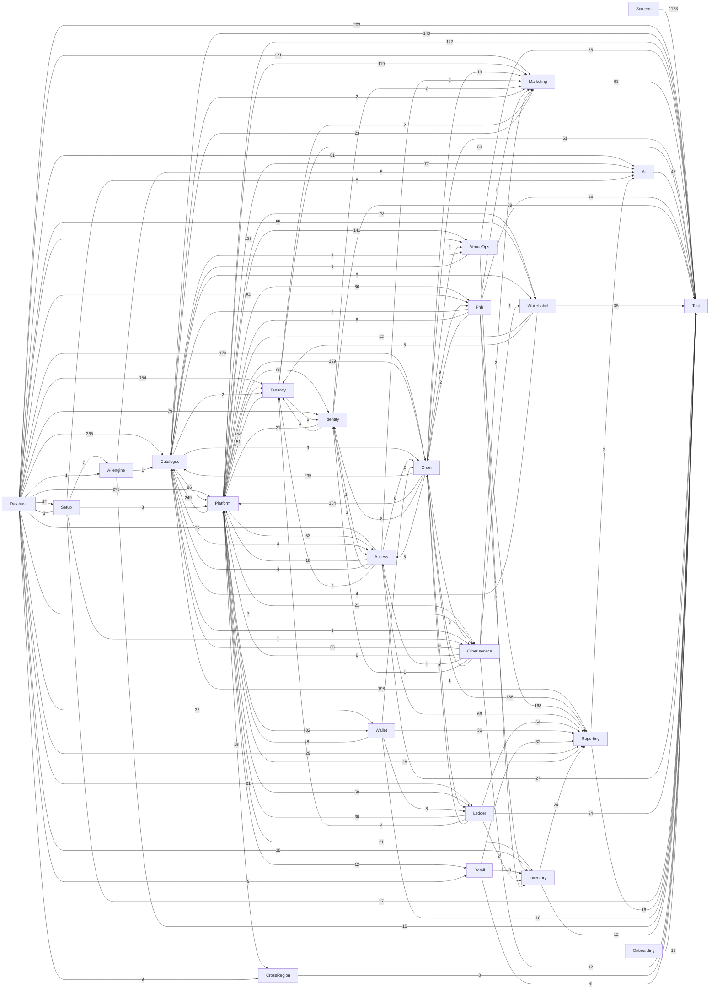

# How the Block A tickets are linked

> **Generated by** `tools/build-ticket-links.py` from `handoff/service-docs/tasks.csv` (the task sheet that becomes the OpenProject tickets). A ticket *waits on* another when it cannot be finished before the other is: that is the "follows" link in OpenProject and the order of each person's board.

**2429 tasks, 15872 links.**

## 1. The build layers, in order

| Layer | Tasks | Build order | Waits on |
|---|---:|---|---|
| Setup | 17 | #3 to #461 | Database (42) |
| Onboarding | 12 | #5 to #16 | nothing |
| Database | 204 | #31 to #3860 | Setup (3) |
| Platform | 24 | #40 to #134 | Setup (8), Database (2) |
| AI engine | 14 | #137 to #2600 | Setup (7), Database (1) |
| Services | 276 | #118 to #1527 | Platform (546), Database (492), Setup (4), AI engine (3), Services (Venue Management) (1) |
| Screens | 326 | #183 to #1558 | Services (983), Setup (781), Services (Venue Management) (110), AI engine (3) |
| Services (Venue Management) | 506 | #181 to #2612 | Database (1267), Services (1141), Platform (899), AI engine (3), Setup (2) |
| Screens (Venue Management) | 853 | #186 to #3243 | Setup (2488), Services (Venue Management) (1353), Services (659), AI engine (1) |
| Test | 197 | #135 to #2762 | Screens (Venue Management) (852), Services (Venue Management) (506), Screens (326), Services (267), Database (203), Platform (24), Setup (17), AI engine (15), Onboarding (12) |

## 2. Service map

An arrow means the service on the right waits on the one on the left; the number is how many task links carry it. Screens are left out here (section 4).

## 3. Services: what each waits on and what waits on it

| Service | Owner | Tasks | Points | Build order | Waits on | Needed by |
|---|---|---:|---:|---|---|---|
| **Other service** | Sanket Keluskar, Surendra | 23 | 65 | #118 to #2605 | Platform 21, Database 7, Order 3, Catalogue 1, Setup 1 | Catalogue 35, Test 12, Platform 6, Marketing 2, WhiteLabel 1, Access 1 ... |
| **Ai** | Kalpita Mejari, Second AI engineer | 45 | 167 | #141 to #1668 | Database 81, Platform 77, AI engine 5, Setup 5, Reporting 2 | screens: Other 58, Test 47, screens: Platform 33, screens: Analytics 19, screens: Engagement & Support 14, screens: White Label 10 ... |
| **Identity** | Deep Khanvilkar, Chinmay Patkar | 39 | 153 | #155 to #1848 | Platform 80, Database 79, Order 8, Tenancy 6, Access 3, Other service 1 | screens: Platform 58, Test 39, screens: Other 39, screens: Analytics 27, screens: Account & Self-Service 23, screens: Tenants & Licensing 22 ... |
| **Order** | Pranay Shinde, Chinmay Patkar | 61 | 315 | #160 to #2444 | Database 173, Platform 129, Catalogue 9, Access 6, Fnb 2, Wallet 2, Ledger 2, Other service 1 | Catalogue 235, Reporting 188, Platform 154, screens: Sell 64, Test 61, Ledger 30 ... |
| **Marketing** | Pranay Shinde, Deep Khanvilkar | 63 | 280 | #167 to #2424 | Database 121, Platform 119, Order 19, Access 8, Identity 7, Other service 2, Catalogue 2, Fnb 2, Tenancy 2 | Test 63, screens: Other 47, screens: Engagement & Support 33, screens: Account & Self-Service 25, Catalogue 23, screens: Membership, Loyalty & Value 16 ... |
| **WhiteLabel** | Hrushikant Patkar, Deep Khanvilkar | 35 | 175 | #211 to #2612 | Platform 70, Database 55, Catalogue 9, Other service 1 | screens: White Label 71, Test 35, screens: Engagement & Support 16, Platform 12, screens: Discovery & Browse 9, screens: Branding & Localisation 9 ... |
| **Platform** | Sanket Keluskar, Narayan Gaonkar | 88 | 370 | #219 to #2434 | Database 276, Platform 154, Order 154, Catalogue 86, Tenancy 51, Ledger 30, Identity 21, Access 18, WhiteLabel 12, Wallet 8, Fnb 6, Other service 6 | screens: Tenants & Licensing 154, Test 88, screens: Other 65, screens: Partners 42, screens: Platform 37, screens: Setup & Go-Live 23 ... |
| **Tenancy** | Deep Khanvilkar, Pranay Shinde | 60 | 221 | #221 to #2457 | Database 154, Platform 144, WhiteLabel 5, Identity 4, Ledger 4, Access 2, Catalogue 2 | screens: Platform 75, screens: Venue Operations 65, screens: Other 61, Test 60, Platform 51, screens: Sell 34 ... |
| **CrossRegion** | Deep Khanvilkar, Chinmay Patkar | 8 | 29 | #246 to #1793 | Platform 15, Database 9 | Test 8, screens: Access 3 |
| **Wallet** | Pranay Shinde, Sanket Keluskar | 16 | 67 | #261 to #2168 | Database 33, Platform 32 | Reporting 36, screens: Other 20, Test 16, Ledger 8, Platform 8, screens: Membership, Loyalty & Value 5 ... |
| **Retail** | Pranay Shinde, Deep Khanvilkar | 6 | 30 | #266 to #897 | Platform 12, Database 9 | Reporting 32, screens: Sell 11, screens: Retail 7, Test 6, screens: Payment 3, Inventory 3 ... |
| **VenueOps** | Narayan Gaonkar, Chinmay Patkar | 75 | 339 | #289 to #2206 | Platform 141, Database 135, Order 2, Catalogue 1 | Test 75, screens: Other 71, screens: Media Library 50, screens: Access & Venue 22, screens: Operations 17, screens: Transport 16 ... |
| **Catalogue** | Narayan Gaonkar, Hrushikant Patkar | 140 | 606 | #304 to #2578 | Database 365, Platform 249, Order 235, Other service 35, Marketing 23, VenueOps 9, Fnb 7, Access 4, WhiteLabel 4, AI engine 1 | Reporting 198, screens: Commercial 193, Test 140, screens: Sell 127, screens: Other 119, Platform 86 ... |
| **Access** | Narayan Gaonkar, Hrushikant Patkar | 27 | 136 | #309 to #1722 | Database 70, Platform 53, Order 5, Catalogue 4, Other service 1, Identity 1 | Reporting 66, screens: Other 42, Test 27, screens: Access & Venue 25, Platform 18, screens: Account & Self-Service 14 ... |
| **Fnb** | Narayan Gaonkar, Deep Khanvilkar | 44 | 233 | #391 to #1313 | Platform 86, Database 84, Order 9 | Reporting 168, screens: Other 62, Test 44, screens: Sell 30, screens: Kitchen 26, screens: In-venue Services 19 ... |
| **Ledger** | Narayan Gaonkar, Sanket Keluskar | 24 | 114 | #759 to #1843 | Database 61, Platform 50, Order 30, Wallet 8 | Reporting 64, Platform 30, Test 24, screens: Other 20, screens: Orders & Money 12, screens: Sell 5 ... |
| **Inventory** | Pranay Shinde, Deep Khanvilkar | 12 | 55 | #767 to #1305 | Platform 21, Database 18, Fnb 3, Retail 3, Ledger 2, VenueOps 1 | Reporting 24, Test 12, screens: Other 12, screens: Stock & Supply 2, screens: Operations 1, screens: Sell 1 ... |
| **Reporting** | Chinmay Patkar, Narayan Gaonkar | 16 | 54 | #998 to #1619 | Catalogue 198, Order 188, Fnb 168, Access 66, Ledger 64, Wallet 36, Retail 32, Database 29, Platform 28, Inventory 24 | screens: Other 17, Test 16, screens: Analytics 10, screens: Venue Operations 4, screens: Sell 3, screens: Reports 3 ... |

## 4. Module builds: the services each module's screens need

| App | Module | Screen tasks | Build order | Waits on services | Other |
|---|---|---:|---|---|---|
| Guest Web — Storefront | Cart & Checkout | 5 | #183 to #1371 | Order 11, Catalogue 4, Marketing 4, WhiteLabel 4, Identity 3, VenueOps 1 | Setup 11 |
| Guest App — Mobile | Cart & Checkout | 3 | #184 to #741 | Order 10, Identity 3, WhiteLabel 3, Catalogue 2, VenueOps 1 | Setup 7 |
| Venue Staff App — Operations | Operations | 12 | #186 to #2262 | VenueOps 17, Identity 13, Catalogue 3, Tenancy 2, Order 2, Inventory 1, Marketing 1 | Setup 36 |
| Guest App — Mobile | Account & Self-Service | 14 | #190 to #1374 | Order 20, Identity 15, Marketing 15, Access 11, Wallet 3, Ledger 2, WhiteLabel 1 | Setup 38 |
| Venue Scanner — Access Control | Access | 4 | #195 to #1791 | Identity 5, CrossRegion 3, Access 3, Order 1, Tenancy 1 | Setup 12 |
| Venue POS — Terminal and Tablet | Shift | 4 | #201 to #1156 | Order 12, Identity 7, Tenancy 3 | Setup 12 |
| Venue CMS — White Label | White Label | 23 | #203 to #1397 | WhiteLabel 71, Ai 10, VenueOps 8, Marketing 8, Catalogue 7, Identity 2, Order 1, Tenancy 1 | Setup 69 |
| Venue Support — Agent Console | Access & Availability | 1 | #206 to #206 | Identity 6 | Setup 2 |
| TICVAI Web — Platform Console | Access & Identity | 4 | #217 to #1627 | Identity 17 | Setup 12, Platform 2 |
| TICVAI Web — Platform Console | Tenants & Licensing | 87 | #254 to #2173 | Identity 22, Tenancy 6, WhiteLabel 2, Order 1 | Setup 258, Platform 154 |
| Venue Management — Back Office | People & Access Rights | 9 | #276 to #2037 | Tenancy 13, Identity 12, Catalogue 1, Ai 1, Reporting 1, Order 1 | Setup 24 |
| Guest App — Mobile | Discovery & Browse | 7 | #322 to #1361 | Catalogue 15, WhiteLabel 4, VenueOps 3, Marketing 2, Access 1 | Setup 19 |
| TICVAI Web — Platform Console | Branding & Localisation | 4 | #339 to #1780 | Identity 10, WhiteLabel 9, VenueOps 2, Tenancy 2 | Setup 12, Platform 4 |
| Guest Web — Storefront | Engagement & Support | 5 | #341 to #1414 | Marketing 8, WhiteLabel 3, Ai 3, Order 1, Fnb 1 | Setup 13, AI engine 1 |
| Guest Web — Storefront | System States | 1 | #342 to #342 | WhiteLabel 1 | Setup 1 |
| Guest Web — Storefront | Support | 2 | #343 to #1335 | WhiteLabel 3, Marketing 2 | Setup 4 |
| Guest App — Mobile | Engagement & Support | 12 | #344 to #1419 | Marketing 13, VenueOps 13, Ai 9, WhiteLabel 4, Fnb 3, Order 3, Catalogue 1 | Setup 32, AI engine 2 |
| Guest App — Mobile | System States | 2 | #345 to #1344 | Marketing 2, WhiteLabel 2 | Setup 2 |
| Venue Management — Back Office | Platform | 63 | #383 to #2445 | Tenancy 68, Identity 6, Catalogue 3, Ai 1 | Setup 186, Platform 6 |
| Venue Management — Back Office | Sell | 81 | #389 to #2538 | Catalogue 107, Tenancy 23, Fnb 5, Order 5, Identity 5, Retail 2, Ai 2, Wallet 1, VenueOps 1, WhiteLabel 1 | Setup 228, Platform 22 |
| Venue Management | Other | 153 | #390 to #2616 | Catalogue 119, VenueOps 71, Tenancy 59, Fnb 56, Access 42, Marketing 34, Ai 29, Order 21, Ledger 20, Wallet 20, Identity 16, Reporting 9, Inventory 7, WhiteLabel 5, Retail 3 | Setup 442, Platform 21 |
| Venue Management — Back Office | Food & Beverage | 6 | #392 to #1567 | Fnb 13, Tenancy 4, Reporting 2, Retail 1 | Setup 15 |
| TICVAI Web — Platform Console | Overview & Health | 5 | #424 to #1879 | Identity 2, Ai 1, Tenancy 1 | Setup 15, Platform 15 |
| TICVAI Web | Other | 12 | #430 to #1552 | Ai 29, Identity 23, Order 2, Tenancy 2 | Setup 36, Platform 29, AI engine 1 |
| Developer Portal | Developer & API | 8 | #441 to #2186 | - | Setup 13, Platform 15 |
| Developer | Other | 3 | #454 to #457 | - | Setup 6, Platform 15 |
| Venue Management — Back Office | Commercial | 148 | #480 to #2597 | Catalogue 192, Order 7, Tenancy 5, Ledger 2, VenueOps 1, Inventory 1 | Setup 431 |
| Venue Management — Back Office | Access & Venue | 44 | #489 to #3243 | Access 25, VenueOps 22, Tenancy 8, Order 5, Catalogue 5, Reporting 2, Ai 1, Marketing 1 | Setup 110, Platform 4 |
| Guest Web — Storefront | High-Demand Access | 1 | #619 to #619 | Catalogue 2 | Setup 1 |
| Venue Management — Back Office | Venue Operations | 38 | #621 to #2148 | Tenancy 65, Reporting 4, Ai 3, Order 3, Fnb 3, VenueOps 3, Access 2, Retail 1 | Setup 110, Platform 1 |
| Guest Web — Storefront | Discovery & Browse | 5 | #627 to #1359 | Catalogue 11, WhiteLabel 5, VenueOps 5, Access 1, Marketing 1 | Setup 11 |
| Guest Web — Storefront | Booking & Selection | 7 | #628 to #1413 | Catalogue 15, Order 7, VenueOps 6, WhiteLabel 5, Marketing 3, Ai 1 | Setup 17 |
| Guest Web — Storefront | Membership, Loyalty & Value | 5 | #629 to #1370 | Marketing 11, Catalogue 5, Identity 5, Order 5, Wallet 3, Access 2, VenueOps 1, WhiteLabel 1 | Setup 11 |
| Guest App — Mobile | High-Demand Access | 1 | #640 to #640 | Catalogue 2 | Setup 3 |
| Guest App — Mobile | Discovery | 1 | #641 to #641 | Catalogue 1 | Setup 1 |
| Guest App — Mobile | Booking & Selection | 10 | #646 to #1368 | Catalogue 20, Order 15, VenueOps 8, WhiteLabel 3, Marketing 2, Ai 1 | Setup 30 |
| Venue POS — Terminal and Tablet | Sell | 26 | #650 to #1377 | Order 59, Fnb 25, Catalogue 16, Tenancy 11, Retail 9, Marketing 8, Ledger 5, Reporting 3, VenueOps 3, Inventory 1, Access 1, Wallet 1 | Setup 78 |
| Guest Kiosk — Self-Service | Sell | 5 | #653 to #2257 | Catalogue 4, WhiteLabel 2 | Setup 15 |
| Guest Kiosk — Self-Service | AI | 1 | #654 to #654 | Catalogue 2, Ai 1, Marketing 1, Order 1 | Setup 3 |
| Guest Web — Storefront | Promotions | 1 | #680 to #680 | Catalogue 2 | Setup 1 |
| Guest App — Mobile | Promotions | 1 | #684 to #684 | Catalogue 3 | Setup 1 |
| Guest Web — Storefront | Ticketing | 3 | #727 to #902 | Order 9, Catalogue 3, Fnb 2, VenueOps 1, Ledger 1 | Setup 9 |
| Guest Web — Storefront | Retail | 2 | #728 to #1123 | Retail 4, Order 3 | Setup 6 |
| Guest App — Mobile | Ticketing | 4 | #739 to #906 | Order 7, Catalogue 1, Ledger 1 | Setup 12 |
| Guest App — Mobile | Membership, Loyalty & Value | 3 | #740 to #1340 | Marketing 5, Order 4, Catalogue 3, Wallet 2, VenueOps 1, Identity 1 | Setup 9 |
| Venue Management — Back Office | Orders & Money | 10 | #790 to #1388 | Order 18, Ledger 12, Tenancy 3, Reporting 3, Fnb 2, Marketing 1, Retail 1 | Setup 24 |
| Guest Web — Storefront | Account & Self-Service | 5 | #861 to #1372 | Marketing 10, Order 10, Identity 8, Access 3, Ledger 2, Wallet 1 | Setup 13 |
| Guest Web — Storefront | In-venue Services | 6 | #862 to #1211 | Fnb 9, VenueOps 7, Access 3, Order 2 | Setup 18 |
| Guest App — Mobile | In-venue Services | 10 | #866 to #1215 | Fnb 10, VenueOps 8, Access 5, Order 3, Catalogue 2, WhiteLabel 2 | Setup 30 |
| Venue Management — Back Office | Rentals | 22 | #926 to #2465 | VenueOps 13, Catalogue 8, Tenancy 4, Ai 2, Identity 1 | Setup 57, Platform 1 |
| Venue Analytics — Cross-Domain Reporting | Analytics | 6 | #1022 to #1776 | Reporting 10, Identity 3, Ai 2, Tenancy 1 | Setup 9 |
| Guest Web — Storefront | Transport | 1 | #1025 to #1025 | VenueOps 6, Order 1 | Setup 3 |
| Guest App — Mobile | Transport | 4 | #1028 to #1032 | VenueOps 10, Order 2 | Setup 12 |
| Guest App — Mobile | In-Venue Experience | 2 | #1073 to #1126 | Access 1, Retail 1, Fnb 1 | Setup 6 |
| Kitchen Display — Pass and Stations | Kitchen | 10 | #1078 to #1558 | Fnb 26, Reporting 2 | Setup 20 |
| Venue Staff App | Other | 2 | #1095 to #1240 | Fnb 6, Inventory 5 | Setup 6 |
| Venue Staff App — Operations | Floor Service | 2 | #1097 to #1099 | Fnb 15, Order 1 | Setup 6 |
| Guest App — Mobile | Retail | 1 | #1127 to #1127 | Retail 3, Order 1 | Setup 3 |
| Venue POS — Terminal and Tablet | Payment | 1 | #1131 to #1131 | Retail 3, Order 2, Access 1, Marketing 1, Wallet 1 | Setup 3 |
| Venue Management — Back Office | Games & Rides | 10 | #1192 to #2615 | WhiteLabel 4, Catalogue 3, VenueOps 1 | Setup 30 |
| Venue Staff App — Operations | Stock on the Floor | 2 | #1232 to #1233 | Fnb 2, Inventory 1 | Setup 4 |
| Venue Management — Back Office | Stock & Supply | 3 | #1255 to #1563 | Inventory 2, Reporting 1, Fnb 1 | Setup 7 |
| Venue Analytics | Other | 3 | #1274 to #1277 | Reporting 8 | Setup 6 |
| Guest App — Mobile | Support | 1 | #1342 to #1342 | Marketing 2 | Setup 3 |
| Venue Support — Agent Console | Conversations | 2 | #1403 to #1405 | Marketing 7 | Setup 4 |
| Venue Management — Back Office | Engagement & Support | 26 | #1428 to #2425 | Marketing 12, WhiteLabel 9, Ai 2, Tenancy 2, Identity 1 | Setup 68 |
| Venue Management — Back Office | Guests & Marketing | 3 | #1449 to #1708 | Tenancy 4, Marketing 2, Ai 2, Reporting 1, Identity 1 | Setup 8 |
| Venue CMS — White Label | Policy | 4 | #1471 to #1480 | Marketing 4 | Setup 9 |
| Venue CMS | Other | 3 | #1483 to #1486 | Marketing 8 | Setup 9 |
| Venue Support — Agent Console | Overview | 1 | #1489 to #1489 | Marketing 1 | Setup 1 |
| Venue Support | Other | 1 | #1493 to #1493 | Marketing 5 | Setup 2 |
| TICVAI Web — Platform Console | AI | 2 | #1528 to #1531 | Ai 4 | Setup 4, Platform 2 |
| TICVAI Web — Platform Console | Analytics | 14 | #1529 to #1654 | Identity 24, Ai 17, Tenancy 1 | Setup 40, Platform 14 |
| TICVAI Web — Platform Console | Platform | 31 | #1532 to #2145 | Identity 52, Ai 32, Tenancy 7 | Setup 88, Platform 31 |
| Venue POS — Terminal and Tablet | Reports | 1 | #1555 to #1555 | Reporting 3 | Setup 3 |
| Venue CMS — White Label | Media Library | 40 | #1615 to #2239 | VenueOps 50, Identity 3, Ai 1, Tenancy 1 | Setup 120 |
| TICVAI Web — Platform Console | Commercial | 2 | #1647 to #2322 | Identity 4, Catalogue 1, Order 1, Ledger 1 | Setup 6, Platform 2 |
| TICVAI Sign-up — Onboarding & Purchase | Onboarding & Assessment | 10 | #1689 to #1983 | Identity 1 | Setup 20, Platform 10 |
| Partner Web — Reseller Portal | Access & Account | 4 | #1692 to #2176 | Identity 10 | Setup 7, Platform 6 |
| Partner Web — Reseller Portal | Partners | 22 | #1697 to #2299 | Identity 4 | Setup 44, Platform 26 |
| Venue Management — Back Office | Setup & Go-Live | 19 | #1762 to #2501 | Catalogue 3, Tenancy 1 | Setup 57, Platform 23 |
| Venue Management — Back Office | Operations | 3 | #1769 to #1771 | Tenancy 6 | Setup 9 |
| TICVAI Web — Platform Console | Releases & Environments | 8 | #1799 to #1820 | Identity 4 | Setup 24, Platform 16 |
| TICVAI Web — Platform Console | Platform Ops | 1 | #1809 to #1809 | - | Setup 3, Platform 2 |
| TICVAI Web — Platform Console | Support & Communications | 2 | #1818 to #1819 | - | Setup 6, Platform 2 |
| Venue Management — Back Office | Partners | 8 | #1840 to #2431 | Identity 8 | Setup 24, Platform 16 |
| TICVAI Sign-up — Onboarding & Purchase | Purchase & Activation | 6 | #1974 to #1996 | - | Setup 12, Platform 3 |
| TICVAI Sign-up — Onboarding & Purchase | Package Builder | 7 | #1984 to #1992 | - | Setup 14, Platform 8 |
| Partner Web — Reseller Portal | Reports & Settlement | 1 | #2012 to #2012 | - | Setup 2, Platform 2 |
| Venue Management — Back Office | Catalogue | 17 | #2302 to #2391 | Catalogue 24, Tenancy 2 | Setup 51 |
| Partner Web — Reseller Portal | Inventory & Pricing | 2 | #2504 to #2505 | Catalogue 6 | Setup 4 |
| Venue CMS — White Label | Kiosk | 1 | #2613 to #2613 | WhiteLabel 4 | Setup 3 |
| Kiosk | Other | 1 | #2614 to #2614 | WhiteLabel 1 | Setup 3 |

## 5. Reports and other read-only work that waits for its data

A backend task that only reads waits for the tasks that write what it reads (decided 30 September).

| Task | Service | Waits on the data of |
|---|---|---|
| SVC-IDENTITY-SESSION-1 | Identity | Other service |
| SVC-CATALOGUE-PRODUCT-2 | Catalogue | Other service, WhiteLabel |
| VM-TENANCY-MATRIX-1 | Tenancy | WhiteLabel |
| CR422-PRICE-EXECUTION-DEPLOYMENT-JOB | Other service | Catalogue |
| SVC-CATALOGUE-PRODUCT-1 | Catalogue | Other service |
| SVC-CATALOGUE-CAPACITY-1 | Catalogue | Order, VenueOps |
| SVC-ORDER-ORDERS-8 | Order | Catalogue, Other service |
| SVC-CATALOGUE-DRAFTED-26 | Catalogue | Order, Other service, VenueOps |
| SVC-IDENTITY-ADMINISTRATION-9 | Identity | Order, Tenancy |
| SVC-IDENTITY-ADMINISTRATION-10 | Identity | Order, Tenancy |
| SVC-IDENTITY-IDENTITY-7 | Identity | Order, Tenancy |
| SVC-CATALOGUE-DRAFTED-30 | Catalogue | Order, Other service, VenueOps |
| SVC-MARKETING-CONSENT-2 | Marketing | Access, Identity, Order |
| SVC-ACCESS-ACCESS-3 | Access | Catalogue, Identity, Order, Other service |
| SVC-ORDER-DRAFTED-1 | Order | Access |
| SVC-CATALOGUE-DRAFTED-18 | Catalogue | Access, Order, Other service |
| SVC-LEDGER-FINANCE-5 | Ledger | Order, Wallet |
| SVC-CATALOGUE-DRAFTED-6 | Catalogue | Order, Other service |
| SVC-VENUEOPS-GENERAL-1 | VenueOps | Catalogue, Order |
| SVC-FNB-GUESTORDERING-2 | Fnb | Order |
| SVC-CATALOGUE-DRAFTED-48 | Catalogue | Fnb, Order, Other service |
| VM-ORDER-DRAFTED-1 | Order | Access, Fnb, Ledger, Wallet |
| SVC-LEDGER-REPORTING-2 | Ledger | Order, Wallet |
| VM-IDENTITY-ADMINISTRATION-2 | Identity | Order, Tenancy |
| SVC-ORDER-REFUND-2 | Order | Fnb, Wallet |
| VM-INVENTORY-STOCK-1 | Inventory | Fnb, Ledger, Retail, VenueOps |
| SVC-MARKETING-GUEST-4 | Marketing | Access, Identity, Order |
| SVC-MARKETING-SEGMENT-4 | Marketing | Access, Order |
| SVC-MARKETING-CONSENT-18 | Marketing | Tenancy |
| SVC-MARKETING-CONSENT-29 | Marketing | Access, Order, Tenancy |
| SVC-IDENTITY-IDENTITY-19 | Identity | Access |
| SVC-AI-GOVERNANCE-5 | Ai | Reporting |
| SVC-AI-AUDIT-1 | Ai | Reporting |
| SVC-PLATFORM-SUBSCRIPTION-18 | Platform | Tenancy |
| SVC-TENANCY-ANALYTICS-1 | Tenancy | Access, Catalogue, Identity, Ledger, Platform, WhiteLabel |
| SVC-PLATFORM-DRAFTED-14 | Platform | Access, Catalogue, Fnb, Identity, Ledger, Order, Tenancy, Wallet, WhiteLabel |
| SVC-TENANCY-APPROVALS-9 | Tenancy | Access, Catalogue, Identity, Ledger, Platform, WhiteLabel |
| SVC-PLATFORM-DRAFTED-10 | Platform | Access, Catalogue, Fnb, Identity, Ledger, Order, Tenancy, Wallet, WhiteLabel |
| SVC-PLATFORM-DRAFTED-4 | Platform | Access, Catalogue, Fnb, Identity, Ledger, Order, Other service, Tenancy, Wallet, WhiteLabel |
| SVC-PLATFORM-DRAFTED-11 | Platform | Access, Catalogue, Fnb, Identity, Ledger, Order, Other service, Tenancy, Wallet, WhiteLabel |
| SVC-PLATFORM-DRAFTED-15 | Platform | Catalogue, Ledger, Order, Other service, Tenancy, Wallet |
| SVC-CATALOGUE-DRAFTED-46 | Catalogue | Other service |
| SVC-CATALOGUE-DRAFTED-8 | Catalogue | Other service |
| SVC-CATALOGUE-DRAFTED-19 | Catalogue | Order, Platform |
| SVC-CATALOGUE-DRAFTED-27 | Catalogue | Other service |
| SVC-CATALOGUE-DRAFTED-22 | Catalogue | Order, Other service, Platform, VenueOps |
| SVC-CATALOGUE-DRAFTED-32 | Catalogue | Order, Other service, VenueOps |
| SVC-CATALOGUE-DRAFTED-28 | Catalogue | Order, Other service, Platform |
| SVC-CATALOGUE-DRAFTED-9 | Catalogue | Order, Other service, Platform |
| SVC-CATALOGUE-DRAFTED-13 | Catalogue | Other service |
| SVC-CATALOGUE-DRAFTED-15 | Catalogue | Other service |
| SVC-CATALOGUE-DRAFTED-21 | Catalogue | Other service |
| SVC-CATALOGUE-DRAFTED-23 | Catalogue | Order, Other service, Platform |
| SVC-CATALOGUE-DRAFTED-31 | Catalogue | Order, Other service, Platform |
| SVC-MARKETING-GUESTS-1 | Marketing | Access, Catalogue, Fnb, Order, Other service, Platform |
| SVC-PLATFORM-DRAFTED-3 | Platform | Access, Catalogue, Identity, Ledger, Order, Other service, Tenancy, Wallet, WhiteLabel |
| SVC-PLATFORM-DRAFTED-6 | Platform | Access, Catalogue, Fnb, Identity, Ledger, Order, Other service, Tenancy, Wallet, WhiteLabel |
| SVC-PLATFORM-DRAFTED-7 | Platform | Access, Catalogue, Fnb, Order, Other service, Wallet |
| SVC-CATALOGUE-DRAFTED-12 | Catalogue | Other service |
| SVC-CATALOGUE-DRAFTED-36 | Catalogue | Marketing |
| SVC-CATALOGUE-DRAFTED-39 | Catalogue | Other service |
| SVC-CATALOGUE-UPSELL-2 | Catalogue | Other service |
| SVC-CATALOGUE-DRAFTED-35 | Catalogue | Fnb, Order, Platform |
| SVC-CATALOGUE-DRAFTED-38 | Catalogue | Fnb, Order, Platform |
| SVC-CATALOGUE-PROMOTIONS-3 | Catalogue | Marketing, Order, Other service, VenueOps |
| SVC-CATALOGUE-DRAFTED-40 | Catalogue | Order |
| SVC-CATALOGUE-DRAFTED-41 | Catalogue | Fnb, Order, Platform, VenueOps |
| SVC-CATALOGUE-DRAFTED-42 | Catalogue | Order |
| SVC-CATALOGUE-DRAFTED-44 | Catalogue | Order |
| SVC-CATALOGUE-DRAFTED-43 | Catalogue | Fnb, Order, Platform |
| SVC-CATALOGUE-DRAFTED-82 | Catalogue | Marketing |
| SVC-CATALOGUE-DRAFTED-83 | Catalogue | Marketing |
| SVC-CATALOGUE-DRAFTED-80 | Catalogue | Fnb, Marketing, Order, Platform, VenueOps |
| SVC-CATALOGUE-DRAFTED-81 | Catalogue | Fnb, Order, Platform, VenueOps |
| DEVICE-BOCA-FGL | Other service | Order |
| SVC-WHITELABEL-KIOSK-2 | WhiteLabel | Catalogue, Other service |

## 6. Tasks that wait on nothing

Only setup and onboarding should be here.

| Task | Layer | Build order |
|---|---|---|
| SETUP-CI | Setup | #3 |
| SETUP-ENV | Setup | #4 |
| SETUP-ONBOARD-CHINMAY-PATKAR | Onboarding | #5 |
| SETUP-ONBOARD-CHITRANGI-MESTRY | Onboarding | #6 |
| SETUP-ONBOARD-DEEP-KHANVILKAR | Onboarding | #7 |
| SETUP-ONBOARD-HRUSHIKANT-PATKAR | Onboarding | #8 |
| SETUP-ONBOARD-KALPITA-MEJARI | Onboarding | #9 |
| SETUP-ONBOARD-PALLAVI-SAWANT | Onboarding | #10 |
| SETUP-ONBOARD-PRADNYA-YERAM | Onboarding | #11 |
| SETUP-ONBOARD-PRANAY-SHINDE | Onboarding | #12 |
| SETUP-ONBOARD-SANKET-KELUSKAR | Onboarding | #13 |
| SETUP-ONBOARD-SECOND-AI-ENGINEER | Onboarding | #14 |
| SETUP-ONBOARD-SURENDRA | Onboarding | #15 |
| SETUP-ONBOARD-TANMAY-DUKHANDE | Onboarding | #16 |
| SETUP-SHELL-EMPLOYEE-APP | Setup | #17 |
| SETUP-SHELL-GUEST-APP | Setup | #18 |
| SETUP-SHELL-GUEST-WEB | Setup | #19 |
| SETUP-SHELL-KIOSK | Setup | #20 |
| SETUP-SHELL-POS | Setup | #21 |
| SETUP-SHELL-VENUE-MANAGEMENT | Setup | #22 |
| SETUP-SHELL-WEB | Setup | #23 |
| R8-DB-LOCAL-CHINMAY-PATKAR | Services | #118 |
| R8-DB-LOCAL-CHITRANGI-MESTRY | Services | #119 |
| R8-DB-LOCAL-DEEP-KHANVILKAR | Services | #120 |
| R8-DB-LOCAL-KALPITA-MEJARI | Services | #121 |
| R8-DB-LOCAL-NARAYAN-GAONKAR | Services | #122 |
| R8-DB-LOCAL-PALLAVI-SAWANT | Services | #123 |
| R8-DB-LOCAL-PRADNYA-YERAM | Services | #124 |
| R8-DB-LOCAL-PRANAY-SHINDE | Services | #125 |
| R8-DB-LOCAL-SANKET-KELUSKAR | Services | #126 |
| R8-DB-LOCAL-SURENDRA | Services | #127 |
| R8-DB-SHARED | Services | #128 |
| TEST-BLOCK-A2-BE | Test | #1585 |
| TEST-BLOCK-A2-FE | Test | #1586 |
| CR403-DB-SEAT-MAP-TEMPLATE-STRUCTURE | Database | #2759 |

