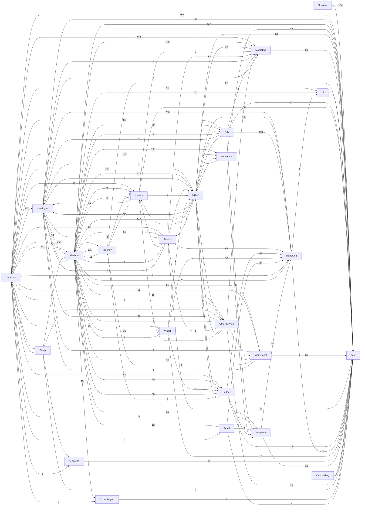

# How the Block A tickets are linked

> **Generated by** `tools/build-ticket-links.py` from `handoff/service-docs/tasks.csv` (the task sheet that becomes the OpenProject tickets). A ticket *waits on* another when it cannot be finished before the other is: that is the "follows" link in OpenProject and the order of each person's board.

**2326 tasks, 13050 links.**

## 1. The build layers, in order

| Layer | Tasks | Build order | Waits on |
|---|---:|---|---|
| Setup | 9 | #3 to #420 | Database (42) |
| Onboarding | 12 | #5 to #16 | nothing |
| Database | 169 | #23 to #2510 | Setup (3) |
| Platform | 20 | #30 to #95 | Setup (8), Database (2) |
| AI engine | 13 | #98 to #2502 | Setup (7), Database (1) |
| Services | 270 | #79 to #1469 | Platform (524), Database (486), Setup (1) |
| Screens | 331 | #136 to #1500 | Services (983), Setup (194), Services (Venue Management) (98), AI engine (3) |
| Services (Venue Management) | 483 | #134 to #2514 | Database (1188), Services (1073), Platform (852) |
| Screens (Venue Management) | 823 | #139 to #2518 | Services (Venue Management) (1310), Setup (823), Services (655), AI engine (1) |
| Test | 196 | #63 to #2519 | Screens (Venue Management) (823), Services (Venue Management) (483), Screens (331), Services (261), Database (169), Platform (20), AI engine (14), Onboarding (12), Setup (9) |

## 2. Service map

An arrow means the service on the right waits on the one on the left; the number is how many task links carry it. Screens are left out here (section 4).

## 3. Services: what each waits on and what waits on it

| Service | Owner | Tasks | Points | Build order | Waits on | Needed by |
|---|---|---:|---:|---|---|---|
| **Other service** | Sanket Keluskar, Surendra | 21 | 59 | #79 to #2507 | Platform 15, Database 5, Order 3, Setup 1 | Catalogue 32, Test 10, Platform 6, Access 1, WhiteLabel 1, Order 1 ... |
| **Ai** | Sanket Keluskar, Narayan Gaonkar | 45 | 167 | #101 to #1612 | Database 81, Platform 77, Reporting 2 | screens: Other 58, Test 47, screens: Platform 33, screens: Analytics 19, screens: Engagement & Support 14, screens: White Label 10 ... |
| **Identity** | Deep Khanvilkar, Sanket Keluskar | 36 | 150 | #115 to #1791 | Database 79, Platform 68, Order 8, Tenancy 5, Other service 1 | screens: Platform 58, screens: Other 39, Test 36, Platform 29, screens: Analytics 27, screens: Tenants & Licensing 21 ... |
| **Order** | Pranay Shinde, Chinmay Patkar | 60 | 313 | #119 to #2386 | Database 169, Platform 126, Catalogue 8, Access 5, Ledger 2, Fnb 1, Identity 1, Wallet 1, Other service 1 | Catalogue 225, Reporting 186, Platform 146, screens: Sell 63, Test 60, Ledger 30 ... |
| **Marketing** | Pranay Shinde, Deep Khanvilkar | 58 | 269 | #123 to #2366 | Database 113, Platform 109, Order 17, Identity 9, Access 6, Catalogue 2, Fnb 2, Other service 1 | Test 58, screens: Other 44, screens: Engagement & Support 33, screens: Account & Self-Service 25, screens: Membership, Loyalty & Value 16, screens: White Label 8 ... |
| **WhiteLabel** | Hrushikant Patkar, Deep Khanvilkar | 35 | 175 | #164 to #2514 | Platform 65, Database 51, Catalogue 8, Other service 1 | screens: White Label 71, Test 35, screens: Engagement & Support 17, Platform 12, screens: Branding & Localisation 9, screens: Discovery & Browse 9 ... |
| **Platform** | Sanket Keluskar, Narayan Gaonkar | 85 | 358 | #172 to #2376 | Database 269, Platform 149, Order 146, Catalogue 74, Tenancy 51, Ledger 30, Identity 29, WhiteLabel 12, Access 9, Wallet 8, Other service 6, Fnb 6 | screens: Tenants & Licensing 155, Test 85, screens: Other 65, screens: Partners 42, screens: Platform 37, screens: Setup & Go-Live 23 ... |
| **Tenancy** | Deep Khanvilkar, Pranay Shinde | 57 | 209 | #177 to #2394 | Database 142, Platform 135, WhiteLabel 5, Identity 4, Ledger 4 | screens: Platform 75, screens: Venue Operations 66, Test 57, screens: Other 51, Platform 51, screens: Sell 34 ... |
| **CrossRegion** | Deep Khanvilkar, Chinmay Patkar | 8 | 29 | #201 to #1737 | Platform 15, Database 9 | Test 8, screens: Access 3 |
| **Wallet** | Pranay Shinde, Sanket Keluskar | 15 | 66 | #216 to #2111 | Database 32, Platform 31 | Reporting 36, screens: Other 17, Test 15, Ledger 8, Platform 8, screens: Membership, Loyalty & Value 5 ... |
| **Retail** | Pranay Shinde, Deep Khanvilkar | 6 | 30 | #221 to #872 | Platform 12, Database 9 | Reporting 32, screens: Sell 11, screens: Retail 7, Test 6, Inventory 3, screens: Payment 3 ... |
| **VenueOps** | Narayan Gaonkar, Chinmay Patkar | 73 | 332 | #242 to #2148 | Platform 135, Database 131, Order 2 | Test 73, screens: Other 71, screens: Media Library 50, screens: Access & Venue 20, screens: Operations 17, screens: Transport 16 ... |
| **Catalogue** | Narayan Gaonkar, Chinmay Patkar | 135 | 589 | #257 to #2486 | Database 327, Platform 242, Order 225, Other service 32, Identity 15, VenueOps 7, Marketing 7, Fnb 5, WhiteLabel 4, Access 3 | Reporting 206, screens: Commercial 164, Test 135, screens: Other 134, screens: Sell 129, Platform 74 ... |
| **Access** | Narayan Gaonkar, Hrushikant Patkar | 26 | 135 | #261 to #1666 | Database 66, Platform 51, Order 5, Catalogue 3, Other service 1, Identity 1 | Reporting 68, screens: Other 44, Test 26, screens: Access & Venue 24, screens: Account & Self-Service 14, Platform 9 ... |
| **Fnb** | Narayan Gaonkar, Deep Khanvilkar | 41 | 227 | #350 to #1261 | Database 81, Platform 80, Order 9 | Reporting 158, screens: Other 50, Test 41, screens: Sell 28, screens: Kitchen 26, screens: In-venue Services 19 ... |
| **Ledger** | Narayan Gaonkar, Sanket Keluskar | 24 | 114 | #726 to #1787 | Database 61, Platform 50, Order 30, Wallet 8 | Reporting 62, Platform 30, Test 24, screens: Other 20, screens: Orders & Money 12, screens: Sell 5 ... |
| **Inventory** | Pranay Shinde, Deep Khanvilkar | 12 | 55 | #734 to #1270 | Platform 21, Database 18, Fnb 3, Retail 3, Ledger 2, VenueOps 1 | Reporting 24, Test 12, screens: Other 12, screens: Stock & Supply 2, screens: Commercial 1, screens: Stock on the Floor 1 ... |
| **Reporting** | Chinmay Patkar, Narayan Gaonkar | 16 | 54 | #968 to #1563 | Catalogue 206, Order 186, Fnb 158, Access 68, Ledger 62, Wallet 36, Retail 32, Database 31, Platform 28, Inventory 24 | screens: Other 17, Test 16, screens: Analytics 10, screens: Venue Operations 4, screens: Sell 3, screens: Reports 3 ... |

## 4. Module builds: the services each module's screens need

| App | Module | Screen tasks | Build order | Waits on services | Other |
|---|---|---:|---|---|---|
| Guest Web — Storefront | Cart & Checkout | 5 | #136 to #1307 | Order 11, WhiteLabel 4, Catalogue 4, Marketing 4, Identity 3, VenueOps 1 | Setup 5 |
| Guest App — Mobile | Cart & Checkout | 3 | #137 to #706 | Order 10, Identity 3, WhiteLabel 3, Catalogue 2, VenueOps 1 | Setup 3 |
| Venue Staff App — Operations | Operations | 12 | #139 to #2205 | VenueOps 17, Identity 13, Catalogue 3, Tenancy 2, Order 2, Inventory 1, Marketing 1 | Setup 12 |
| Guest App — Mobile | Account & Self-Service | 14 | #143 to #1320 | Order 20, Marketing 15, Identity 13, Access 11, Wallet 3, Ledger 2, WhiteLabel 1 | Setup 14 |
| Venue Scanner — Access Control | Access | 4 | #148 to #1735 | Identity 5, Access 3, CrossRegion 3, Order 1, Tenancy 1 | Setup 4 |
| Venue POS — Terminal and Tablet | Shift | 4 | #154 to #1126 | Order 12, Identity 7, Tenancy 3 | Setup 4 |
| Venue CMS — White Label | White Label | 23 | #156 to #1341 | WhiteLabel 71, Ai 10, Marketing 8, VenueOps 8, Catalogue 6, Identity 2, Order 1, Tenancy 1 | Setup 23 |
| Venue Support — Agent Console | Access & Availability | 1 | #159 to #159 | Identity 6 | Setup 1 |
| TICVAI Web — Platform Console | Access & Identity | 4 | #171 to #1571 | Identity 17 | Setup 4, Platform 2 |
| Partner Web — Reseller Portal | Access & Account | 4 | #174 to #2120 | Identity 10 | Setup 4, Platform 6 |
| TICVAI Web — Platform Console | Tenants & Licensing | 87 | #209 to #2117 | Identity 21, Tenancy 6, WhiteLabel 2, Order 1 | Setup 84, Platform 155 |
| Venue Management — Back Office | People & Access Rights | 9 | #231 to #1980 | Tenancy 13, Identity 12, Reporting 1, Order 1, Catalogue 1, Ai 1 | Setup 6 |
| Guest App — Mobile | Discovery & Browse | 7 | #275 to #1324 | Catalogue 15, WhiteLabel 4, VenueOps 3, Marketing 2, Access 1 | Setup 7 |
| TICVAI Web — Platform Console | Branding & Localisation | 4 | #292 to #1724 | Identity 10, WhiteLabel 9, VenueOps 2, Tenancy 2 | Setup 4, Platform 4 |
| Guest Web — Storefront | Engagement & Support | 5 | #294 to #1360 | Marketing 8, Ai 3, WhiteLabel 3, Fnb 1, Order 1 | AI engine 1, Setup 5 |
| Guest Web — Storefront | System States | 1 | #295 to #295 | WhiteLabel 1 | Setup 1 |
| Guest Web — Storefront | Support | 2 | #296 to #1284 | WhiteLabel 3, Marketing 2 | Setup 2 |
| Guest App — Mobile | Engagement & Support | 12 | #297 to #1365 | VenueOps 14, Marketing 13, Ai 9, WhiteLabel 4, Fnb 3, Order 3, Catalogue 1 | AI engine 2, Setup 12 |
| Guest App — Mobile | System States | 2 | #298 to #299 | WhiteLabel 2 | Setup 2 |
| Venue Management — Back Office | Platform | 63 | #342 to #2326 | Tenancy 68, Identity 6, Catalogue 3, Ai 1 | Setup 60, Platform 6 |
| Venue Management — Back Office | Sell | 81 | #348 to #2467 | Catalogue 108, Tenancy 23, Order 5, Identity 5, Fnb 4, Ai 2, Retail 2, WhiteLabel 1, VenueOps 1, Wallet 1 | Setup 65, Platform 22 |
| Venue Management | Other | 156 | #349 to #2518 | Catalogue 134, VenueOps 71, Tenancy 49, Access 44, Fnb 44, Marketing 34, Ai 29, Order 21, Ledger 20, Wallet 17, Identity 16, Reporting 9, Inventory 7, WhiteLabel 5, Retail 3 | Setup 139, Platform 21 |
| Venue Management — Back Office | Food & Beverage | 5 | #351 to #1509 | Fnb 12, Tenancy 3, Reporting 2, Retail 1 | Setup 3 |
| TICVAI Web — Platform Console | Overview & Health | 5 | #381 to #1822 | Identity 2, Ai 1, Tenancy 1 | Setup 5, Platform 15 |
| TICVAI Web | Other | 12 | #387 to #1494 | Ai 29, Identity 23, Tenancy 2, Order 2 | Setup 12, Platform 29, AI engine 1 |
| Developer Portal | Developer & API | 8 | #398 to #2128 | - | Platform 15, Setup 5 |
| Developer | Other | 3 | #412 to #415 | - | Setup 3, Platform 15 |
| Venue Management — Back Office | Commercial | 128 | #441 to #2499 | Catalogue 163, Order 7, Tenancy 6, Ledger 2, VenueOps 1, Inventory 1 | Setup 107 |
| Venue Management — Back Office | Access & Venue | 44 | #452 to #2218 | Access 24, VenueOps 20, Tenancy 8, Order 5, Catalogue 4, Reporting 2, Ai 1, Marketing 1 | Setup 21, Platform 4 |
| Guest Web — Storefront | High-Demand Access | 1 | #585 to #585 | Catalogue 2 | Setup 1 |
| Venue Management — Back Office | Venue Operations | 38 | #587 to #2091 | Tenancy 66, Reporting 4, Ai 3, Order 3, VenueOps 3, Fnb 3, Access 2, Retail 1 | Setup 35, Platform 1 |
| Guest Web — Storefront | Discovery & Browse | 5 | #593 to #1322 | Catalogue 11, WhiteLabel 5, VenueOps 5, Access 1, Marketing 1 | Setup 5 |
| Guest Web — Storefront | Booking & Selection | 7 | #594 to #1359 | Catalogue 15, Order 7, VenueOps 6, WhiteLabel 5, Marketing 3, Ai 1 | Setup 7 |
| Guest Web — Storefront | Membership, Loyalty & Value | 5 | #595 to #1309 | Marketing 11, Catalogue 5, Order 5, Identity 4, Wallet 3, Access 2, VenueOps 1, WhiteLabel 1 | Setup 5 |
| Guest App — Mobile | High-Demand Access | 1 | #606 to #606 | Catalogue 2 | Setup 1 |
| Guest App — Mobile | Discovery | 1 | #607 to #607 | Catalogue 1 | Setup 1 |
| Guest App — Mobile | Booking & Selection | 10 | #612 to #1305 | Catalogue 20, Order 15, VenueOps 8, WhiteLabel 3, Marketing 2, Ai 1 | Setup 10 |
| Venue POS — Terminal and Tablet | Sell | 26 | #615 to #1315 | Order 58, Fnb 24, Catalogue 17, Tenancy 11, Retail 9, Marketing 8, Ledger 5, Reporting 3, Wallet 2, Access 1, VenueOps 1, Inventory 1 | Setup 26 |
| Guest Kiosk — Self-Service | Sell | 5 | #618 to #2200 | Catalogue 4, WhiteLabel 2 | Setup 5 |
| Guest Web — Storefront | Promotions | 1 | #645 to #645 | Catalogue 2 | Setup 1 |
| Guest App — Mobile | Promotions | 1 | #649 to #649 | Catalogue 3 | Setup 1 |
| Guest Web — Storefront | Ticketing | 3 | #691 to #876 | Order 9, Catalogue 3, Fnb 2, VenueOps 1, Ledger 1 | Setup 3 |
| Guest Web — Storefront | Retail | 2 | #692 to #1092 | Retail 4, Order 3 | Setup 2 |
| Guest App — Mobile | Ticketing | 4 | #704 to #880 | Order 7, Catalogue 1, Ledger 1 | Setup 4 |
| Guest App — Mobile | Membership, Loyalty & Value | 3 | #705 to #1289 | Marketing 5, Order 4, Catalogue 3, Wallet 2, Identity 1, VenueOps 1 | Setup 3 |
| Venue Management — Back Office | Orders & Money | 10 | #758 to #1335 | Order 18, Ledger 12, Tenancy 3, Reporting 3, Fnb 2, Retail 1, Marketing 1 | Setup 4 |
| Guest Web — Storefront | Account & Self-Service | 5 | #837 to #1318 | Marketing 10, Order 10, Identity 7, Access 3, Ledger 2, Wallet 1 | Setup 5 |
| Guest Web — Storefront | In-venue Services | 6 | #838 to #1173 | Fnb 9, VenueOps 7, Access 3, Order 2 | Setup 6 |
| Guest App — Mobile | In-venue Services | 10 | #842 to #1177 | Fnb 10, VenueOps 8, Access 5, Order 3, WhiteLabel 2, Catalogue 2 | Setup 10 |
| Venue Management — Back Office | Rentals | 19 | #918 to #2408 | VenueOps 12, Catalogue 8, Tenancy 2, Ai 2 | Setup 11, Platform 1 |
| Venue Analytics — Cross-Domain Reporting | Analytics | 6 | #992 to #1720 | Reporting 10, Identity 3, Ai 2, Tenancy 1 | Setup 3 |
| Guest Web — Storefront | Transport | 1 | #995 to #995 | VenueOps 6, Order 1 | Setup 1 |
| Guest App — Mobile | Transport | 4 | #998 to #1002 | VenueOps 10, Order 2 | Setup 4 |
| Guest App — Mobile | In-Venue Experience | 2 | #1044 to #1095 | Fnb 1, Access 1, Retail 1 | Setup 2 |
| Kitchen Display — Pass and Stations | Kitchen | 10 | #1049 to #1500 | Fnb 26, Reporting 2 | Setup 10 |
| Venue Staff App | Other | 2 | #1066 to #1251 | Fnb 6, Inventory 5 | Setup 2 |
| Venue Staff App — Operations | Floor Service | 2 | #1068 to #1070 | Fnb 15, Order 1 | Setup 2 |
| Guest App — Mobile | Retail | 1 | #1096 to #1096 | Retail 3, Order 1 | Setup 1 |
| Venue POS — Terminal and Tablet | Payment | 1 | #1101 to #1101 | Retail 3, Order 2, Access 1, Marketing 1 | Setup 1 |
| Venue Management — Back Office | Games & Rides | 10 | #1154 to #2517 | WhiteLabel 4, Catalogue 3, VenueOps 1 | Setup 10 |
| Venue Staff App — Operations | Stock on the Floor | 2 | #1195 to #1196 | Fnb 2, Inventory 1 | - |
| Venue Management — Back Office | Stock & Supply | 2 | #1206 to #1505 | Inventory 2, Reporting 1 | Setup 1 |
| Venue Analytics | Other | 3 | #1224 to #1227 | Reporting 8 | Setup 3 |
| Guest App — Mobile | Support | 1 | #1291 to #1291 | Marketing 2 | Setup 1 |
| Venue Support — Agent Console | Conversations | 2 | #1348 to #1350 | Marketing 7 | Setup 2 |
| Guest Kiosk — Self-Service | AI | 1 | #1368 to #1368 | Catalogue 2, Ai 1, Marketing 1, Order 1 | Setup 1 |
| Venue Management — Back Office | Engagement & Support | 26 | #1377 to #2367 | Marketing 12, WhiteLabel 10, Tenancy 2, Ai 2, Identity 1 | Setup 16 |
| Venue Management — Back Office | Guests & Marketing | 3 | #1398 to #1651 | Tenancy 4, Marketing 2, Ai 2, Reporting 1, Identity 1 | Setup 2 |
| Venue CMS — White Label | Policy | 2 | #1419 to #1420 | Marketing 2 | - |
| Venue CMS | Other | 2 | #1426 to #1427 | Marketing 5 | Setup 2 |
| Venue Support — Agent Console | Overview | 1 | #1430 to #1430 | Marketing 1 | - |
| Venue Support | Other | 1 | #1434 to #1434 | Marketing 5 | Setup 1 |
| TICVAI Web — Platform Console | AI | 2 | #1470 to #1473 | Ai 4 | Platform 2 |
| TICVAI Web — Platform Console | Analytics | 14 | #1471 to #1598 | Identity 24, Ai 17, Tenancy 1 | Platform 14, Setup 12 |
| TICVAI Web — Platform Console | Platform | 31 | #1474 to #2088 | Identity 52, Ai 32, Tenancy 7 | Setup 26, Platform 31 |
| Venue POS — Terminal and Tablet | Reports | 1 | #1497 to #1497 | Reporting 3 | Setup 1 |
| Venue CMS — White Label | Media Library | 40 | #1559 to #2181 | VenueOps 50, Identity 3, Ai 1 | Setup 40 |
| TICVAI Web — Platform Console | Commercial | 2 | #1591 to #2281 | Identity 4, Catalogue 1, Order 1, Ledger 1 | Setup 2, Platform 2 |
| TICVAI Sign-up — Onboarding & Purchase | Onboarding & Assessment | 10 | #1634 to #1926 | Identity 1 | Setup 10, Platform 10 |
| Partner Web — Reseller Portal | Partners | 22 | #1641 to #2242 | Identity 4 | Setup 22, Platform 26 |
| Venue Management — Back Office | Setup & Go-Live | 19 | #1707 to #2430 | Catalogue 3, Tenancy 2 | Setup 19, Platform 23 |
| Venue Management — Back Office | Operations | 3 | #1712 to #1714 | Tenancy 6 | Setup 3 |
| TICVAI Web — Platform Console | Releases & Environments | 8 | #1743 to #1764 | Identity 4 | Setup 8, Platform 16 |
| TICVAI Web — Platform Console | Platform Ops | 1 | #1753 to #1753 | - | Setup 1, Platform 2 |
| TICVAI Web — Platform Console | Support & Communications | 2 | #1762 to #1763 | - | Setup 2, Platform 2 |
| Venue Management — Back Office | Partners | 8 | #1783 to #2373 | Identity 8 | Setup 8, Platform 16 |
| TICVAI Sign-up — Onboarding & Purchase | Purchase & Activation | 6 | #1917 to #1939 | - | Setup 6, Platform 3 |
| TICVAI Sign-up — Onboarding & Purchase | Package Builder | 7 | #1927 to #1935 | - | Setup 7, Platform 8 |
| Partner Web — Reseller Portal | Reports & Settlement | 1 | #1955 to #1955 | - | Setup 1, Platform 2 |
| Venue Management — Back Office | Catalogue | 17 | #2245 to #2363 | Catalogue 24, Tenancy 2 | Setup 17 |
| Partner Web — Reseller Portal | Inventory & Pricing | 2 | #2433 to #2434 | Catalogue 6 | Setup 2 |
| Venue CMS — White Label | Kiosk | 1 | #2515 to #2515 | WhiteLabel 4 | Setup 1 |
| Kiosk | Other | 1 | #2516 to #2516 | WhiteLabel 1 | Setup 1 |

## 5. Reports and other read-only work that waits for its data

A backend task that only reads waits for the tasks that write what it reads (decided 30 September).

| Task | Service | Waits on the data of |
|---|---|---|
| SVC-IDENTITY-SESSION-1 | Identity | Other service |
| SVC-CATALOGUE-PRODUCT-2 | Catalogue | Other service, WhiteLabel |
| VM-TENANCY-MATRIX-1 | Tenancy | WhiteLabel |
| SVC-CATALOGUE-PRODUCT-1 | Catalogue | Other service |
| SVC-CATALOGUE-CAPACITY-1 | Catalogue | Order, VenueOps |
| SVC-CATALOGUE-DRAFTED-21 | Catalogue | Other service |
| SVC-ORDER-ORDERS-8 | Order | Catalogue, Other service |
| VM-IDENTITY-ADMINISTRATION-2 | Identity | Order, Tenancy |
| SVC-IDENTITY-ADMINISTRATION-9 | Identity | Order, Tenancy |
| SVC-IDENTITY-ADMINISTRATION-10 | Identity | Order, Tenancy |
| SVC-IDENTITY-IDENTITY-7 | Identity | Order, Tenancy |
| SVC-CATALOGUE-DRAFTED-27 | Catalogue | Identity, Order, Other service |
| SVC-CATALOGUE-DRAFTED-22 | Catalogue | Identity, Order, Other service, VenueOps |
| SVC-CATALOGUE-DRAFTED-26 | Catalogue | Identity, Order, Other service, VenueOps |
| SVC-CATALOGUE-DRAFTED-30 | Catalogue | Identity, Order, Other service, VenueOps |
| SVC-ACCESS-ACCESS-3 | Access | Catalogue, Identity, Order, Other service |
| SVC-MARKETING-CONSENT-2 | Marketing | Access, Identity, Order |
| SVC-ORDER-DRAFTED-1 | Order | Access |
| SVC-CATALOGUE-DRAFTED-18 | Catalogue | Access, Identity, Order, Other service |
| SVC-LEDGER-FINANCE-5 | Ledger | Order, Wallet |
| SVC-CATALOGUE-DRAFTED-6 | Catalogue | Identity, Order, Other service |
| SVC-VENUEOPS-GENERAL-1 | VenueOps | Order |
| SVC-FNB-GUESTORDERING-2 | Fnb | Order |
| SVC-CATALOGUE-DRAFTED-48 | Catalogue | Fnb, Identity, Order, Other service |
| VM-ORDER-DRAFTED-1 | Order | Access, Fnb, Identity, Ledger, Wallet |
| SVC-LEDGER-REPORTING-2 | Ledger | Order, Wallet |
| VM-INVENTORY-STOCK-1 | Inventory | Fnb, Ledger, Retail, VenueOps |
| SVC-MARKETING-GUEST-4 | Marketing | Access, Identity, Order |
| SVC-MARKETING-SEGMENT-4 | Marketing | Access, Order |
| SVC-AI-GOVERNANCE-5 | Ai | Reporting |
| SVC-AI-AUDIT-1 | Ai | Reporting |
| SVC-PLATFORM-SUBSCRIPTION-18 | Platform | Tenancy |
| SVC-TENANCY-ANALYTICS-1 | Tenancy | Identity, Ledger, Platform, WhiteLabel |
| SVC-PLATFORM-DRAFTED-14 | Platform | Fnb, Identity, Ledger, Order, Tenancy, Wallet, WhiteLabel |
| SVC-TENANCY-APPROVALS-9 | Tenancy | Identity, Ledger, Platform, WhiteLabel |
| SVC-PLATFORM-DRAFTED-10 | Platform | Fnb, Identity, Ledger, Order, Tenancy, Wallet, WhiteLabel |
| SVC-PLATFORM-DRAFTED-4 | Platform | Catalogue, Fnb, Identity, Ledger, Order, Other service, Tenancy, Wallet, WhiteLabel |
| SVC-PLATFORM-DRAFTED-11 | Platform | Catalogue, Fnb, Identity, Ledger, Order, Other service, Tenancy, Wallet, WhiteLabel |
| SVC-PLATFORM-DRAFTED-15 | Platform | Catalogue, Identity, Ledger, Order, Other service, Tenancy, Wallet |
| SVC-CATALOGUE-DRAFTED-13 | Catalogue | Other service |
| SVC-CATALOGUE-DRAFTED-15 | Catalogue | Other service |
| SVC-CATALOGUE-DRAFTED-46 | Catalogue | Other service |
| SVC-CATALOGUE-DRAFTED-8 | Catalogue | Other service |
| SVC-CATALOGUE-DRAFTED-19 | Catalogue | Identity, Order, Platform |
| SVC-CATALOGUE-DRAFTED-23 | Catalogue | Identity, Order, Other service, Platform |
| SVC-CATALOGUE-DRAFTED-31 | Catalogue | Identity, Order, Other service, Platform |
| SVC-CATALOGUE-DRAFTED-32 | Catalogue | Order, Other service, VenueOps |
| SVC-CATALOGUE-DRAFTED-28 | Catalogue | Identity, Order, Other service, Platform |
| SVC-CATALOGUE-DRAFTED-9 | Catalogue | Identity, Order, Other service, Platform |
| SVC-MARKETING-GUESTS-1 | Marketing | Access, Catalogue, Fnb, Identity, Order, Other service, Platform |
| SVC-PLATFORM-DRAFTED-3 | Platform | Access, Catalogue, Identity, Ledger, Order, Other service, Tenancy, Wallet, WhiteLabel |
| SVC-PLATFORM-DRAFTED-6 | Platform | Access, Catalogue, Fnb, Identity, Ledger, Order, Other service, Tenancy, Wallet, WhiteLabel |
| SVC-PLATFORM-DRAFTED-7 | Platform | Access, Catalogue, Fnb, Identity, Order, Other service, Wallet |
| SVC-CATALOGUE-DRAFTED-12 | Catalogue | Other service |
| SVC-CATALOGUE-DRAFTED-36 | Catalogue | Marketing |
| SVC-CATALOGUE-DRAFTED-39 | Catalogue | Other service |
| SVC-CATALOGUE-UPSELL-2 | Catalogue | Other service |
| SVC-CATALOGUE-DRAFTED-35 | Catalogue | Fnb, Identity, Order, Platform |
| SVC-CATALOGUE-DRAFTED-38 | Catalogue | Fnb, Identity, Order, Platform |
| SVC-CATALOGUE-PROMOTIONS-3 | Catalogue | Marketing, Order, Other service, VenueOps |
| SVC-CATALOGUE-DRAFTED-43 | Catalogue | Fnb, Identity, Order, Platform |
| SVC-CATALOGUE-DRAFTED-40 | Catalogue | Order |
| SVC-CATALOGUE-DRAFTED-41 | Catalogue | Fnb, Order, Platform, VenueOps |
| SVC-CATALOGUE-DRAFTED-42 | Catalogue | Order |
| SVC-CATALOGUE-DRAFTED-44 | Catalogue | Order |
| DEVICE-BOCA-FGL | Other service | Order |
| SVC-WHITELABEL-KIOSK-2 | WhiteLabel | Catalogue, Other service |

## 6. Tasks that wait on nothing

Only setup and onboarding should be here.

| Task | Layer | Build order |
|---|---|---|
| SETUP-CI | Setup | #3 |
| SETUP-ENV | Setup | #4 |
| SETUP-ONBOARD-CHINMAY-PATKAR | Onboarding | #5 |
| SETUP-ONBOARD-CHITRANGI-MESTRY | Onboarding | #6 |
| SETUP-ONBOARD-DEEP-KHANVILKAR | Onboarding | #7 |
| SETUP-ONBOARD-HRUSHIKANT-PATKAR | Onboarding | #8 |
| SETUP-ONBOARD-KALPITA-MEJARI | Onboarding | #9 |
| SETUP-ONBOARD-PALLAVI-SAWANT | Onboarding | #10 |
| SETUP-ONBOARD-PRADNYA-YERAM | Onboarding | #11 |
| SETUP-ONBOARD-PRANAY-SHINDE | Onboarding | #12 |
| SETUP-ONBOARD-SANKET-KELUSKAR | Onboarding | #13 |
| SETUP-ONBOARD-SECOND-AI-ENGINEER | Onboarding | #14 |
| SETUP-ONBOARD-SURENDRA | Onboarding | #15 |
| SETUP-ONBOARD-TANMAY-DUKHANDE | Onboarding | #16 |
| R8-DB-LOCAL-CHINMAY-PATKAR | Services | #79 |
| R8-DB-LOCAL-CHITRANGI-MESTRY | Services | #80 |
| R8-DB-LOCAL-DEEP-KHANVILKAR | Services | #81 |
| R8-DB-LOCAL-KALPITA-MEJARI | Services | #82 |
| R8-DB-LOCAL-NARAYAN-GAONKAR | Services | #83 |
| R8-DB-LOCAL-PALLAVI-SAWANT | Services | #84 |
| R8-DB-LOCAL-PRADNYA-YERAM | Services | #85 |
| R8-DB-LOCAL-PRANAY-SHINDE | Services | #86 |
| R8-DB-LOCAL-SANKET-KELUSKAR | Services | #87 |
| R8-DB-LOCAL-SURENDRA | Services | #88 |
| R8-DB-SHARED | Services | #89 |
| TEST-BLOCK-A2-BE | Test | #1529 |
| TEST-BLOCK-A2-FE | Test | #1530 |

